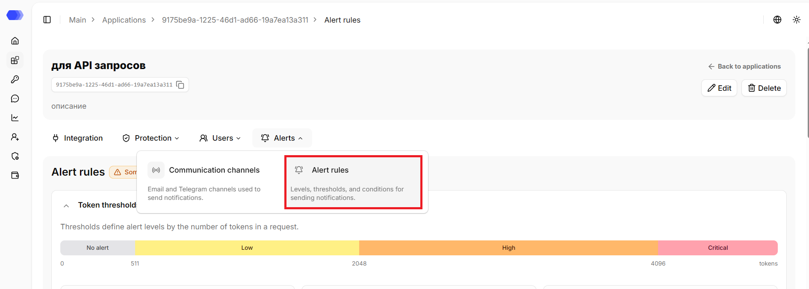
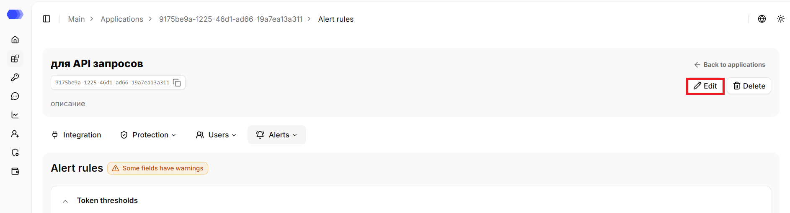
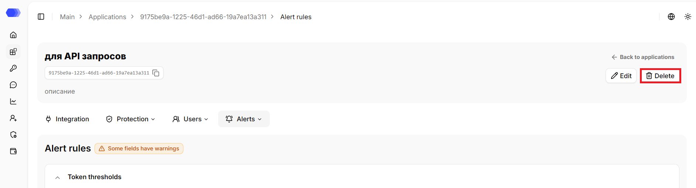
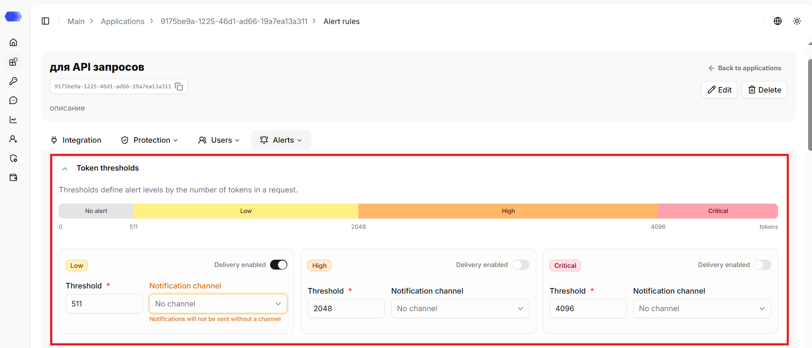
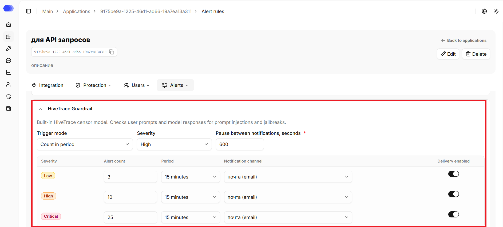
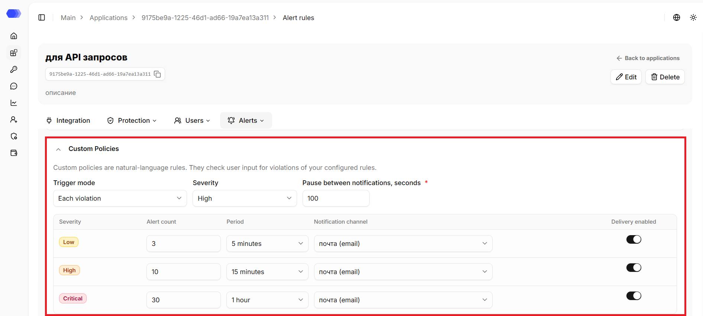
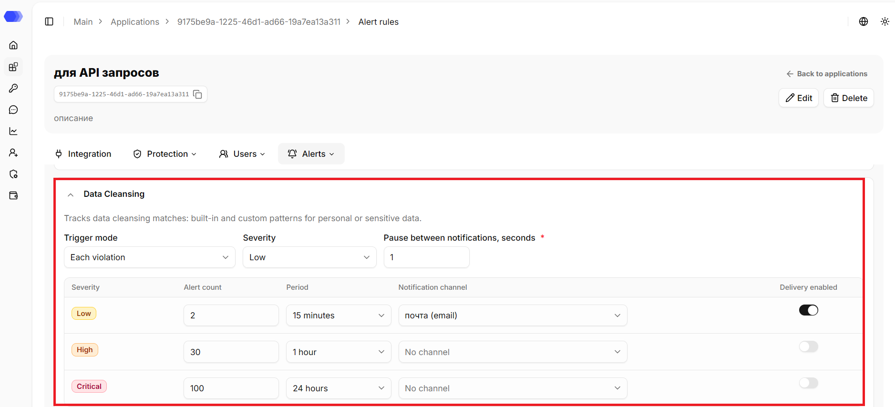
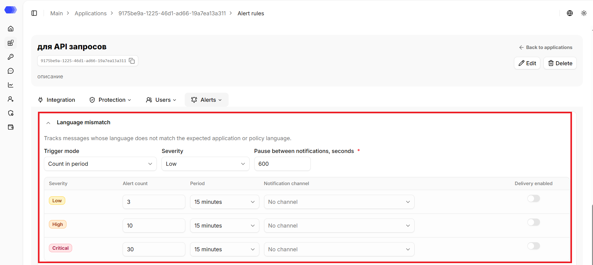

The **Alert Rules** section defines how, when, and under what conditions notifications about violations are sent. Settings are configured separately for each violation type.

## Opening the **Alert Rules** section

1. In the sidebar, select **Applications**.
2. Open the required application by clicking its card or its name, depending on the selected view.
3. Hover over the **Alerts** tab.
4. Click **Alert Rules**.

The page header displays the application's name, ID, and description (if any). The copy button is available next to the ID. The header also contains the `Back to applications` link that leads to the `Applications` section.

## Editing the application

1. Click `Edit`.
2. Change the required fields.
3. Click `Save`.

## Deleting the application

1. Click `Delete`.
2. Confirm the deletion in the confirmation dialog.

This action cannot be undone. Prior to deletion, please verify that integration traffic has been stopped or redirected and that the associated API tokens are no longer in use.

## Token Thresholds

The **Token Thresholds** block is used to control the size of individual requests and model responses. Thresholds help detect and limit abnormal or resource-intensive interactions at the level of a single request. A warning level is set based on the number of tokens in the request: the more tokens, the higher the level.

The token threshold range is divided into 4 zones, each corresponding to a severity level:

- **No alert** — no notifications are sent;
- **Low** — a warning level indicating that the limit is being approached;
- **High** — indicates a significant excess of the expected message size;
- **Critical** — a critical threshold requiring immediate attention and, if necessary, blocking actions.

If the threshold values are invalid (for example, they overlap or are out of order), the `Some fields have errors` label is displayed in the block header, and the `Fix threshold values` message is shown instead of the scale. The borders of the field with the invalid value are highlighted in red, and a hint explaining the error is shown below it.

Thus, token thresholds allow users to set several severity levels and receive warnings of increasing importance — from an early signal that the limit is being approached to a critical threshold requiring immediate action.

The following settings are available for each severity level:

- **Delivery enabled** — the toggle that enables sending notifications for this level;
- **Threshold** — a numeric value in tokens at which the level triggers (required field);
- **Notification channel** — the channel through which the notification is delivered. Defaults to `No channel`.

> **Note:** if `No channel` is selected for a level, the notification is still created but is not sent to the user. To receive notifications, please select a channel for the corresponding level. If no channel is selected, a warning indicator is displayed.

## HiveTrace Guardrail

This block is used to configure notifications about security policy violations:

- **Trigger mode** — `Each violation` or `Count in period`;
- **Severity** — `Low`, `High`, or `Critical`;
- **Pause between notifications** — the interval, in seconds, during which repeat notifications are not sent.

The following settings are available for each severity level:

- **Alert count** — the number of violations required to send notifications;
- **Period** — the interval over which the violation count is calculated;
- **Notification channel** — the channel through which the notification is delivered. Defaults to `No channel`;
- **Delivery enabled** — the toggle that enables sending notifications for this level.

> **Note:** if `No channel` is selected for a level, the notification is still created but is not sent to the user. To receive notifications, please select a channel for the corresponding level. If no channel is selected, a warning indicator is displayed.

## Custom Policies

This block is used to configure notifications about custom policy violations:

- **Trigger mode** — `Each violation` or `Count in period`;
- **Severity** — `Low`, `High`, or `Critical`;
- **Pause between notifications** — the interval, in seconds, during which repeat notifications are not sent.

The following settings are available for each severity level:

- **Alert count** — the number of violations required to send notifications;
- **Period** — the interval over which the violation count is calculated;
- **Notification channel** — the channel through which the notification is delivered. Defaults to `No channel`;
- **Delivery enabled** — the toggle that enables sending notifications for this level.

> **Note:** if `No channel` is selected for a level, the notification is still created but is not sent to the user. To receive notifications, please select a channel for the corresponding level. If no channel is selected, a warning indicator is displayed.

## Data Cleansing

This block is used to configure notifications about DataClean violations:

- **Trigger mode** — `Each violation` or `Count in period`;
- **Severity** — `Low`, `High`, or `Critical`;
- **Pause between notifications** — the interval, in seconds, during which repeat notifications are not sent.

The following settings are available for each severity level:

- **Alert count** — the number of violations required to send notifications;
- **Period** — the interval over which the violation count is calculated;
- **Notification channel** — the channel through which the notification is delivered. Defaults to `No channel`;
- **Delivery enabled** — the toggle that enables sending notifications for this level.

> **Note:** if `No channel` is selected for a level, the notification is still created but is not sent to the user. To receive notifications, please select a channel for the corresponding level. If no channel is selected, a warning indicator is displayed.

## Language mismatch

This block is used to configure notifications about language check violations:

- **Trigger mode** — `Each violation` or `Count in period`;
- **Severity** — `Low`, `High`, or `Critical`;
- **Pause between notifications** — the interval, in seconds, during which repeat notifications are not sent.

The following settings are available for each severity level:

- **Alert count** — the number of violations required to send notifications;
- **Period** — the interval over which the violation count is calculated;
- **Notification channel** — the channel through which the notification is delivered. Defaults to `No channel`;
- **Delivery enabled** — the toggle that enables sending notifications for this level.

> **Note:** if `No channel` is selected for a level, the notification is still created but is not sent to the user. To receive notifications, please select a channel for the corresponding level. If no channel is selected, a warning indicator is displayed.

By default, all blocks are expanded. If a block is collapsed, a brief summary is displayed in its header:

- **Token thresholds** — the `No alert`, `Low`, `High`, and `Critical` zones with their token boundaries. If the threshold values are invalid (for example, they overlap or are out of order), the `Fix threshold values` message is displayed.
- Other sections — the trigger mode, threat level, and pause between notifications (in seconds).

## Changes saving

When changes are made on the page, the panel with action buttons appears:

- **Cancel** — discards the changes and reverts the page to the previous saved state;

- **Save** — saves the changes.
