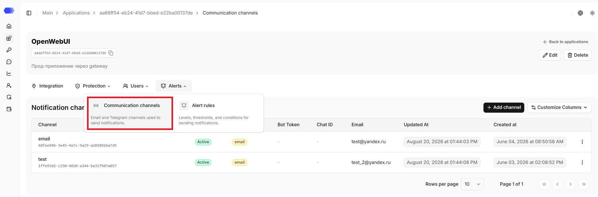
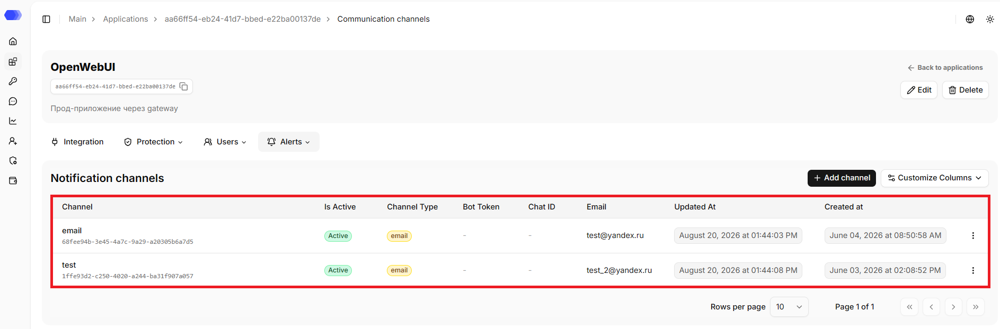
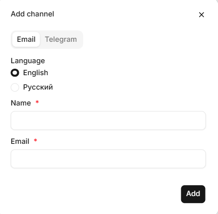
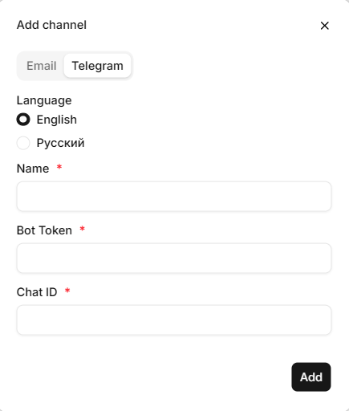

On the **Communication channels** section, you can review existing notification channels and add new ones. Currently, two delivery methods are supported: **Email** and **Telegram**.

## Opening the **Communication channels** section

1. In the sidebar, select **Applications**.
2. Open the required application by clicking its card or its name, depending on the selected view.
3. Hover over the **Alerts** tab.
4. Click **Communication channels**.

The page header displays the application's name, ID, and description (if any). The copy button is available next to the ID. The header also contains the `Back to applications` link that leads to the `Applications` section.

All configured notifications are also available in the **Alerts** section, providing centralized visibility into system events and incidents.

## Notification channels table

An alert configuration defines where HiveTrace sends notifications for the selected application and in which language the message is generated.

The page displays a table of created channels:

- **Channel** — channel name, unique configuration identifier.
- **Is Active** — configuration state.
- **Channel Type** — Email or Telegram.
- **Bot Token** и **Chat ID** — Telegram parameters; for Email, a dash (`—`) is displayed in these columns.
- **Email** — Email address; for Telegram, a dash (`—`) is displayed in this column.
- **Updated At** — the date of the last change.
- **Created At** — the date the configuration was created.
- The **Customize Columns** button allows you to choose the visible table columns.
- The **⋮** menu opens the actions available for this configuration.
- At the bottom of the table, one can change the number of rows per page and navigate between pages.

### Creating an Email configuration

1. Click **Add channel**.
2. Select the **Email** tab.
3. Select the notification language: **English** or **Russian**.
4. Enter a name in the **Name** field to make the channel easy to find in the table.
5. Enter the recipient address in the **Email** field.
6. Click **Add**.

Fields marked with an asterisk are required. After adding, the configuration appears in the table; check its status and recipient address.

### Creating a Telegram configuration

1. Click **Add channel**.
2. Select the **Telegram** tab.
3. Select the notification language: **English** or **Russian**.
4. Enter a name in the **Name** field to make the channel easy to find in the table.
5. Specify the **Bot Token** obtained for the Telegram bot.
6. Specify the **Chat ID** to which notifications should be sent.
7. Click **Add**.

Properly configured alerts enable faster incident response, improve operational visibility, and help maintain a strong security posture for AI applications. Do not publish the Telegram bot token or share it in open channels. If the token has been exposed, generate a new one and update the configuration.

> **Important:** SIEM integration is configured during platform deployment by your DevOps engineer or a HiveTrace specialist. The supported log forwarding format is **Syslog**.

## Access to the page

To edit an application in the header, the following permissions are required:

- Area **Applications** — access level of at least `Edit`.

To delete an application in the header, the following permissions are required:

- Area **Applications** — `Full` access level.

To view the notification channels page, the following permissions are required:

- Area **Applications** — access level of at least `Read`;
- Area **Application policies** — access level of at least `Read`.

To add a new channel or edit an existing one, the following permissions are required:

- Area **Applications** — access level of at least `Read`;
- Area **Application policies** — access level of at least `Edit`.

To delete a channel, the following permissions are required:

- Area **Applications** — access level of at least `Read`;
- Area **Application policies** — `Full` access level.

If the user does not have access to view the page, `403 — Access denied` is displayed.
