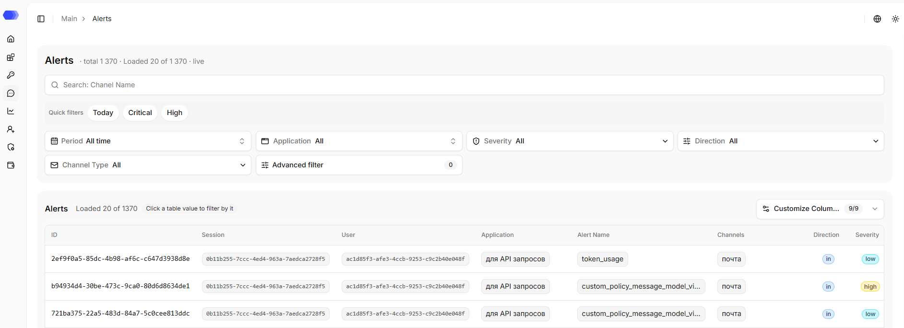
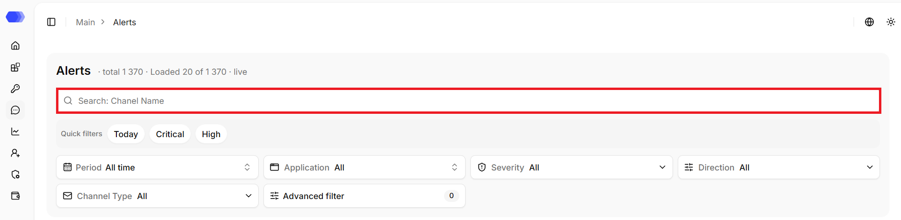
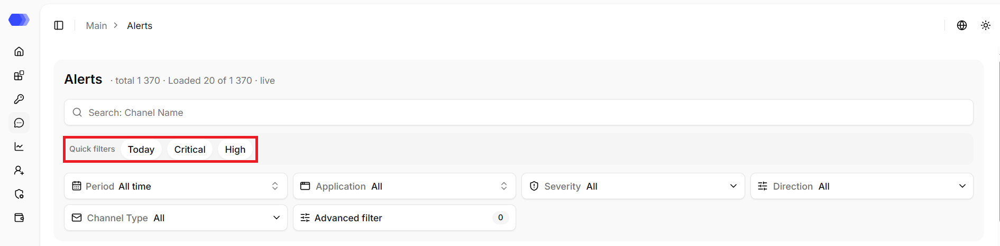
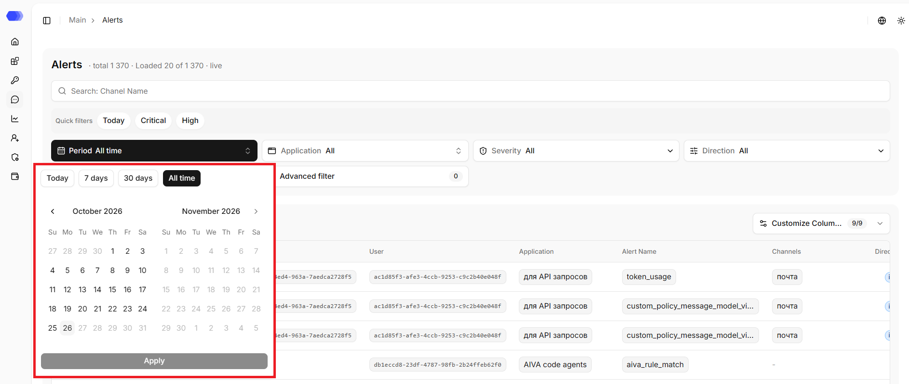
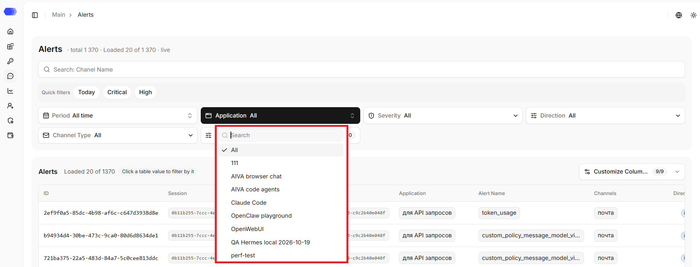
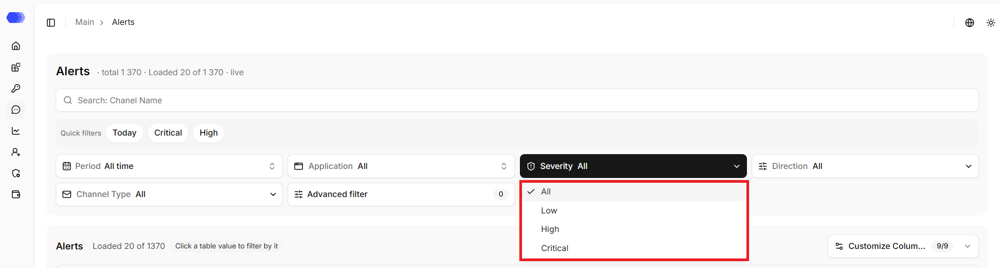
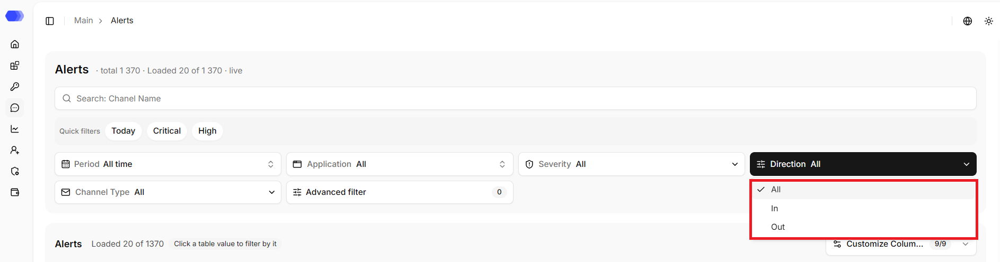
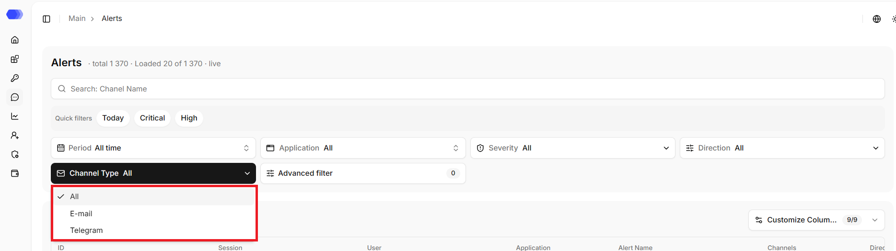
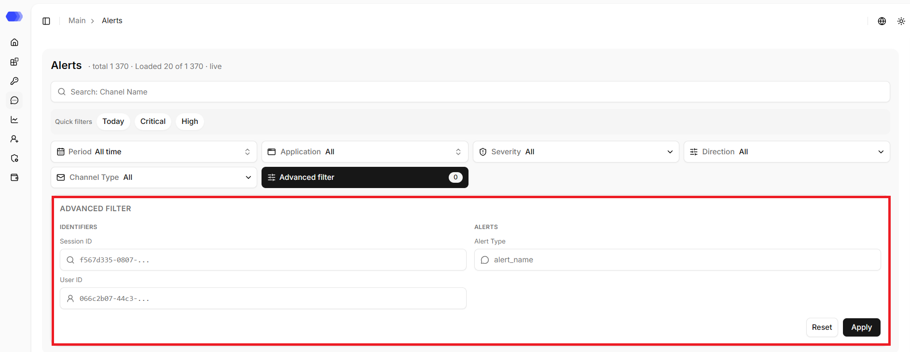

The **Alerts** section provides a centralized view of all notifications and events generated by HiveTrace. Alerts can be forwarded to external delivery channels such as **email**, **Telegram**, and to a **SIEM system** when integration is enabled.

The main component of the page is a table displaying alert details.

## Table Columns

| Field         | Description                                                             |
| ------------- | ----------------------------------------------------------------------- |
| ID            | Unique alert identifier                                                 |
| Session       | Unique session identifier                                               |
| User          | Unique user identifier                                                  |
| Application   | Application that registered the event                                   |
| Alert Name    | Category of the event or incident                                       |
| Channels      | Names of delivery configurations used for the notification              |
| Direction     | Event direction — **in** (incoming message) or **out** (model response) |
| Severity      | Alert severity level: **Low**, **High**, **Critical**                   |
| Date and Time | Time when the alert was generated                                       |

> **Note:** if no notification channels are configured for the application, the **Channels** field will remain empty. The alert is still recorded and visible on this page.

The screenshot's `token_usage` and `custom_policy_message_model_violation` values are examples. The actual value identifies the check or threshold that generated the alert.

Horizontal scrolling reveals columns that do not fit on the screen at the same time.

## Search by channel name

The search finds records by the exact channel name.

## Quick filters

- **Today** — only records for the current day;
- **High** — only records with the `High` threat level;
- **Critical** — only records with the `Critical` threat level.

A predefined set of conditions is applied when clicked.

## Period

Choose **Today**, **7 days**, **30 days**, **All time**, or a custom calendar range. Month arrows navigate the calendar. Select both boundaries and then **Apply**. Future dates are disabled.

## Application

The list shows the available applications, including deleted ones. The search field narrows the list. The **All** value removes the application restriction; selecting a specific item updates the table.

## Severity

Alerts can be filtered by threat level: `Low`, `High`, `Critical`. The `All` value removes the restriction; selecting a specific item updates the table.

## Direction

Alerts can be filtered by incoming (`in`) or outgoing (`out`) direction. The `All` value removes the restriction; selecting a specific item updates the table.

## Channel type

Alerts can be filtered by channel type: `E-mail` or `Telegram`. The `All` value removes the restriction; selecting a specific item updates the table.

## Advanced filter

- **Session ID** — exact session identifier;
- **User ID** — exact user identifier;
- **Alert Type** — event name.

The counter on the button shows the number of active advanced conditions. `Apply` updates the results, `Reset` clears the fields in this block.

## Filtering by clicking a value in the table

Clicking a value in the `Session`, `User`, `Application`, `Alert Name`, `Channels`, `Direction`, `Severity`, or `Date and time` columns filters records by that value.

Applying filters updates the page URL parameters. Reset clears every condition. Filled fields are combined, so an overly narrow combination can return an empty table.

## Table controls

**Customize Columns** hides or restores columns without deleting data. Pagination at the bottom changes the number of rows and opens the previous or next result page.

The **Alerts** section ensures full visibility into security events, simplifies investigations, and supports timely incident response.
