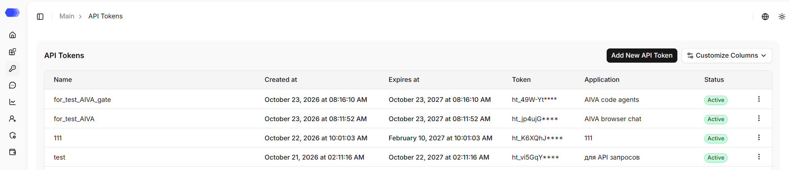
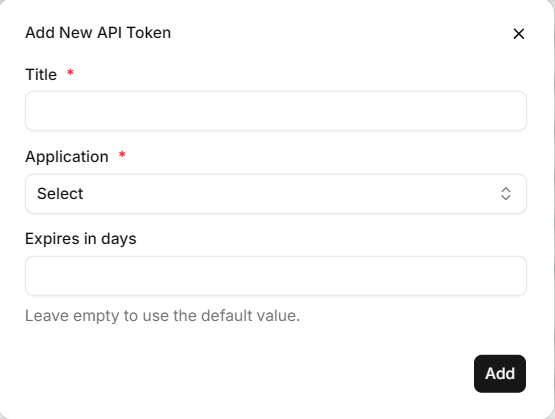

API tokens authorize SDK and direct API integrations. A token value is displayed only once after creation.

## API-token table

- **Name** — human-readable purpose of the token.
- **Created at** — issue time.
- **Expires at** — time after which authentication fails.
- **Token** — safe shortened preview; the full secret is never shown in the table.
- **Application** — the assigned application, or **All applications** for a legacy token.
- **Status** — `Active` or `Inactive`.
- **Row menu** — deletes the selected token after confirmation.

**Column settings** hides or restores columns. **Rows per page**, **Previous**, and **Next** control pagination.

## Create a token

Select **Add New API Token** and provide:

- **Title** — required purpose of the token;
- **Application** — required scope selected from existing applications;
- **Expires in days** — optional positive integer from 1 to 3,650. Leaving it blank uses the server default.

Select **Add**, then copy the generated token from the next dialog and store it in a secrets manager. Its full value cannot be recovered after the dialog closes.

## Application scope

Starting from version 4.3, the token is scoped to the selected application. The request `application_id` must match it. Please create a separate token for each application and environment.

Tokens created **before upgrading to 4.3** can display **All applications** and have `application_id = null`. They remain visible for backward compatibility, but a new token with such a scope can no longer be created through the interface. Replace each legacy token with separate application-scoped tokens and then delete it.

## Deleting a token

1. Select the three-dot button in the token row.
2. Select **Delete**.
3. Confirm the action.

Deletion immediately revokes integration access. Move the application to a replacement token and verify a request before deleting the old credential.

## Table controls

**Customize Columns** hides or restores columns without deleting data. Pagination at the bottom changes the number of rows and opens the previous or next result page.

## Security

Send the token as `Authorization: Bearer <token>`. Never place it in browser code, source control, logs, or documentation examples. Use separate short-lived tokens per application and environment, rotate them, and revoke unused credentials.

## Access to the page

To view the API tokens table, the following permissions are required:

- Area **API tokens and integrations** — access level of at least `Read`.

To add a new API token, the following permissions are required:

- Area **Applications** — access level of at least `Read`;
- Area **API tokens and integrations** — access level of at least `Edit`.

To delete an API token, the following permissions are required:

- Area **API tokens and integrations** — `Full` access level.

If the user does not have access to view the page, `403 — Access denied` is displayed.
