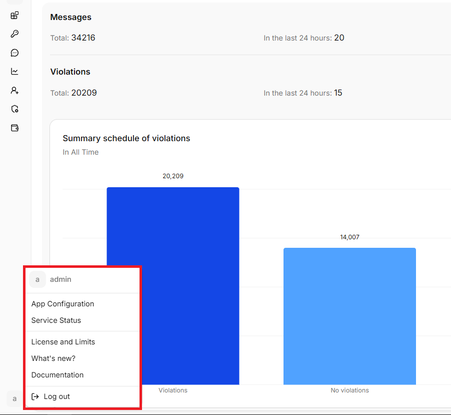
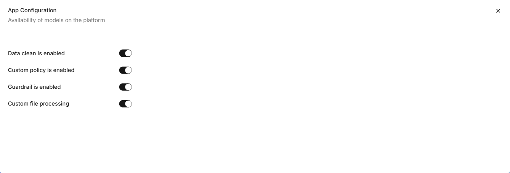

**App Configuration** contains instance-wide HiveTrace options. To open it, select the profile icon in the bottom-left corner and choose **App Configuration**.

## Required permissions

| Action | Area | Min. access level |
|---|---|---|
| Viewing the page | `Platform` | `Read` |
| Editing application configurations | `Platform` | `Edit` |

If the user does not have access to view the page, `403 — Access denied` is displayed.

## General settings

System users can review and change the settings available for the current HiveTrace instance. 

The settings are available for data cleansing, custom policies, Guardrail, and custom file processing. They override application settings. If a check is disabled at the platform level, it will not be performed in any application — even if the corresponding switch is enabled in the application settings. The global settings do not change the saved application settings.

Before saving, verify that the changes match your deployment configuration and organizational policies.
