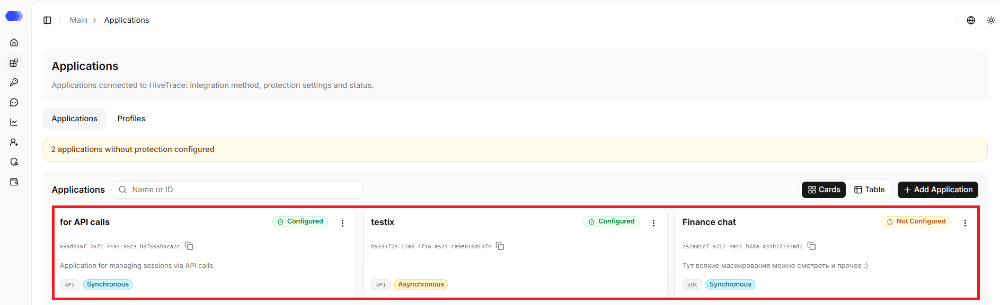
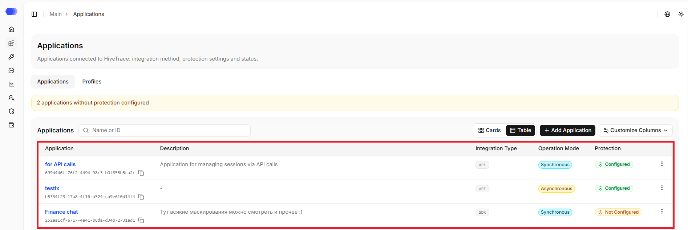
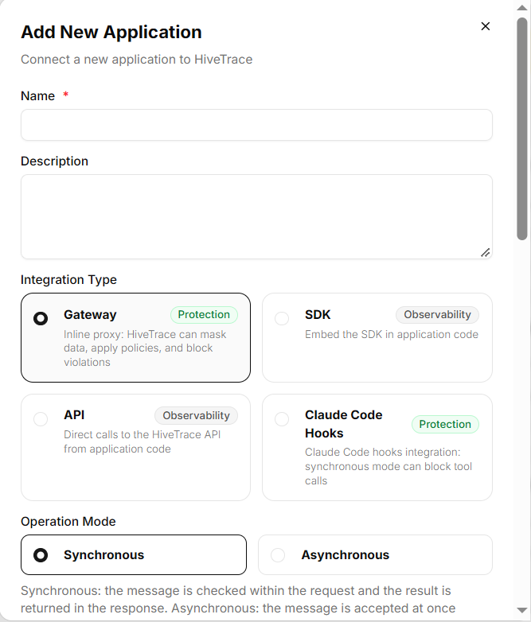
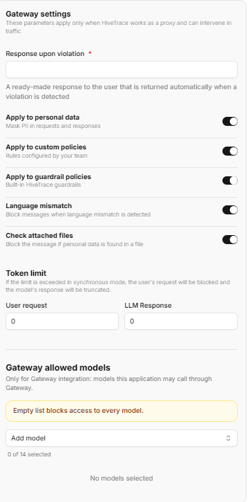
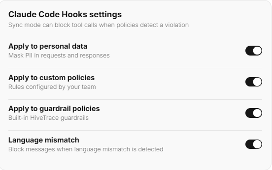

The **Applications** section lists AI applications connected to HiveTrace. Each application has its own integration type, operating mode, security checks, and traffic limits.

In the sidebar, select **Applications** to navigate to the **Applications** section.

The banner with the total number of applications without configured protection is displayed at the top of the page. It is hidden when there are no such applications.

## Application search

The search works by application ID, name, and description and is case-insensitive.

## Applications table

Above the table there is the `Add Application` button, and below the table there is pagination.

By default, applications are displayed as cards — each application is presented as a separate card with key information.

One can also switch the display to table view, in which data are presented as rows and columns.

Regardless of the selected view, the following data are displayed for each application:

- **ID** — unique application identifier. The copy icon next to it copies its value to the clipboard.. 
- **Name** — application name; the full text is shown on hover.
- **Description** — application's purpose; displayed if provided.
- **Integration type** — `Gateway`, `SDK`, `API` or `Claude Hooks`.
- **Operation mode** — synchronous or asynchronous.
- **Protection** — application's protection status.
- **Actions menu** — editing and deleting the application.

Application cards additionally display the name of the profile the application is linked to. 

Opening an application depends on the selected view:

**Card view** — click the application card.

**Table view** — click the application name in the corresponding table row.

The page size is set by the `Rows per page` or `Cards per page` option, depending on the selected view. Pagination at the bottom changes the number of rows and opens the previous or next result page.

**Customize Columns** hides or restores columns without deleting data. It is available only in table view.

## Creating an application

Click **Add Application**. The form contains:

- **Name** — required display name, no more than 256 characters;
- **Description** — optional text, no more than 1500 characters;
- **Integration Type** — required selection of Gateway, SDK, API, or Claude Code Hooks;
- **Operation Mode** — required selection of Synchronous or Asynchronous.

Changing the integration type immediately changes the lower form. `Gateway` and `Claude Code Hooks` settings are retained while switching options until the dialog closes. Click `Add` to create the application. Validation errors keep the dialog open and appear next to the relevant field.

**Gateway** and **Claude Code Hooks** are marked `Protection` because HiveTrace can intervene in synchronous processing. **SDK** and **API** are marked `Observability` and send data only for recording and analysis.

### Gateway

Gateway routes model traffic through HiveTrace and can stop unsafe requests before execution:

- **Synchronous** runs checks before forwarding the request and displays the remaining Gateway controls.
- **Asynchronous** analyses events without blocking the request; dependent fields are hidden.
- **Response upon violation** is the required phrase returned instead of a blocked result.
- **DataClean**, **Custom Policy**, **Guardrail**, **Language Mismatch**, **File Check** switches enable the corresponding checks.
- **User request** and **LLM response** define the two token limits.
- **Allowed models** — by default, the model list is empty. An empty list blocks access to every model. To add a model, click `Add model` — a list of available models opens. You can select a model by clicking it in the list or use search — type the name manually to quickly find the required model. To allow all models at once, use the `Add all models` option.

The response upon violation is required only for synchronous Gateway. The value must contain at least one non-whitespace character.

Each switch controls whether its check runs. A value of `0` in a token-limit field means that no positive threshold is configured; enter a value greater than zero to enforce a limit.

### SDK and API

Use these observability methods for a client library or direct HiveTrace API calls. They add no extra form fields. Application settings define default processing; Override API can supply inline configuration per request.

### Claude Code Hooks

This method validates Claude Code actions, including tool calls. Synchronous mode displays DataClean, Custom Policy, Guardrail, and Language Mismatch switches. The blocking-response and token-limit fields are not displayed for Claude Code Hooks.

**Add** saves the application with all selected parameters. The close icon in the top-right corner dismisses the form without creating an application.

## Editing an application

1. Open the actions menu via the three dots.
2. Click `Edit`.
3. Change the fields.
4. Click `Save`.

## Deleting an application

1. Open the actions menu via the three dots.
2. Click `Delete`.
3. Confirm the deletion in the confirmation dialog.

This action cannot be undone. Prior to deletion, please verify that integration traffic has been stopped or redirected and that the associated API tokens are no longer in use.

## Application page

Open an application by clicking its card or its name, depending on the selected view. The card displays the name, ID, description (if available), and the available sections:

- **Integration** — integration type and application operation mode;

- **Protection**:

  `Censoring policies` - Guardrail, custom policies;

  `Blacklists` - message and file blacklists;

  `Language check` - the list of allowed languages, check directions, and the threshold of permissible letters from other writing systems;
  
  `Data Cleansing` - built-in, custom, whitelist patterns, processing types and detection depth;

- **Users**:  

  `User list` - users who have interacted with the application;

  `User groups` - the list of groups added to the application;

- **Alerts**:  

  `Communication channels` - notification delivery channels;

  `Alert rules` - settings that define notification sending.

The page also contains the `Back to applications` link that leads to the **Applications** section. The application can also be edited or deleted on the page.

## File processing

HiveTrace can extract text from request and response attachments and apply DataClean and file blacklists. Input and output files have separate controls, size/image limits, and a detection-only mode. Processing requires the `file-extractor` service.

## Recommendations

- Create separate applications for independent products and environments.
- Do not reuse API tokens across applications.
- Test policies after configuration changes.
- During an investigation, rely on the configuration snapshot stored with the session.
