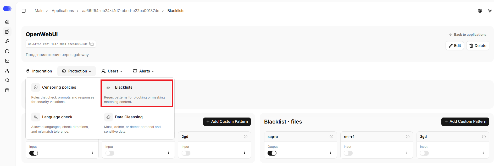
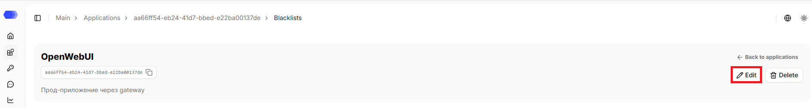
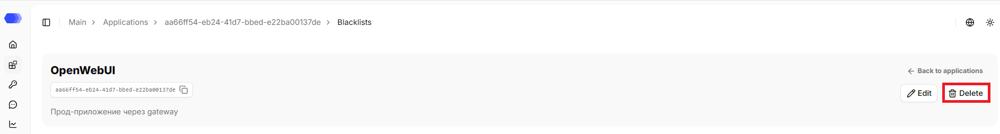
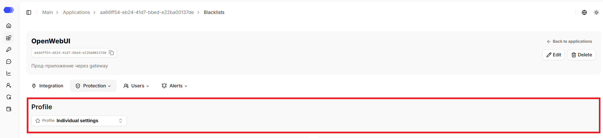
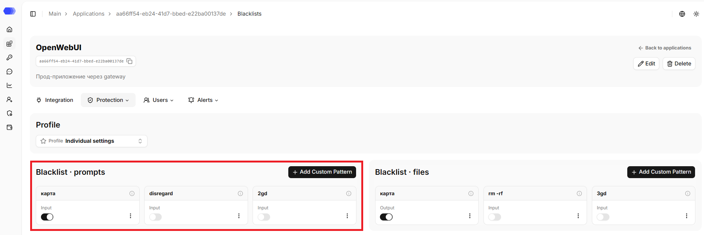
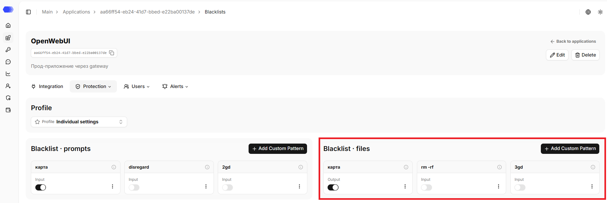
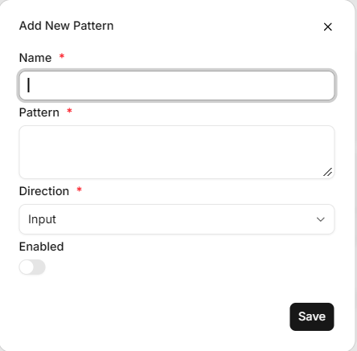

HiveTrace supports blacklists — regex patterns for blocking or masking matching content; when one is detected, the message is automatically marked as a violation. Blacklists are configured separately for messages and files.

## Opening the **Blacklists** section

1. In the sidebar, select **Applications**.
2. Open the required application by clicking its card or its name, depending on the selected view.
3. Hover over the **Protection** tab.
4. Click **Blacklists**.

The page header displays the application's name, ID, and description (if any). The copy button is available next to the ID. The header also contains the `Back to applications` link that leads to the `Applications` section.

## Editing the application

1. Click `Edit`.
2. Change the required fields.
3. Click `Save`.

## Deleting the application

1. Click `Delete`.
2. Confirm the deletion in the confirmation dialog.

This action cannot be undone. Prior to deletion, please verify that integration traffic has been stopped or redirected and that the associated API tokens are no longer in use.

## Profile

If a profile is selected, its name is displayed. If no profile is selected, individual settings are applied. When the application's protection settings are changed, the application is removed from the profile, and the current settings become individual.

The profile can be updated on the page:
1. Click the `Profile` button.
2. Select the required profile from the list. The search field helps narrow the list.
3. Confirm applying the profile to the application in the confirmation dialog.

## Blacklist prompts

Patterns in this section are applied to message text. Each card contains the pattern name, an `Enable` switch, an information button, and a **⋮** menu for editing or deletion.

Select **Add pattern** to create a rule. A disabled pattern remains saved but is not used during checks.

## Blacklist files

The **Blacklist files** section works in the same way, but applies its patterns to the contents of files attached to a request. Individual rules can be enabled or disabled, inspected, edited, or deleted.

## Adding a pattern

Select **Add pattern** in the appropriate section and complete the form:

1. **Name** — the label displayed in the list.
2. **Pattern** — a regular expression or another supported pattern expression.
3. **Direction** — **Input** for user requests or **Output** for model responses.
4. **Enabled** — activates the rule immediately after creation.
5. **Save** — creates the pattern. The **×** button closes the form without saving.

Test the expression on representative data before enabling it. An overly broad pattern can cause false positives.

## Verifying the result

After saving the settings, send a test request through the connected application. Trigger results are available in **Session Analytics**: open a record and go to the **Censors** or **Validation Configuration** sections. For synchronous protected integrations, a violation may also result in the request being blocked.
