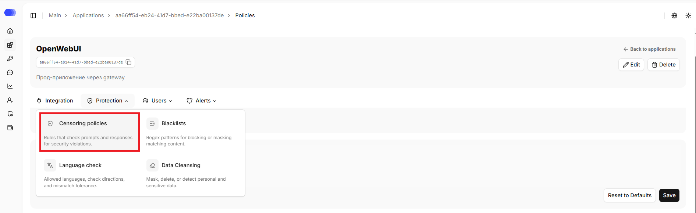
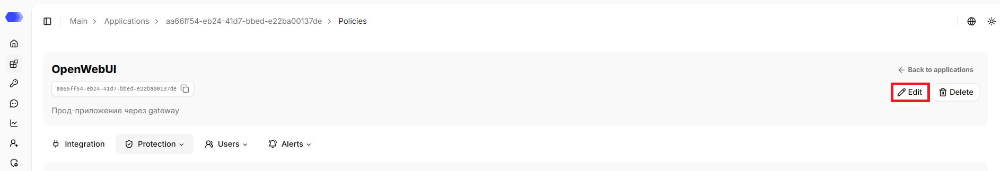
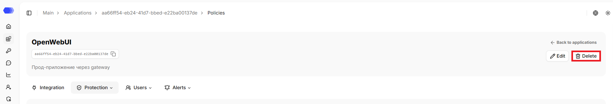
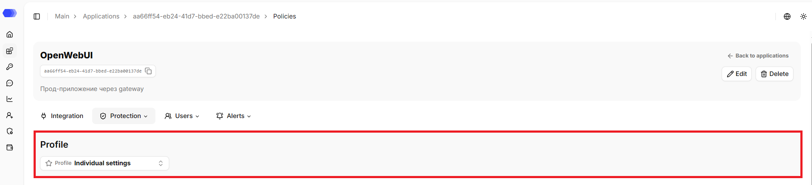
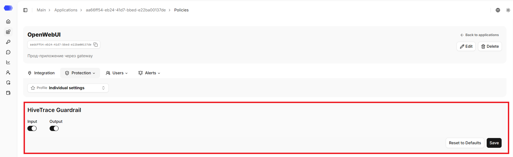
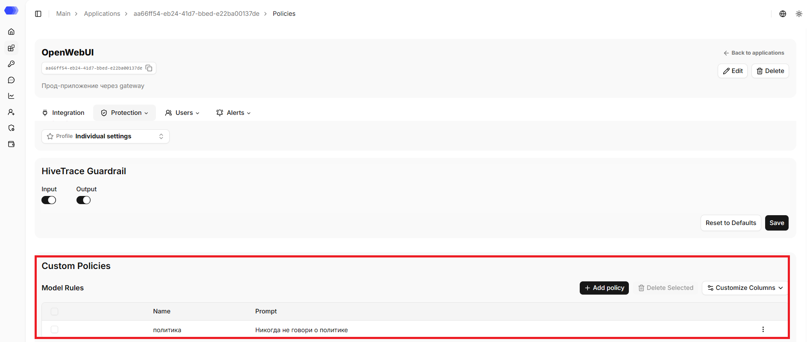
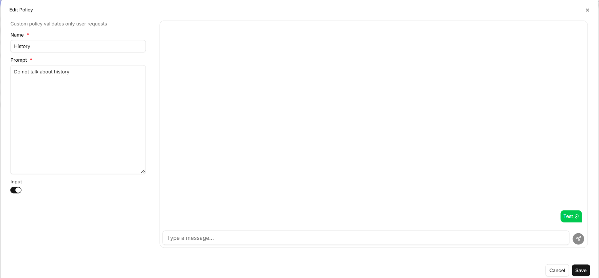

Policies are configured separately for each application. They let you enable the built-in HiveTrace protection, and create custom rules for user requests.

## Opening policy settings

1. In the sidebar, select **Applications**.
2. Open the required application by clicking its card or its name, depending on the selected view.
3. Hover over the **Protection** tab.
4. Click **Censoring policies**.

The page header displays the application's name, ID, and description (if any). The copy button is available next to the ID. The header also contains the `Back to applications` link that leads to the `Applications` section.

## Editing the application

1. Click `Edit`.
2. Change the required fields.
3. Click `Save`.

## Deleting the application

1. Click `Delete`.
2. Confirm the deletion in the confirmation dialog.

This action cannot be undone. Prior to deletion, please verify that integration traffic has been stopped or redirected and that the associated API tokens are no longer in use.

## Profile

If a profile is selected, its name is displayed. If no profile is selected, individual settings are applied. When the application's protection settings are changed, the application is removed from the profile, and the current settings become individual.

The profile can be updated on the page:
1. Click the `Profile` button.
2. Select the required profile from the list. The search field helps narrow the list.
3. Confirm applying the profile to the application in the confirmation dialog.

## HiveTrace Guardrail

HiveTrace Guardrail provides built-in protection against unsafe requests. Enable checks independently for each direction:

- **Input** checks messages sent from the user to the model.
- **Output** checks model responses before they are returned to the user.

Select **Save** to apply changes. **Reset to Defaults** discards unsaved changes and restores the last saved values.

## Custom Policies

A custom policy validates user requests using an instruction prompt. The **Model rules** table displays the name and prompt of every policy.

Available actions:

- **Add policy** opens the policy form.
- A row checkbox selects a policy; the header checkbox selects all visible rows.
- **Delete Selected** removes the selected policies and is enabled after at least one row is selected.
- **Customized Columns** controls which table columns are visible.
- The row **⋮** menu is used to edit or delete a specific policy, as well as to work with the policy version history, where previous versions can be viewed and the required one restored.
- **Rows per page**, **Previous**, and **Next** control pagination.

### Creating, editing, and testing a policy

Select **Add policy**, or choose Edit from a row's **⋮** menu. Complete these fields:

1. **Name** — a clear rule name.
2. **Prompt** — the instruction used to validate user requests.
3. **Input** — enables the policy for incoming messages.

Use the test panel on the right to enter a sample request and send it:

- a red message with a warning icon means the policy detected a violation;
- a green message with a shield means the request passed validation.

Test both prohibited and acceptable wording. Select **Save** when finished; **Cancel** closes the form without saving.

## Verify the result

After saving the settings, send a test request through the connected application. To inspect triggers, open the record in **Session Analytics**, then use the **Censors** or **Validation configuration** tabs. With a synchronous protected integration, a detected violation can also block the request.
