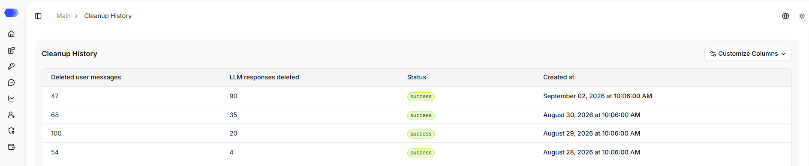

**Cleanup history** shows the outcome of background message-deletion jobs. Use it to confirm that a job has finished and to check how many user messages and LLM responses were removed.

## Opening the page

Follow the link in a cleanup notification. An administrator can also open `/cleanup-history` directly.

## Table fields

- **Deleted user messages** — number of deleted user prompts.
- **LLM responses deleted** — number of deleted model responses.
- **Status** — current state of the background job. Counters may change while it is running.
- **Created at** — date and time when the job started.
- **Pagination** — opens another history page when the table contains more jobs than one page can display.
- **Customize Columns** — hides or restores columns without deleting data.

## Verifying a cleanup

1. Locate the latest job by its creation time.
2. Wait for it to finish; do not start a duplicate cleanup while it is running.
3. Compare both counters with the expected data volume. The values can differ because a session does not necessarily contain equal numbers of prompts and responses.
4. If the job fails, record its start time and ask the platform administrator to inspect backend and ClickHouse logs.

Cleanup history contains aggregated results and cannot restore deleted messages.

## Access to the page

To view the cleanup history, the following permissions are required:

- Area **Platform** — access level of at least `Read`.

If the user does not have access to view the page, `403 — Access denied` is displayed.
