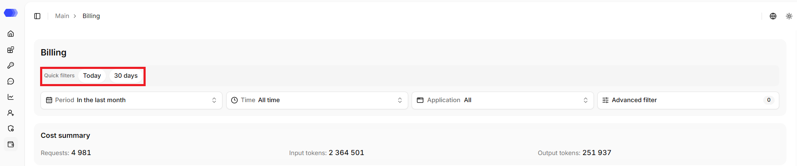
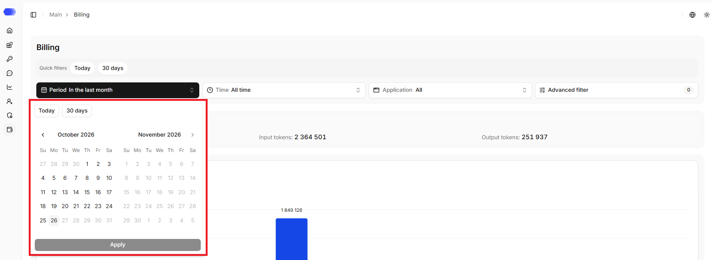
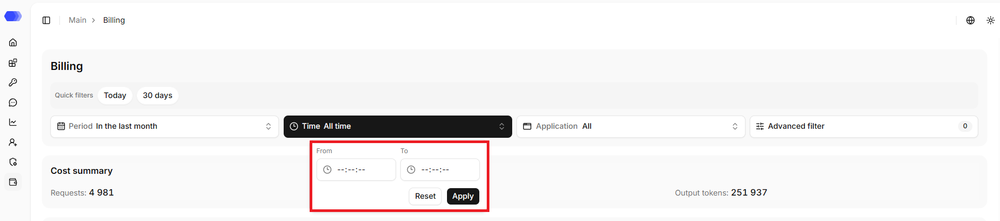
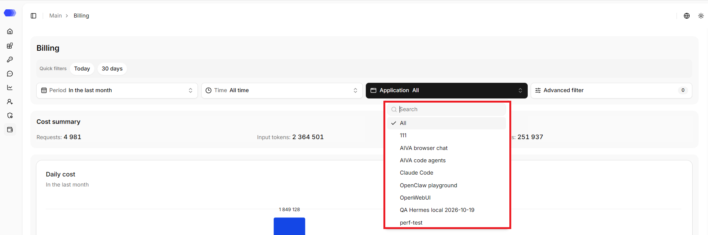
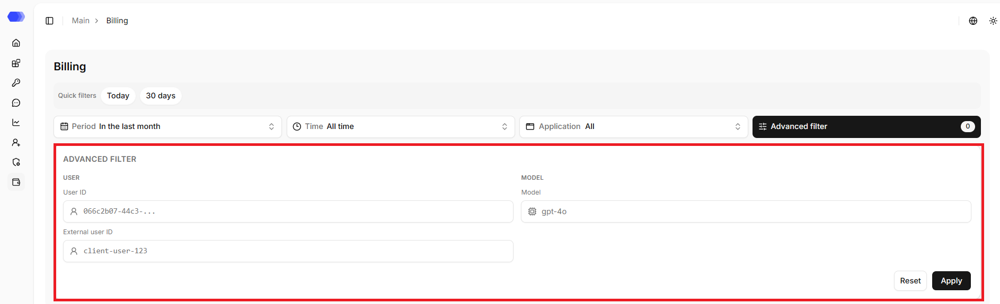
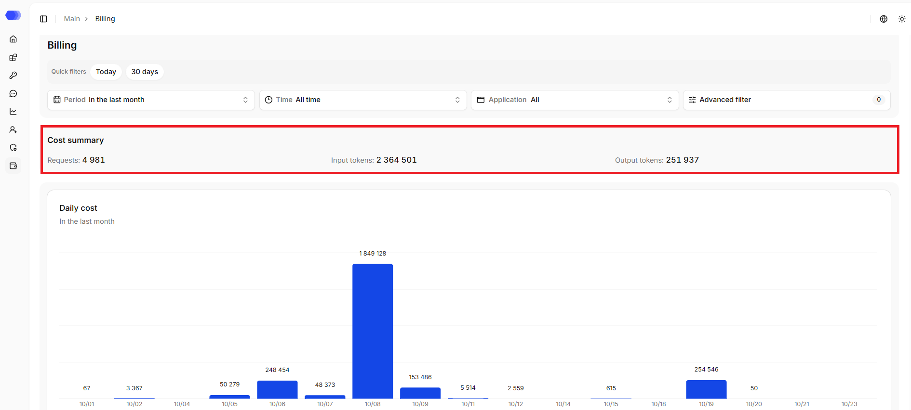
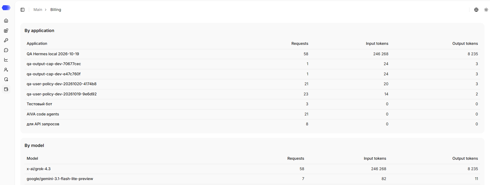
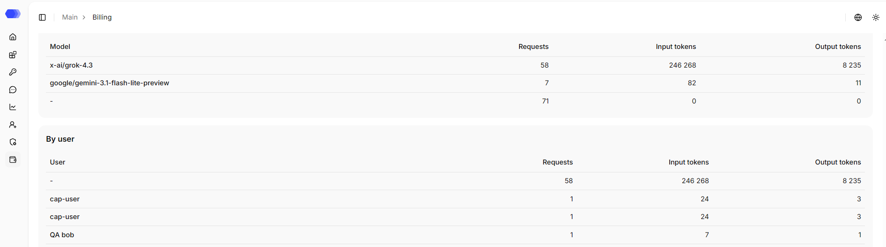

The **Billing** section shows LLM load in requests and tokens. Use it to identify which application, model, or user produces most of the traffic.

## Quick filters

- **Today** — only records for the current day;
- **30 days** — only records for the last 30 days.

A predefined set of conditions is applied when clicked.

## Period

Choose **Today**, **30 days**, or a custom calendar range. Month arrows navigate the calendar. Select both boundaries and then **Apply**. Future dates are disabled.

## Time

A time input form is opened by clicking the `Time` field.

In the form, one can set:

- the start time of the period (e.g., 00:00:00);
- the end time of the period (e.g., 23:59:59).

The entered values are applied when `Apply` is clicked.

The `Reset` button clears the entered time values.

## Application

The list shows the available applications, including deleted ones. The search field narrows the list. The **All** value removes the application restriction; selecting a specific item updates the table.

## Advanced filter

- **User ID** — exact user identifier;
- **External user ID** — exact external user identifier;
- **Model** — the model the user interacted with.

The counter on the button shows the number of active advanced conditions. `Apply` updates the results, `Reset` clears this section.

After filters are applied, the summary, chart, and all tables below are updated; reset returns data for all time.

The exception is the `Daily cost` block. By default, this block shows data for the last month.

## Usage summary

The top card shows totals for the selected period:

- **Requests** — number of processed model requests;
- **Input tokens** — tokens sent to models in prompts;
- **Output tokens** — tokens returned in model responses.

The **Daily usage** card visualizes consumption over time. Its subtitle states the active period, such as **In the last month**; dates appear on the horizontal axis, and each bar has its value above it. A day with no consumption may have no visible bar.

## By application and model

**By application** helps identify the integration producing most of the load. Each row contains its request count, input tokens, and output tokens. An identifier can appear instead of a friendly name when no display name was available for the application.

**By model** groups the same metrics by the model name supplied by the integration. Compare request count and token volume together: a few long requests can consume more tokens than many short requests.

## By user

The final table attributes load to users. Its first column can contain a full name, external identifier, or internal ID, depending on what was available at processing time. A dash means the requests could not be associated with a specific user.

All three tables use the same **Requests**, **Input tokens**, and **Output tokens** metrics. A non-zero request count with zero tokens means token statistics were not supplied or recorded for those entries.

## Analysing usage

1. Open the filters in the **Period** block.
2. Select a start date and end date, and optionally one application.
3. Apply the filters and verify the displayed period below the chart title.
4. Identify peak days.
5. Use the application, model, and user tables to locate the source of the load.

An empty table means that no data matches the current conditions. Version 4.4 reports usage but does not calculate monetary cost or provide an export action.

## Access to the page

To view the **Billing** page, the following permissions are required:

- Area **Analytics** — access level of at least `Read`.

To filter by application, the following permissions are required:

- Area **Applications** — access level of at least `Read`;
- Area **Analytics** — access level of at least `Read`.

If the user does not have access to view the page, `403 — Access denied` is displayed.
