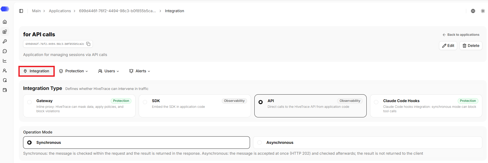
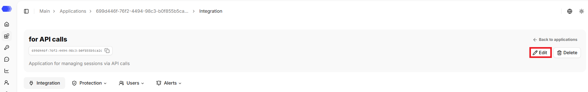
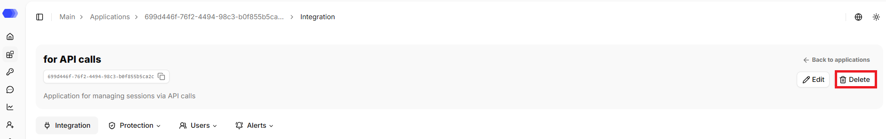
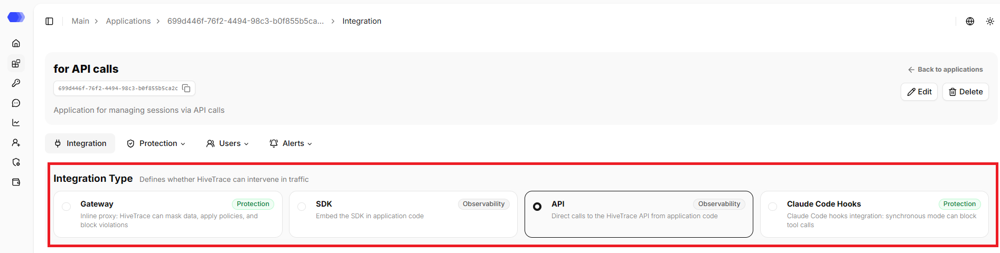
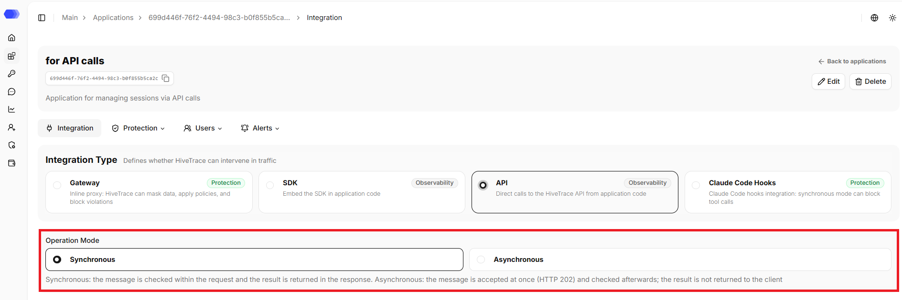
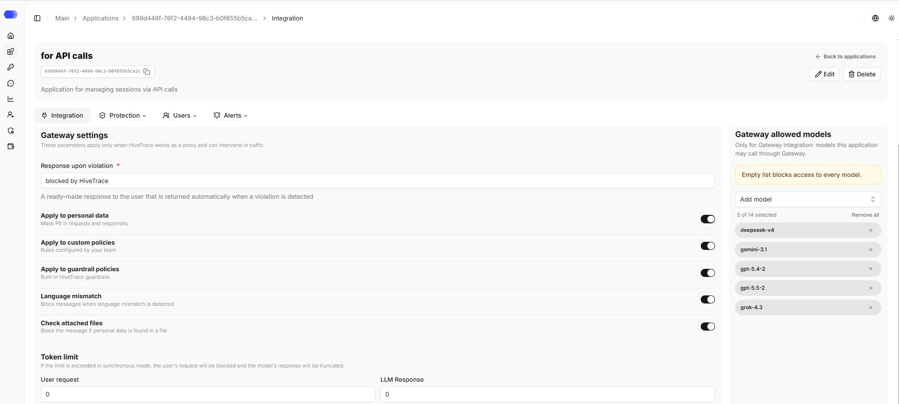
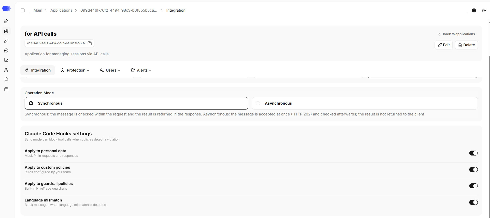

The **Integration** section allows you to choose how the application integrates with HiveTrace and its operation mode.

## Opening the **Integration** section

1. In the sidebar, select **Applications**.
2. Open the required application by clicking its card or its name, depending on the selected view.
3. The **Integration** tab opens.

The page header displays the application's name, ID, and description (if any). The copy button is available next to the ID. The header also contains the `Back to applications` link that leads to the `Applications` section.

## Editing the application

1. Click `Edit`.
2. Change the required fields.
3. Click `Save`.

## Deleting the application

1. Click `Delete`.
2. Confirm the deletion in the confirmation dialog.

This action cannot be undone. Prior to deletion, please verify that integration traffic has been stopped or redirected and that the associated API tokens are no longer in use.

## Integration Type

This block determines whether HiveTrace can intervene in traffic.

There are 4 options available: **Gateway**, **SDK**, **API**, **Claude Code Hooks**.

**Gateway** and **Claude Code Hooks** are marked `Protection` because HiveTrace can intervene in synchronous processing. **SDK** and **API** are marked `Observability` and send data only for recording and analysis.

## Operation Mode

This block determines how a message is processed during checks.

- **Synchronous** — message is checked within the request, and the result is returned in the response;
- **Asynchronous** — message is accepted immediately (HTTP 202) and checked later; the result is not returned to the client.

### Gateway

Gateway routes model traffic through HiveTrace and can stop unsafe requests before execution:

- **Synchronous** runs checks before forwarding the request and displays the remaining Gateway controls.
- **Asynchronous** analyses events without blocking the request; dependent fields are hidden.
- **Response upon violation** is the required phrase returned instead of a blocked result.
- **DataClean**, **Custom Policy**, **Guardrail**, **Language Mismatch**, **File Check** switches enable the corresponding checks.
- **User request** and **LLM response** define the two token limits.
- **Allowed models** — by default, the model list is empty. An empty list blocks access to every model. To add a model, click `Add model` — a list of available models opens. You can select a model by clicking it in the list or use search — type the name manually to quickly find the required model. To allow all models at once, use the `Add all models` option.

The response upon violation is required only for synchronous Gateway. The value must contain at least one non-whitespace character.

Each switch controls whether its check runs. A value of `0` in a token-limit field means that no positive threshold is configured; enter a value greater than zero to enforce a limit.

### SDK and API

Use these observability methods for a client library or direct HiveTrace API calls. They add no extra form fields. Application settings define default processing; Override API can supply inline configuration per request.

### Claude Code Hooks

This method validates Claude Code actions, including tool calls. Synchronous mode displays DataClean, Custom Policy, Guardrail, and Language Mismatch switches. The blocking-response and token-limit fields are not displayed for Claude Code Hooks.

## Access to the page

To edit an application in the header, the following permissions are required:

- Area **Applications** — access level of at least `Edit`.

To delete an application in the header, the following permissions are required:

- Area **Applications** — `Full` access level.

To view the **Integration** page, the following permissions are required:

- Area **Applications** — access level of at least `Read`.

To update the application settings and edit it, the following permissions are required:

- Area **Applications** — access level of at least `Edit`.

To delete an application, the following permissions are required:

- Area **Applications** — `Full` access level.

If the user does not have access to view the page, `403 — Access denied` is displayed.
