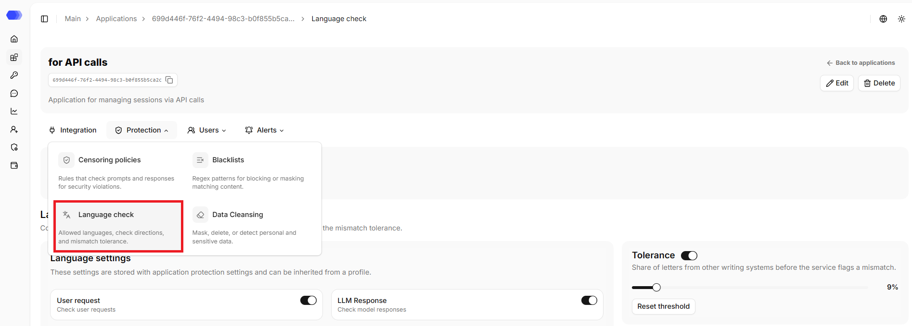
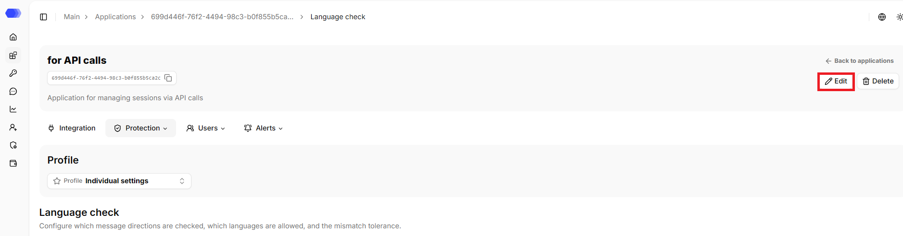
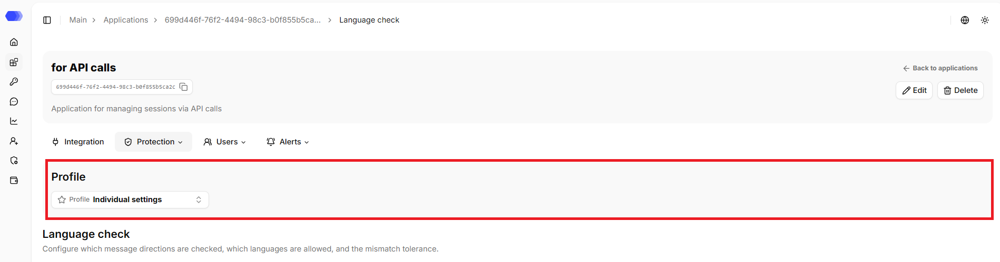
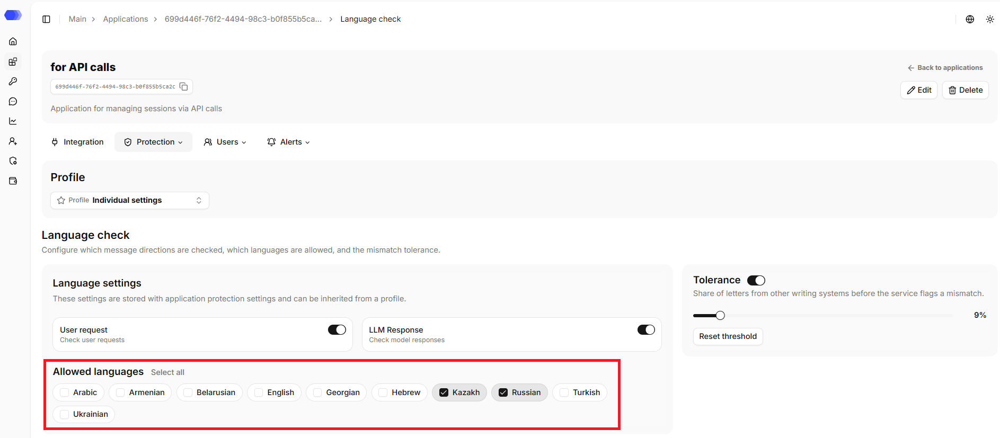
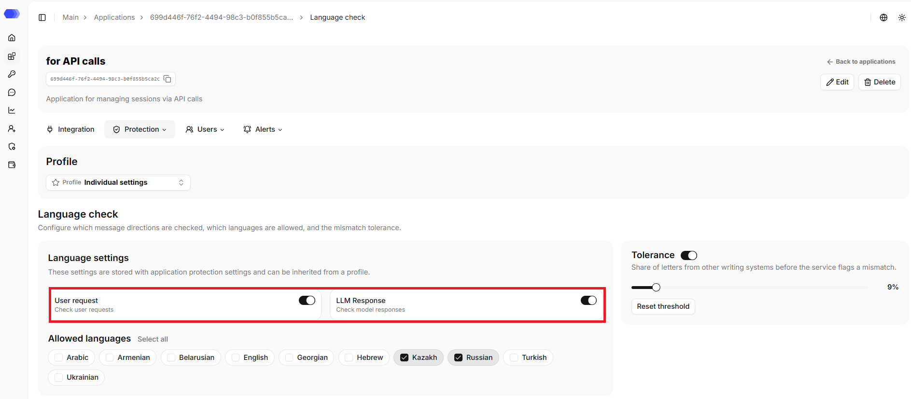
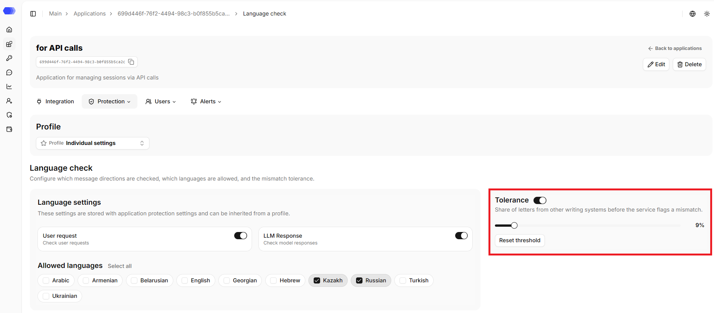

The **Language check** section allows you to control the language of requests and responses: define the list of allowed languages and detect text in foreign languages.

## Opening the **Language check** section

1. In the sidebar, select **Applications**.
2. Open the required application by clicking its card or its name, depending on the selected view.
3. Hover over the **Protection** tab.
4. Click **Language check**.

The page header displays the application's name, ID, and description (if any). The copy button is available next to the ID. The header also contains the `Back to applications` link that leads to the `Applications` section.

## Editing the application

1. Click `Edit`.
2. Change the required fields.
3. Click `Save`.

## Deleting the application

1. Click `Delete`.
2. Confirm the deletion in the confirmation dialog.

This action cannot be undone. Prior to deletion, please verify that integration traffic has been stopped or redirected and that the associated API tokens are no longer in use.

## Profile

If a profile is selected, its name is displayed. If no profile is selected, individual settings are applied. When the application's protection settings are changed, the application is removed from the profile, and the current settings become individual.

The profile can be updated on the page:
1. Click the `Profile` button.
2. Select the required profile from the list. The search field helps narrow the list.
3. Confirm applying the profile to the application in the confirmation dialog.

## Allowed languages

The following languages are available in this section: `English`, `Arabic`, `Armenian`, `Belarusian`, `Georgian`, `Hebrew`, `Kazakh`, `Russian`, `Turkish`, and `Ukrainian`.

To allow a language, select its checkbox; you can choose one language or several — up to all of them.

## Request and response checks

Checks for incoming and outgoing messages are enabled separately.

> **Note:** to switch the request or response check toggle to the active state, at least one language must be selected.

## Tolerance

The threshold sets the permissible share of letters from other writing systems at which the text is not yet considered a violation. It can be set from `0%` to `100%`: the lower the value, the stricter the check — at 0%, any foreign letter results in a violation. Mixed text is checked against this threshold: as long as the share of foreign letters is not exceeded, no violation is recorded.

The configured threshold can be reset using the `Reset threshold` button or via the toggle. After resetting, the threshold field returns to the default value — `25%`, and the toggle becomes inactive. Click `Save` to apply the changes.

## Access to the page

To edit an application in the header, the following permissions are required:

- Area **Applications** — access level of at least `Edit`.

To delete an application in the header, the following permissions are required:

- Area **Applications** — `Full` access level.

To view the language check settings, the following permissions are required:

- Area **Applications** — access level of at least `Read`;
- Area **Application policies** — access level of at least `Read`.

To edit the language check settings, the following permissions are required:

- Area **Applications** — access level of at least `Read`;
- Area **Application policies** — access level of at least `Edit`.

To update the application profile, the following permissions are required:

- Area **Applications** — access level of at least `Edit`;
- Area **Application policies** — access level of at least `Edit`;
- Area **Protection profiles** — access level of at least `Read`.

If the user does not have access to view the page, `403 — Access denied` is displayed.
