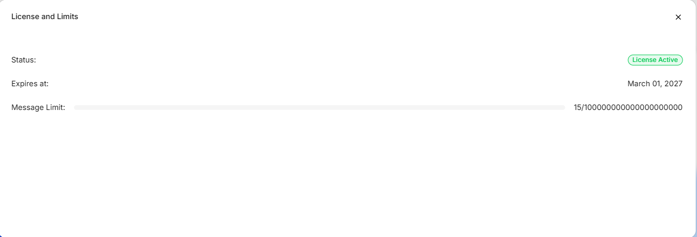

Open **License and limits** from the profile menu to review the license status, expiration date, and message usage.

The message counter shows used messages against the available total, while the progress bar visualizes the consumed share. Values in the screenshot are examples; use the values displayed in your environment. If necessary, contact the person responsible for licensing before the license expires or the limit is reached. Select **×** to close the dialog.

## Access to the page

To activate and deactivate the license, the following permissions are required:

- Area **Platform** — access level of at least `Read`;
- Enable the **Manage the license** granular permission.
