The **Data Cleansing** section configures sensitive-data processing for each application. Saved settings apply to new messages and files.

## Opening the **Data Cleansing** section

1. In the sidebar, select **Applications**.
2. Open the required application by clicking its card or its name, depending on the selected view.
3. Hover over the **Protection** tab.
4. Click **Data Cleansing**.

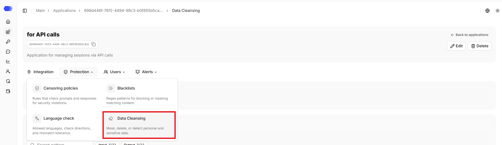

The page header displays the application's name, ID, and description (if any). The copy button is available next to the ID. The header also contains the `Back to applications` link that leads to the `Applications` section.

## Editing the application

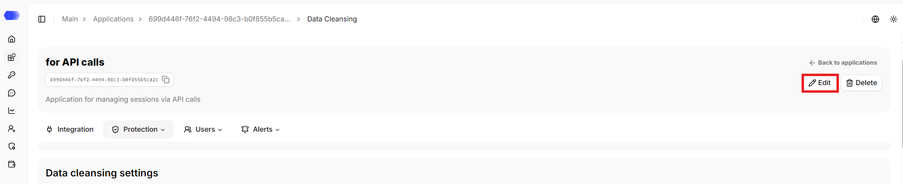

1. Click `Edit`.
2. Change the required fields.
3. Click `Save`.

## Deleting the application

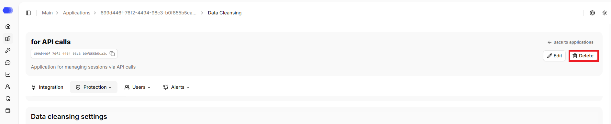

1. Click `Delete`.
2. Confirm the deletion in the confirmation dialog.

This action cannot be undone. Prior to deletion, please verify that integration traffic has been stopped or redirected and that the associated API tokens are no longer in use.

## Profile

If a profile is selected, its name is displayed. If no profile is selected, individual settings are applied. When the application's protection settings are changed, the application is removed from the profile, and the current settings become individual.

The profile can be updated on the page:
1. Click the `Profile` button.
2. Select the required profile from the list. The search field helps narrow the list.
3. Confirm applying the profile to the application in the confirmation dialog.

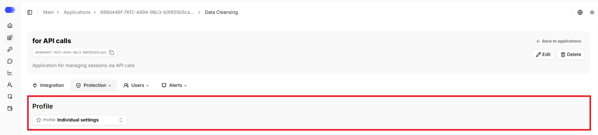

## Base Patterns

The **Base Patterns** block contains 22 built-in patterns. They are grouped into subsections, which makes it easier to find the required pattern.

- **Personal data** — `Person name`, `Address`, `Phone number`, `Email`, `Passport details`, `SNILS`, `Driver's license`;

- **Banking secrecy** — `Bank card`, `Card security code`, `BIC`, `Correspondent account`, `Bank account number`;

- **Organization details** — `INN`, `KPP`, `OGRN`, `OGRNIP`;

- **Technical data** — `IP address`, `Domain name`, `URL`, `Access token`;

- **Other** — `License plate`, `VIN`.

The counters show the total number of patterns and how many are enabled for each direction — both across the entire block and within each subsection.

The search works by basic pattern name, is case-insensitive, and matches by partial match.

Each card has two switches: **Input** checks user requests and **Output** checks model responses. The information icon opens the pattern description. Please enable only the required directions: this makes processing results predictable and simplifies the analysis of triggers.

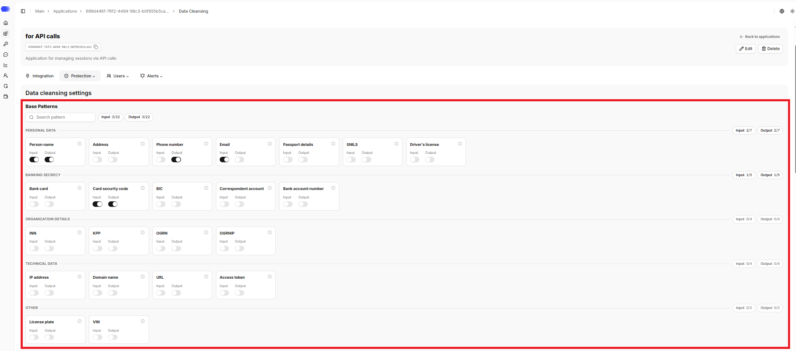

## Custom patterns

**Custom patterns** add team-specific regular expressions. 

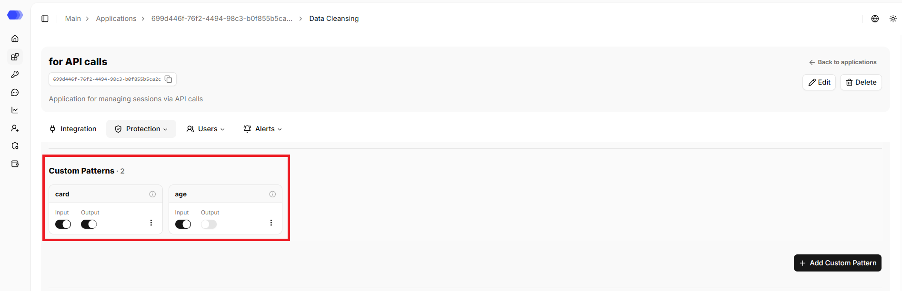

Click **Add Custom Pattern** and fill out the form:

1. **Name** — the label displayed in the list.
2. **Pseudonym** — the label that replaces the detected value during pseudonymization.
3. **Description** — the pattern description (optional).
4. **Pattern** — a regular expression or another supported pattern expression.
5. **Direction** — **Input** for user requests or **Output** for model responses.
6. **Enable** — activates the rule immediately after creation.
7. **Save** — creates the pattern. The **×** button closes the form without saving.

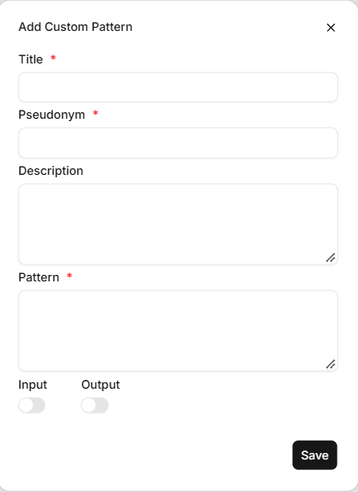

After saving, input and output checks can be enabled or disabled independently on the pattern card.

The three-dot menu provides edit and delete actions, as well as access to the pattern version history, where previous versions can be viewed and restored.

The counter shows the number of patterns in the section; if there are no custom patterns, `No custom patterns yet. Add a pattern to define application-specific data cleansing rules.` is displayed.

## Whitelist patterns

**Whitelist patterns** define exceptions for values that resemble sensitive data but are valid in your workflow.

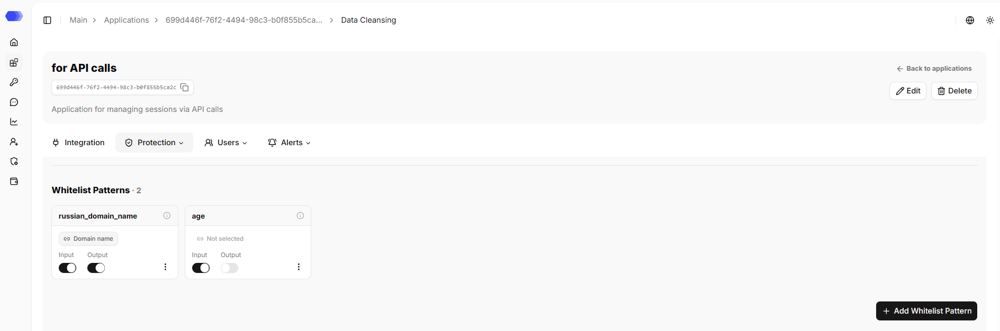

Click **Add Whitelist Pattern** and fill out the form:

1. **Name** — the label displayed in the list.
3. **Description** — the pattern description (optional).
4. **Pattern** — a regular expression or another supported pattern expression.
4. **Target rule** — specifies which base or custom pattern the new pattern is linked to. By default, `Not selected` is displayed in the field. Clicking it opens the dropdown list, where the required pattern can be selected with a click.
5. **Direction** — **Input** for user requests or **Output** for model responses.
6. **Enable** — activates the rule immediately after creation.
7. **Save** — creates the pattern. The **×** button closes the form without saving.

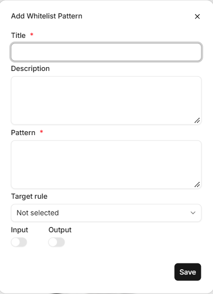

After saving, input and output checks can be enabled or disabled independently on the pattern card.

The three-dot menu provides edit and delete actions.

The counter shows the number of patterns in the section; if there are no whitelist patterns, `No whitelist patterns yet. Add a pattern to keep trusted values from being cleaned.` is displayed.

## Processing type

Input and output can use different types:

- **Masking** replaces the detected value with `X` characters.
- **Deletion** removes the detected value from the text;
- **Detection** detects matches without changing the text;
- **Pseudonymization** replaces it with a stable label such as `NAME_1` or `EMAIL_1`.

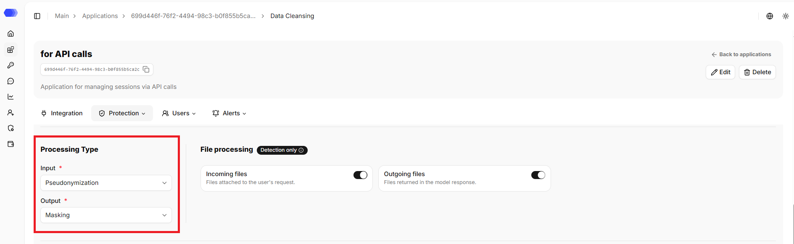

The selected mode applies only to the directions enabled on the pattern cards. After making changes, check the result in the test block below on the page.

## File processing

**Incoming files** and **Outgoing files** control text extraction and inspection for user attachments and model-produced files. **Detection only** means entities are reported without modifying the file.

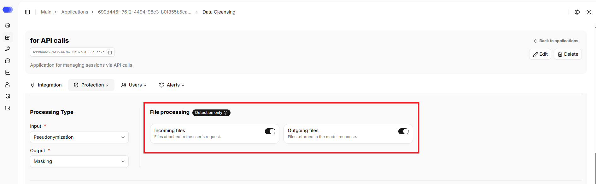

## Inspection depth and source storage

Message and file inspection depth controls how much context is analyzed. Deeper inspection can improve contextual detection but costs more time and resources.

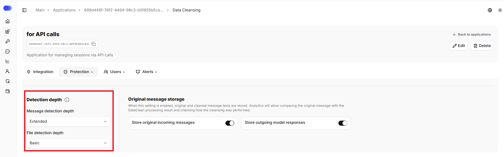

Source-storage switches retain both original and cleaned messages for comparison in analytics. Enable them only when permitted by your access and retention policies.

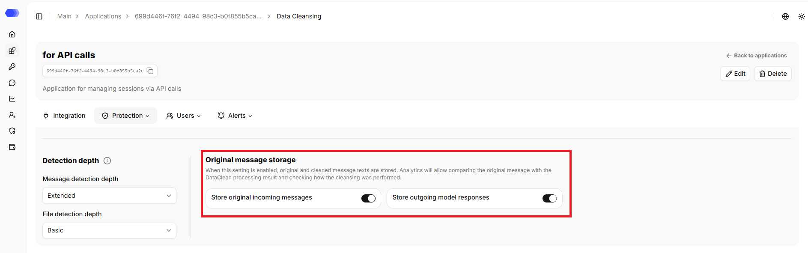

## Test data cleaning

1. Enter a sample in **Original text**.
2. Click **Clean up**.
3. Compare **Processed text (Input)** and **Processed text (Output)**.
4. Verify pseudonymized labels, masked values, deleted values, and detected matches.
5. Review **Detected sensitive data** using the Incoming and Outgoing tabs.

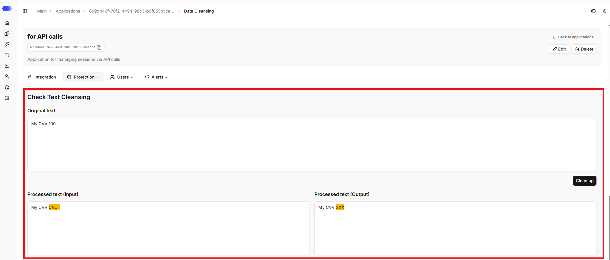

The result table shows the entity type, original text, and processed text. Use **Customize Columns** to select visible columns.

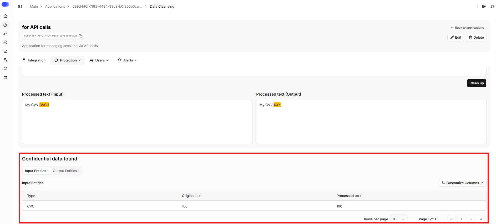

## Recommended setup order

1. Enable the required built-in patterns and directions.
2. Add custom and whitelist patterns.
3. Select message-processing modes.
4. Configure files, inspection depth, and source storage.
5. Test the configuration.
6. Send a test request and verify it in **Session analytics**.
