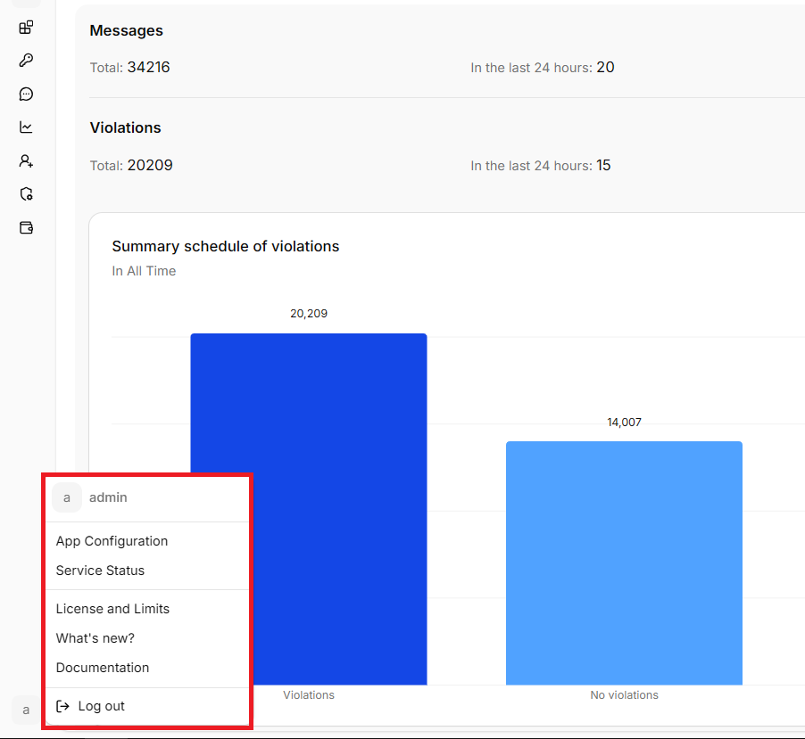
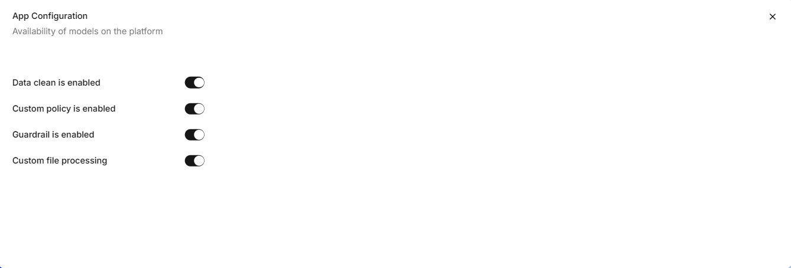

**Platform settings** contains instance-wide HiveTrace options. To open it, select the profile icon in the upper-right corner and choose **Platform settings**.

## General settings

System users can review and change the settings available for the current HiveTrace instance. The exact fields depend on the installed version and deployment configuration.

Before saving, verify that the changes match your deployment configuration and organizational policies.
