The **Profiles** section allows you to configure protection once and apply it to multiple applications — without configuring each application separately.

## Opening the **Profiles** section

1. In the sidebar, select **Applications**.
2. Click the **Profiles** tab.

## Profile search

The search works by profile name or description and is case-insensitive.

## Profiles table

Above the table there is the **Create profile** button, and below the table there is pagination.

By default, profiles are displayed as cards — each profile is presented as a separate card with key information.

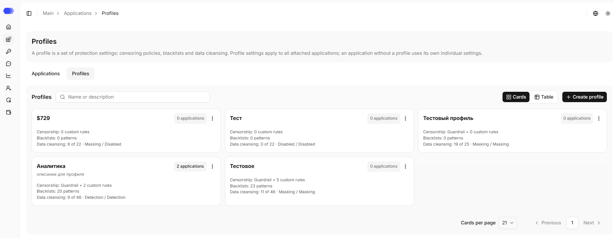

You can also switch the display to table view, in which data are presented as rows and columns.

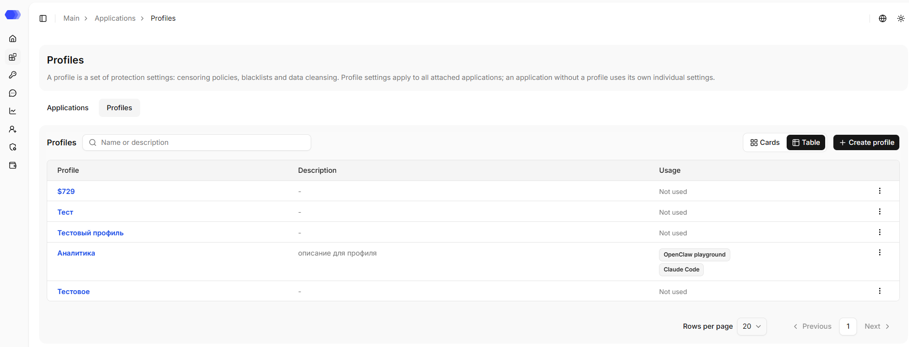

Regardless of the selected view, the following data are displayed for each profile:

- **Name** — profile name; the full text is shown on hover.
- **Description** — profile's purpose; displayed optionally (if added).
- **Actions menu** — the three dots open the editing and deletion menu.

In card view, the following is additionally displayed for each profile::

- **Censorship** — whether a security policy is enabled, as well as the number of enabled custom policies;
- **Blacklists** — the number of enabled blacklist rules for messages and files;
- **Data cleansing** — the number of enabled base, custom and whitelist patterns and the processing type for input and output;
- **Application count** — the number of applications to which the current profile is applied.

In table view, the list of applications that use the profile is displayed. If the profile is not yet in use, `Not used` is displayed.

The page size is set by the `Rows per page` or `Cards per page` option, depending on the selected view. Pagination at the bottom changes the number of rows and opens the previous or next result page.

## Creating a profile

Click **Create Profile**. The form contains:

- **Name** — required field, no more than 256 characters;
- **Description** — optional text, no more than 1500 characters;

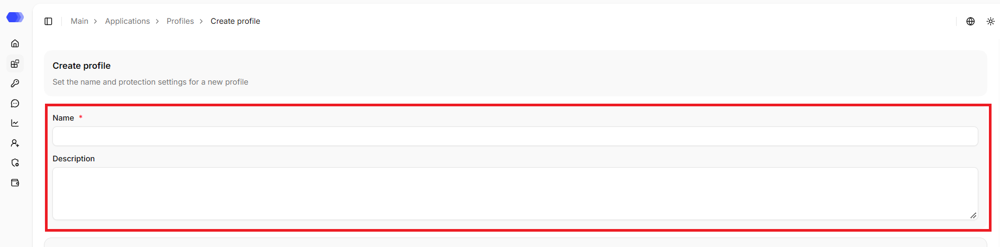

### HiveTrace Guardrail

**HiveTrace Guardrail** provides built-in protection against unsafe requests. Enable checks independently for each direction:

- **Input** checks messages sent from the user to the model.
- **Output** checks model responses before they are returned to the user.

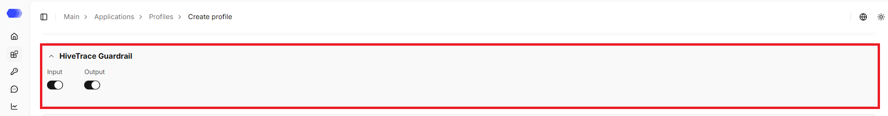

### Custom Policies

A custom policy validates user requests using an instruction prompt. The table shows the name and prompt of each policy, as well as its status. The counter on the button shows the number of policies in the section; if there are no policies, the `No results` message is displayed.

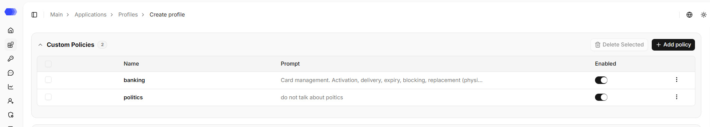

Available actions:

- **Add policy** opens the policy form.
- A row checkbox selects a policy; the header checkbox selects all visible rows.
- **Delete Selected** removes the selected policies and is enabled after at least one row is selected.
- The row **⋮** menu is used to edit or delete a specific policy.

### Blacklist prompts

Patterns in this block are applied to message text. Each card contains the pattern name, direction, an `Enable` switch, an information button, and a `"⋮"` menu for editing or deletion.

Select `Add Custom Pattern` to create a rule. A disabled pattern remains saved but is not used during checks.

The counter on the button shows the number of patterns in the block; if there are no patterns, `No patterns` is displayed.

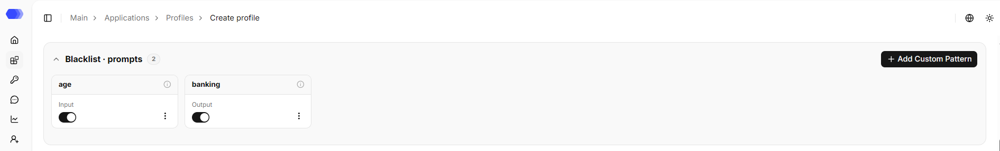

### Blacklist files

The **Blacklist files** block works in the same way, but applies its patterns to the contents of files attached to a request.

Select `Add Custom Pattern` to create a rule. A disabled pattern remains saved but is not used during checks.

The counter on the button shows the number of patterns in the block; if there are no patterns, `No patterns` is displayed.

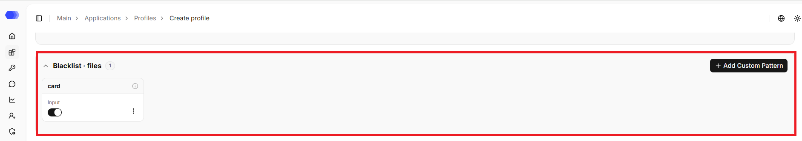

### Language check

The **Language check** block allows you to control the language of requests and responses: define the list of allowed languages and detect text in foreign languages.

**Request and response checks** — checks for incoming and outgoing messages are enabled separately.

> **Note:** to switch the request or response check toggle to the active state, at least one language must be selected.

**Allowed languages** — select the required languages using the checkboxes. The following languages are available: `English`, `Arabic`, `Armenian`, `Belarusian`, `Georgian`, `Hebrew`, `Kazakh`, `Russian`, `Turkish`, and `Ukrainian`.

**Tolerance** — a share of letters from other writing systems at which the text is not yet considered a violation. The configured threshold can be reset using the `Reset threshold` button or via the toggle. After resetting, the threshold field returns to the default value — `25%`, and the toggle becomes inactive.

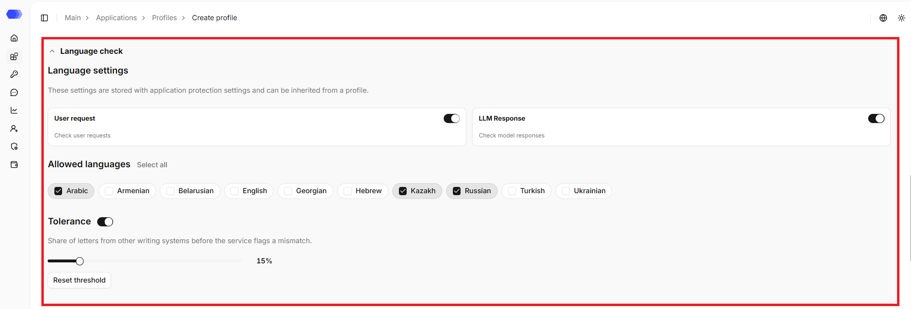

### Data Cleansing

The **Data Cleansing** section configures sensitive-data processing for each application. Saved settings apply to new messages and files.

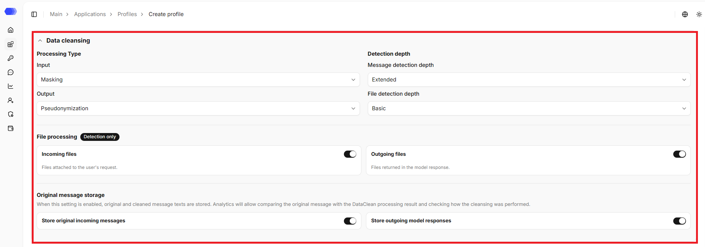

**Processing type**

By default, the `Disabled` option is selected for both directions — no data processing is performed.

Input and output can use different types:

- **Masking** replaces the detected value with `X` characters.
- **Deletion** removes the detected value from the text;
- **Detection** detects matches without changing the text;
- **Pseudonymization** replaces it with a stable label such as `NAME_1` or `EMAIL_1`.

The selected mode applies only to the directions enabled on the pattern cards.

**File processing**

**Incoming files** and **Outgoing files** control text extraction and inspection for user attachments and model-produced files. **Detection only** means entities are reported without modifying the file.

**Inspection depth and source storage**

Message and file inspection depth controls how much context is analyzed. Deeper inspection can improve contextual detection but costs more time and resources.

Source-storage switches retain both original and cleaned messages for comparison in analytics. Enable them only when permitted by your access and retention policies.

## Base Patterns

The **Base Patterns** block contains built-in patterns. They are grouped into subsections, which makes it easier to find the required pattern.

- **Personal data** — `Person name`, `Address`, `Phone number`, `Email`, `Passport details`, `SNILS`;

- **Banking secrecy** — `Bank card`, `Card security code`;

- **Organization details** — `INN`, `KPP`, `OGRN`, `OGRNIP`;

- **Technical data** — `IP address`, `Domain name`, `URL`, `Access token`.

The counters show the total number of patterns and how many are enabled for each direction — both across the entire block and within each subsection.

The search works by basic pattern name, is case-insensitive, and matches by partial match.

Each card has two switches: **Input** checks user requests and **Output** checks model responses. Please enable only the required directions: this makes processing results predictable and simplifies the analysis of triggers.

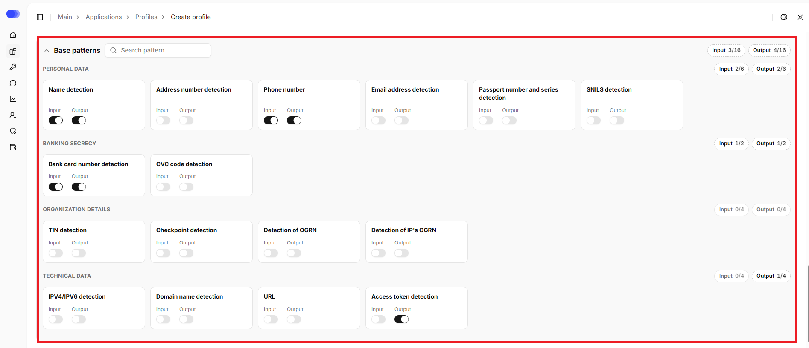

## Custom patterns

**Custom patterns** add team-specific regular expressions. 

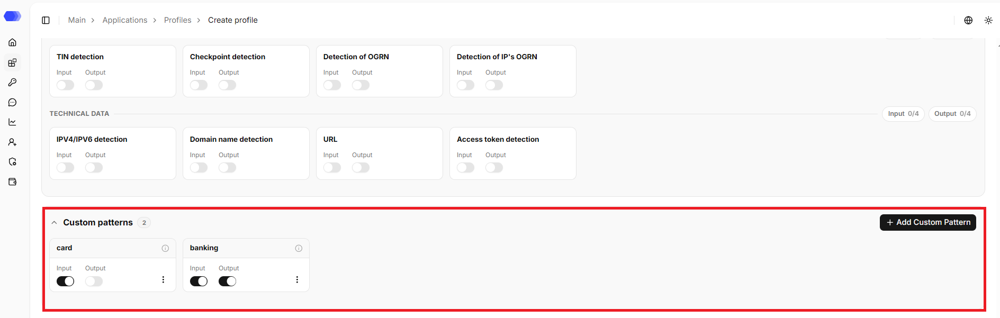

Click **Add Custom Pattern** and fill out the form:

1. **Name** — the label displayed in the list.
2. **Pseudonym** — the label that replaces the detected value during pseudonymization.
3. **Description** — the pattern description (optional).
4. **Pattern** — a regular expression or another supported pattern expression.
5. **Direction** — **Input** for user requests or **Output** for model responses.
6. **Enable** — activates the rule immediately after creation.
7. **Save** — creates the pattern. The **×** button closes the form without saving.

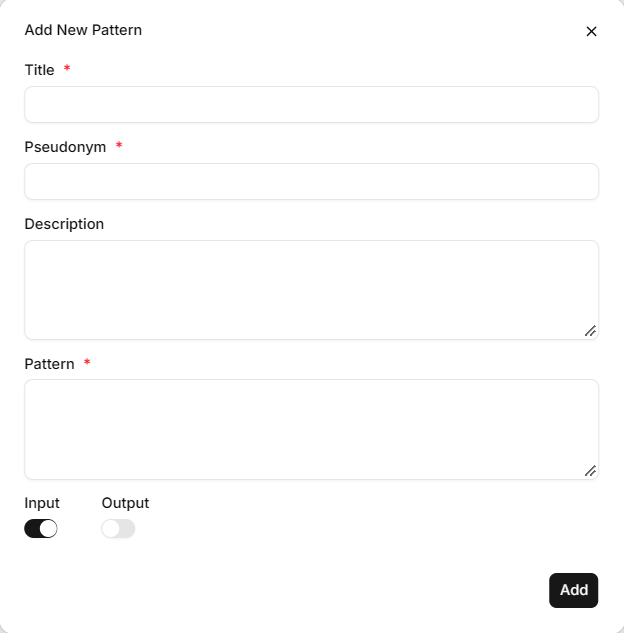

After saving, input and output checks can be enabled or disabled independently on the pattern card. The three-dot menu provides edit and delete actions. The counter shows the number of patterns in the section; if there are no custom patterns, `No patterns` is displayed.

## Allowed patterns

**Allowed patterns** define exceptions for values that resemble sensitive data but are valid in your workflow.

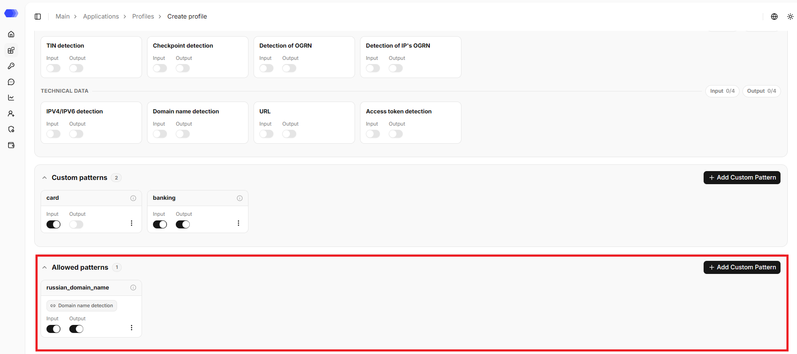

Click **Add Custom Pattern** and fill out the form:

1. **Name** — the label displayed in the list.
3. **Description** — the pattern description (optional).
4. **Pattern** — a regular expression or another supported pattern expression.
4. **Target rule** — specifies which base or custom pattern the new pattern is linked to. By default, `Not selected` is displayed in the field. Clicking it opens the dropdown list, where the required pattern can be selected with a click.
5. **Direction** — **Input** for user requests or **Output** for model responses.
6. **Enable** — activates the rule immediately after creation.
7. **Save** — creates the pattern. The **×** button closes the form without saving.

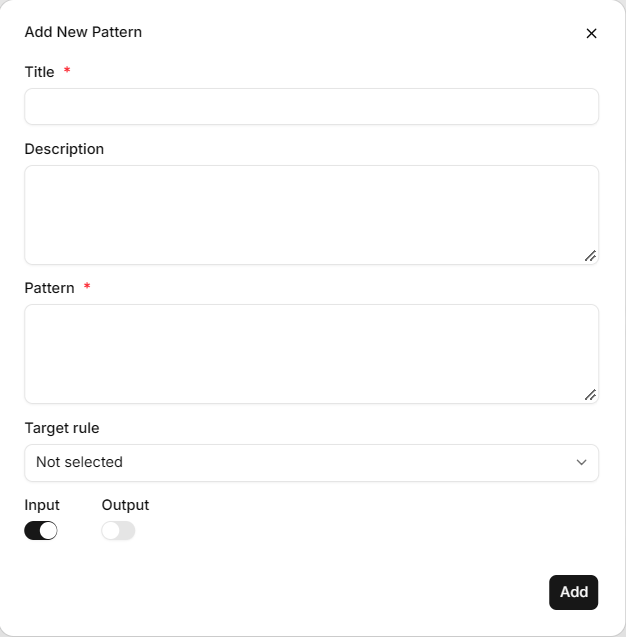

After saving, input and output checks can be enabled or disabled independently on the pattern card. The three-dot menu provides edit and delete actions. The counter shows the number of patterns in the section; if there are no whitelist patterns, `No allowed patterns yet. Add a pattern so trusted values are not cleaned.` is displayed.

By default, all profile blocks are expanded, so the full set of settings is visible. If needed, any block can be collapsed. The profile with the specified values is created upon clicking `Create profile`.

## Profile page

Opening a profile depends on the selected view:

**Card view** — click the profile card.

**Table view** — click the profile name in the corresponding table row.

At the top of the page, the profile's name, and description (if any) are displayed.

The page also contains the `Back to profiles` link that leads to the `Profiles` section.

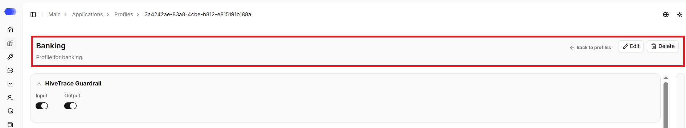

## Editing the profile

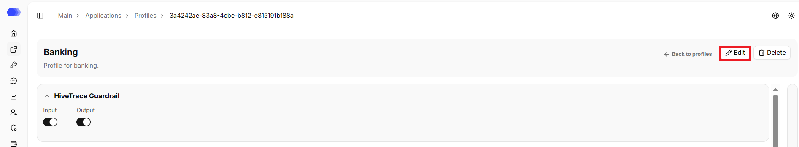

1. Click `Edit`.
2. Change the required fields.
3. Click `Save`.

## Deleting the profile

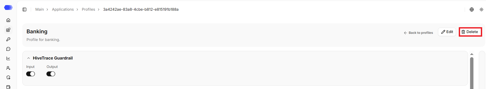

1. Click `Delete`.
2. Confirm the deletion in the confirmation dialog.

### Linking applications to the profile

By default, the **Applications** panel is open; it can be collapsed. To reopen the panel, click the collapsed panel.

To apply a profile to an application, click `Add application`. The list of available applications opens, from which you can select the required one — it will be linked to the profile and receive its settings. The search field narrows the list. To add all applications at once, click `Add all`.

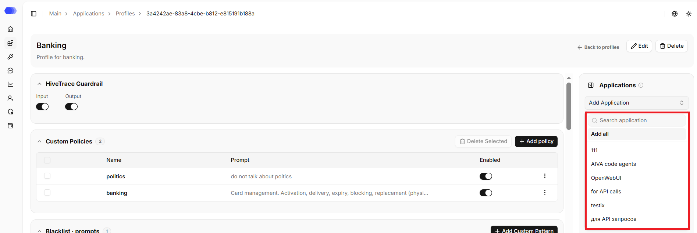

> **Note:** profile changes are applied to the application automatically. If the application's protection settings are manually changed, profile settings are no longer applied to it, and the current settings become individual.

### Removing applications from the profile

Applications linked to the profile can be removed from the list: click the cross next to the application to remove a single application, or `Remove all` to clear the list completely.

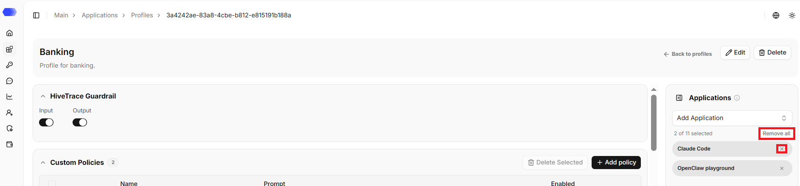

### Saved settings

The section also displays previously saved settings:

**HiveTrace Guardrail** — direction settings;

**Custom policies** — policies with their names, prompts, and status;

**Blacklist prompts** — blacklist patterns for message text;

**Blacklist files** — blacklist patterns for file contents;

**Language check** — allowed languages, request and response checks, tolerance;

**Data Cleansing** — processing types, file processing settings, original message storage for input and output, detection depth for message and file;

**Base patterns** — base patterns with direction settings;

**Custom patterns** — custom patterns with direction settings;

**Allowed patterns** — allowed patterns with direction settings.

By default, all profile blocks are expanded, so the full set of settings is visible. If needed, any block can be collapsed. 

### Saving changes

When changes are made to the profile, an information panel appears at the bottom of the page:

- **Counter and sections** — information about unsaved sections.
- **Reset** — discards all unsaved changes.
- **Save settings** — saves the changes.

## Access to the page

To view profiles, the following permissions are required:

- Area **Applications** — access level of at least `Read`;
- Area **Protection profiles** — access level of at least `Read`.

To create a new profile and edit the existing one, the following permissions are required:

- Area **Applications** — access level of at least `Read`;
- Area **Protection profiles** — access level of at least `Edit`.

To delete profiles, the following permissions are required:

- Area **Applications** — access level of at least `Read`;
- Area **Protection profiles** — `Full` access level.

If the user does not have access to view the page, `403 — Access denied` is displayed.
