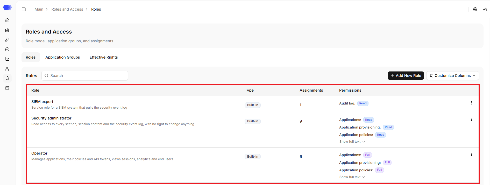
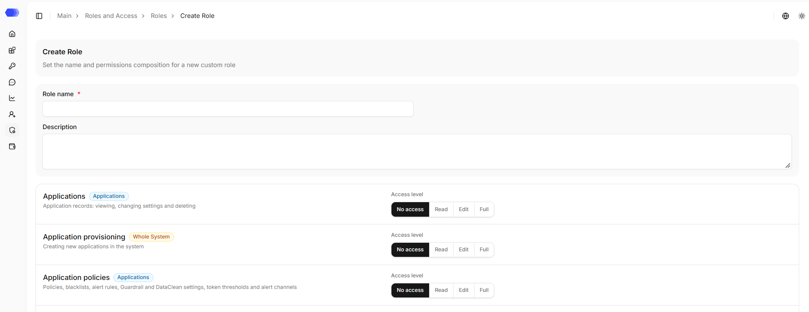
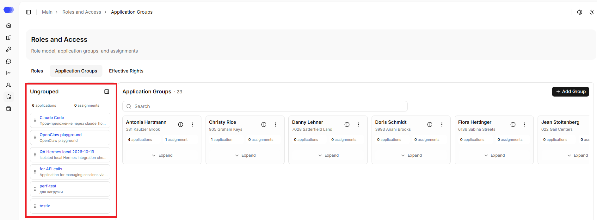
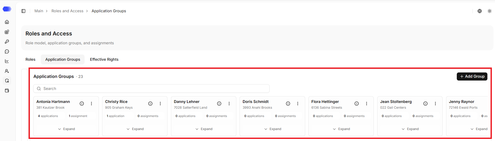
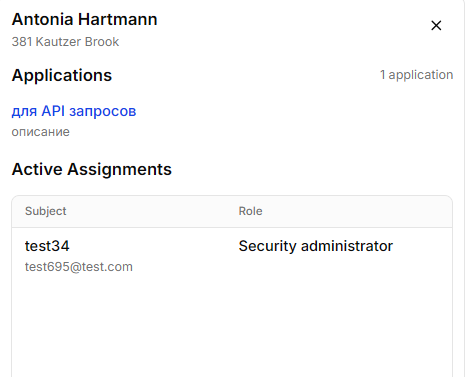
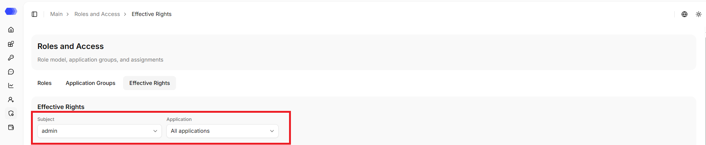
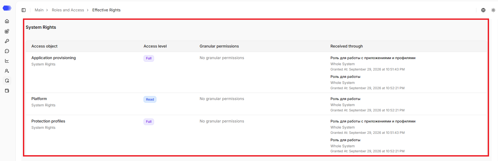
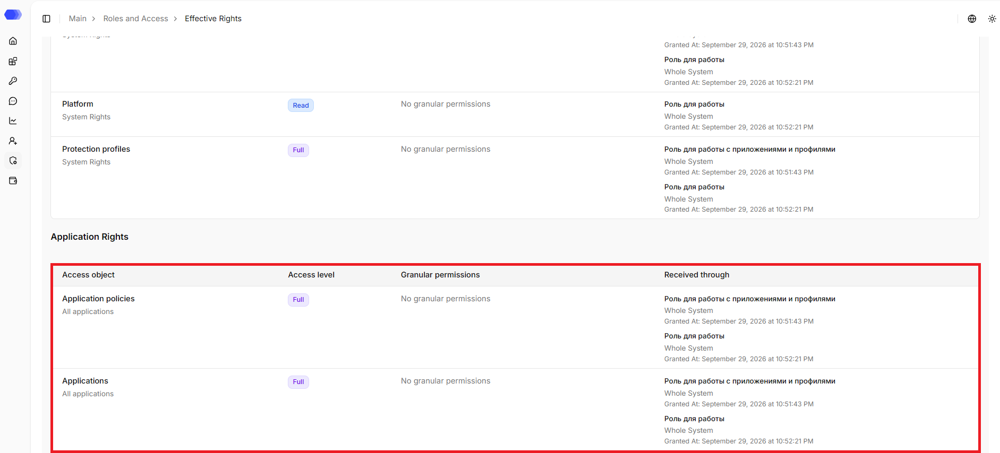

The **Roles and access** section is used to manage roles, application groups, and view system users' permissions. The section contains several tabs and screens. It is better to understand the tabs, and then perform specific configurations.

## **Roles**

On the `Roles` tab, one can view the list of created roles, creates new roles, and edits existing ones.

The search field is used to find a record in the table.

The page displays a table of roles:

- **Role** — role name and description.
- **Type** — `Built-in` or `Custom`.
- **Assignments** — number of assignments of the role to system users.
- **Permissions** — a brief summary of the permissions included in the role;
- **Actions menu** — edits, duplicates, and deletes a specific role.

**Column settings** hides or restores columns. **Rows per page**, **Previous**, and **Next** control pagination.

> **Note:** built-in roles can only be duplicated, they cannot be edited or deleted directly, but they can be used as a basis for a new custom role.

If a custom role has active assignments, it cannot be deleted. These assignments must first be revoked from the system users. Attempting to delete such a role returns the error `Role still has active assignments`.

If a role has many permissions, only a brief summary is shown in the column. To see the full set of permissions, expand the row using `Show full`.

System roles are typically used as preconfigured access sets, while custom roles are created for specific work tasks.

### Creating and editing a custom role

Click `Add New Role` or select `Edit` from the **⋮** menu.

The general information is filled in at the top of the page:

- **Role name** — required field. System users might use the name to find the role in the table and select it when assigning access.

- **Description** — optional field. It is convenient for explaining which team or task the role was created for.

Below is the list of functional areas:

- **Applications** - viewing, updating and deleting applications;
- **Application provisioning** - creating new applications in the system;
- **Application policies** - policies, blacklists, alert rules, Guardrail and DataClean settings, token thresholds and alert channels;
- **Protection profiles** - protection settings that are applied to applications;
- **Sessions and messages** - sessions, messages, alerts and export;
- **Analytics** - analytical reports and summary metrics of applications;
- **End users** - end users of applications and their groups;
- **API tokens and integrations** - application SDK keys and end-user directory sources;
- **System users** - accounts of system users;
- **Roles and assignments** - roles, their composition and role assignments of system users;
- **Application groups** - application groups and their membership;
- **Audit log** - export of the security event log to external systems;
- **Platform** - system settings, service status, data cleanup and the license.

Each functional area has a label:

- `Applications` - the permissions relate to applications. When assigning such a role, you will need to select where it applies: to all applications, to a single application, or to an application group.
- `Whole System` - the permissions are system-wide and are not tied to a specific application. For example, such permissions are used to manage system users, roles, application groups, or other general settings.

An access level is selected for eahc functional area:

- `No access` - a system user will not be able to see the corresponding section and perform actions from this area.
- `Read` - a system user will be able to read data.
- `Edit` - a system user will be able to view and modify data.
- `Full` - a system user will receive maximum access within this area, including additional actions, if available.

Some functional areas have separate granular permissions. They are displayed to the right of the main access level and allow you to configure the role more precisely.

For example, for the **Sessions and messages** area, one can separately allow:

- reading session content;

- exporting sessions;

- downloading analysis files.

Such permissions do not replace the general access level but rather refine it. If there are no additional checkboxes for an area, only the access level needs to be selected.

### Deleting a custom role

1. Go to the role you want to delete.
2. Check the number of assignments in the role's row.
3. If the number of assignments is greater than `0`, first revoke this role's assignments from system users.
4. Open the role's actions menu using 3 dots.
5. Select `Delete`.
6. Confirm the deletion.

Only a custom role without active assignments can be deleted. If the role still has assignments, deletion is blocked. After deletion, the role disappears from the list and can no longer be assigned to new system users.

## **Application Groups**

On the `Application groups` tab, one can view, create, and edit application groups. This is convenient when several system users need to be granted the same access to a shared set of applications. For example, you can create a `Production` group, add applications to it, and assign roles to the group.

The `Ungrouped` column is located on the left. It shows applications that are not currently part of any group. Counters for applications and assignments are displayed above the list. By default, this column is open and can be collapsed. To reopen it, click the collapsed panel.

### Creating a group

1. Click `Add group`.
2. Fill in the required fields.
3. Click `Add`.

### Adding applications to the group

To add an application to a group, pick it up by the drag handle and drag it to the required group. The cursor changes, indicating that the item can be moved. When an application is added to a group, it receives the access assigned to that group.

### Application Groups

The main area of the page contains application group cards. Each card shows:

- group name;
- group description (if any);
- number of applications in the group;
- number of assignments to the group;
- the button that expands the application list;
- actions menu.

The search field is used to find a group in the table.

The information icon opens the group's side panel. It displays:

- the group name and description;
- the list of applications in the group;
- active role assignments to this group.

If there are no assignments, `No results` is displayed in the side panel. The **×** button closes the panel.

The actions menu allows you to edit or delete the group. Only a group without active assignments can be deleted. If roles are still assigned to the group, deletion is blocked, and `The application group still has active assignments` is displayed. Before deleting, open the group's side panel and check whether the group has any active assignments. When removed from the group, the application is returned to `Ungrouped`. Applications can also be moved between the `Ungrouped` column and groups.

Each application — both in the `Ungrouped` column and inside a group — is displayed with its name (a blue clickable link leading to the application card) and description (if any).

## **Effective Rights**

On the `Effective permissions` tab, one can select a system user and view which permissions they have received after all assignments. The tab is used for verification, permissions cannot be changed directly on the page: changes are made through roles, application groups, and role assignments.

At the top of the page, there are two filters:

- `Subject` — the list of system users.
- `Application` — the scope of verification. One can select `All applications` or a specific application.

### System Rights Table

System rights are the permissions that are not tied to any application.

The table displays the following data:

- `Access object` - a functional area.
- `Access level` - `No access`, `Read`, `Edit`, or `Full`.
- `Granular permissions` - additional permissions within the area, if any. If there are no additional permissions, `No granular permissions` is displayed.
- `Received through` - the source of the permission: the role, the assignment scope, and the grant date. This column helps understand how the system user has received a particular permission.

### Application Rights Table

Application rights are the permissions that relate to applications.

The table displays the following data:

- `Access object` - a functional area.
- `Access level` - `No access`, `Read`, `Edit`, or `Full`.
- `Granular permissions` - additional permissions within the area, if any. If there are no additional permissions, `No granular permissions` is displayed.
- `Received through` - the source of the permission: the role, the assignment scope, and the grant date. This column helps understand how the system user has received a particular permission.

## Access to the page

To view roles and their assignments, the following permissions are required:

- Area **Roles and assignments** — access level of at least `Read`.

To edit, duplicate, and delete roles, the following permissions are required:

- Area **Roles and assignments** — `Full` access level.

To view application groups, the following permissions are required:

- Area **Roles and assignments** — access level of at least `Read`;
- Area **Application groups** — access level of at least `Read`.

To create application groups, add applications to groups, and remove applications from groups, the following permissions are required:

- Area **Roles and assignments** — access level of at least `Read`;
- Area **Application groups** — `Full` access level.

To view system user assignments, the following permissions are required:

- Area **Roles and assignments** — access level of at least `Read`;
- Area **System users** — access level of at least `Read`.

If the user does not have access to view the page, `403 — Access denied` is displayed.
