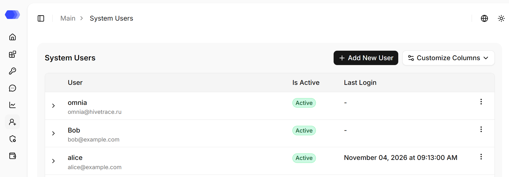
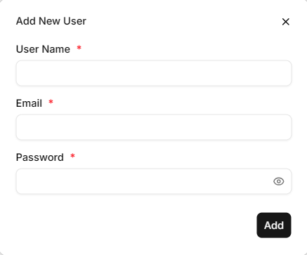
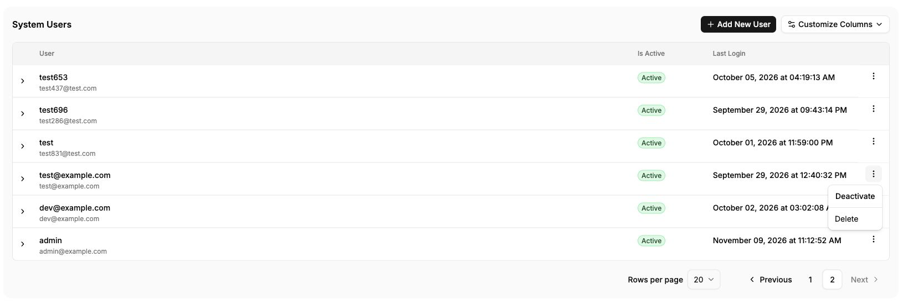
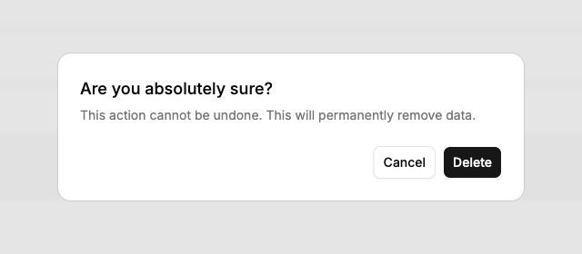
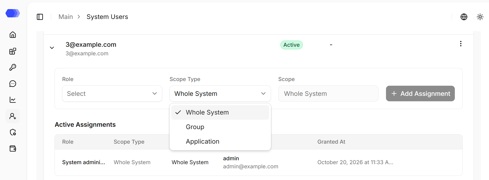
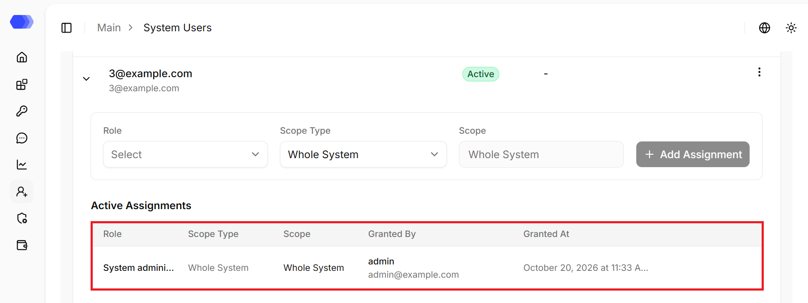

Use **System users** to manage employee accounts that can sign in to the HiveTrace administration console. Open it from the user-with-plus icon in the left navigation.

## Required permissions

| Action | Area | Min. access level |
|---|---|---|
| Viewing the page | `System users` | `Read` |
| Creating system users | `System users` | `Edit` |
| Activating and deactivating system users | `System users` | `Edit` |
| Deleting system users | `System users` | `Full` |
| Viewing the active assignments of system users | `System users` | `Read` |
| | `Roles and assignments` | `Read` |
| Assigning roles to system users, revoking them | `System users` | `Read` |
| | `Roles and assignments` | `Full` |

If the user does not have access to view the page, `403 — Access denied` is displayed.

## User table

Each row represents one account. The table contains the following information:

| Column | Description |
| --- | --- |
| **User** | Username and email |
| **Is Active** | Current account state |
| **Last login** | Date and time of the last successful sign-in; a dash is displayed when the account has never signed in |

Click **Customize Columns** to show or hide available table fields. The **⋮** menu at the end of a row opens actions for that account; the available actions depend on the current administrator's permissions and the account state.

Use the controls below the table to change the number of rows per page or move to the previous or next page. An unavailable navigation control is shown disabled.

## Add a user

1. Click **Add New User**.
2. Complete all required fields.
3. Click **Add**.

The form contains:

| Field | Purpose |
| --- | --- |
| **Username** | Name displayed in the interface |
| **Email** | Unique address used to sign in |
| **Password** | Initial password for the new account |

All fields are marked with an asterisk and are require. The eye icon in **Password** reveals or hides the entered value. Click **×** to close the form without creating an account.

After the user is added successfully, the account appears in the table. Access to the interface sections is not automatically granted upon account creation: a role must be assigned. The role determines what the user can do within the scope of the assignment: it defines which operations are allowed and which remain unavailable.

## Activating and deactivating an account

1. Find the account and open its **⋮** menu.
2. Select **Deactivate** for an active account or **Activate** for an inactive one.
3. Wait for the success notification and check the **Is Active** column.

The action applies immediately, without a separate confirmation dialog. Deactivation prevents the user from accessing the platform but keeps the account and its role assignments. To restore access, activate the account again; the assigned roles still determine which sections are available.

## Deleting an account

1. Find the account and open **⋮ → Delete**.
2. Review the confirmation dialog and click **Delete**. Close the dialog to cancel.
3. Wait for the success notification and check that the account has disappeared from the table.

There is no account-restore action on this page. Use **Deactivate** when access only needs to be suspended.

Activation and deactivation require **System users → Edit**; deletion requires **Full** access. Without the corresponding permission, the action is not shown. You cannot deactivate or delete your own account, or remove the last active system administrator. If an action is rejected, read the error notification; have another administrator perform an allowed action or first ensure another active administrator has the required system role.

## Assigning a role to a system user

1. Find the account in the system users table.
2. Expand the system user's row.
3. Select a role.
4. Select the `Scope type`. A role can be assigned to the entire system, to an application group, or to a specific application. 
5. Select the `Scope` if it is required for the selected scope type.
6. Click `Add Assignment`.

After saving, the system user receives the permissions within the selected scope. If the assignment is successfully granted, the interface displays the `Assignment granted` notification. If the system user is already signed in, they may need to refresh the page.

Having a permission does not automatically grant a user access to a specific application. The permission must apply to that application — it must be part of an assignment whose scope includes the application.

## Viewing the system user's active assignments

1. Find the account in the system users table.
2. Expand the system user's row.
3. View the `Active assignments` table.

The table shows which roles have already been granted to the system user, where they apply, who granted the assignment, and when it was granted. If there are no assignments, `No results` is displayed.

The user can have multiple assignments. Permissions from different assignments are combined: the absence of access in one role does not cancel a permission granted by another. The user's effective permissions are determined by all their active assignments and their scopes.

An active assignment can be revoked. Revoking removes the role assignment from the system user. After revocation, permissions granted only through this assignment no longer apply.

## Recommendations for configuring roles

- Create roles for work tasks, not for specific people.
- Do not grant full access if read-only access is sufficient for the system user.
- Use application groups for teams that work with the same set of applications.
- Verify the system user's permissions after changing roles.
- Revoke assignments if the system user should not have access.
