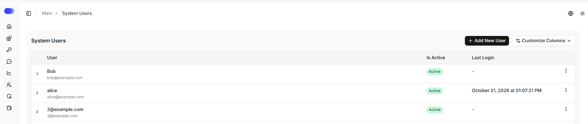
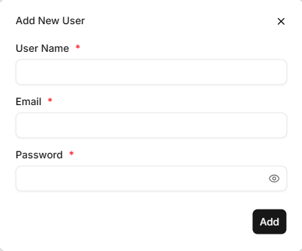
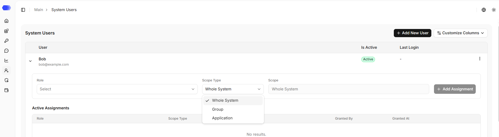
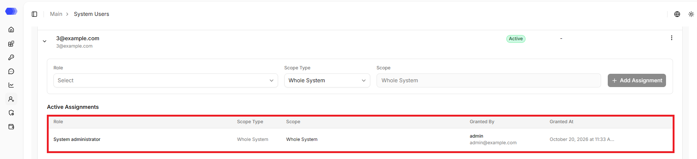

Use **System users** to manage employee accounts that can sign in to the HiveTrace administration console. Open it from the user-with-plus icon in the left navigation.

## User table

Each row represents one account. The table contains the following information:

| Column | Description |
| --- | --- |
| **User** | Username and email |
| **Is Active** | Current account state |
| **Last login** | Date and time of the last successful sign-in; a dash is displayed when the account has never signed in |

Click **Customize Columns** to show or hide available table fields. The **⋮** menu at the end of a row opens actions for that account; the available actions depend on the current administrator's permissions and the account state.

Use the controls below the table to change the number of rows per page or move to the previous or next page. An unavailable navigation control is shown disabled.

## Add a user

1. Click **Add New User**.
2. Complete all required fields.
3. Click **Add**.

The form contains:

| Field | Purpose |
| --- | --- |
| **Username** | Name displayed in the interface |
| **Email** | Unique address used to sign in |
| **Password** | Initial password for the new account |

All fields are marked with an asterisk and are require. The eye icon in **Password** reveals or hides the entered value. Click **×** to close the form without creating an account.

After the user is added successfully, the account appears in the table. Access to the interface sections is not automatically granted upon account creation: a role must be assigned. The role determines what the user can do within the scope of the assignment: it defines which operations are allowed and which remain unavailable.

## Assigning a role to a system user

1. Find the account in the system users table.
2. Expand the system user's row.
3. Select a role.
4. Select the `Scope type`. A role can be assigned to the entire system, to an application group, or to a specific application. 
5. Select the `Scope` if it is required for the selected scope type.
6. Click `Add Assignment`.

After saving, the system user receives the permissions within the selected scope. If the assignment is successfully granted, the interface displays the `Assignment granted` notification. If the system user is already signed in, they may need to refresh the page.

## Viewing the system user's active assignments

1. Find the account in the system users table.
2. Expand the system user's row.
3. View the `Active assignments` table.

The table shows which roles have already been granted to the system user, where they apply, who granted the assignment, and when it was granted. If there are no assignments, `No results` is displayed.

An active assignment can be revoked. Revoking removes the role assignment from the system user. After revocation, permissions granted only through this assignment no longer apply.

## Recommendations for configuring roles

- Create roles for work tasks, not for specific people.
- Do not grant full access if read-only access is sufficient for the system user.
- Use application groups for teams that work with the same set of applications.
- Verify the system user's permissions after changing roles.
- Revoke assignments if the system user should not have access.

## Access to the page

To view the system users table, the following permissions are required:

- Area **System users** — access level of at least `Read`.

To create system users, activate or deactivate them, the following permissions are required:

- Area **System users** — access level of at least `Edit`.

To delete system users, the following permissions are required:

- Area **System users** — `Full` access level.

To view the active assignments of system users, the following permissions are required:

- Area **System users** — access level of at least `Read`;
- Area **Roles and assignments** — access level of at least `Read`.

To assign roles to system users and revoke them, the following permissions are required:

- Area **System users** — access level of at least `Read`;
- Area **Roles and assignments** — `Full` access level.

If the user does not have access to view the page, `403 — Access denied` is displayed.
