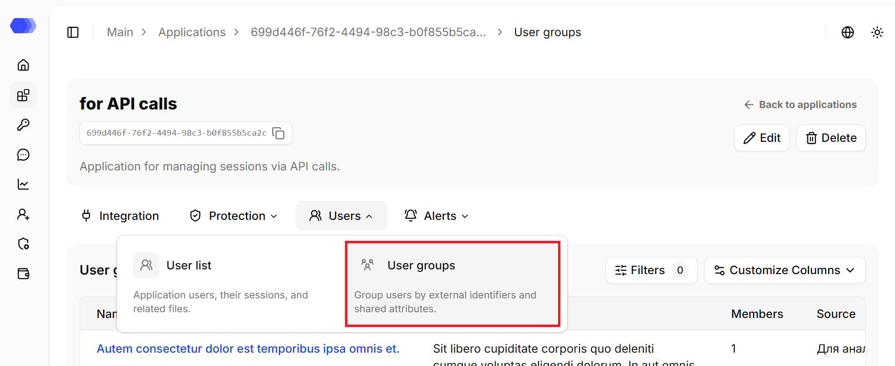
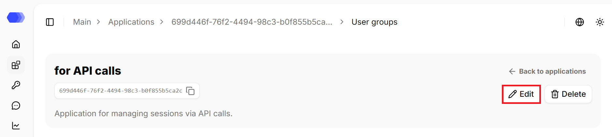
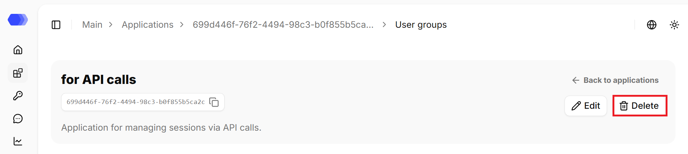
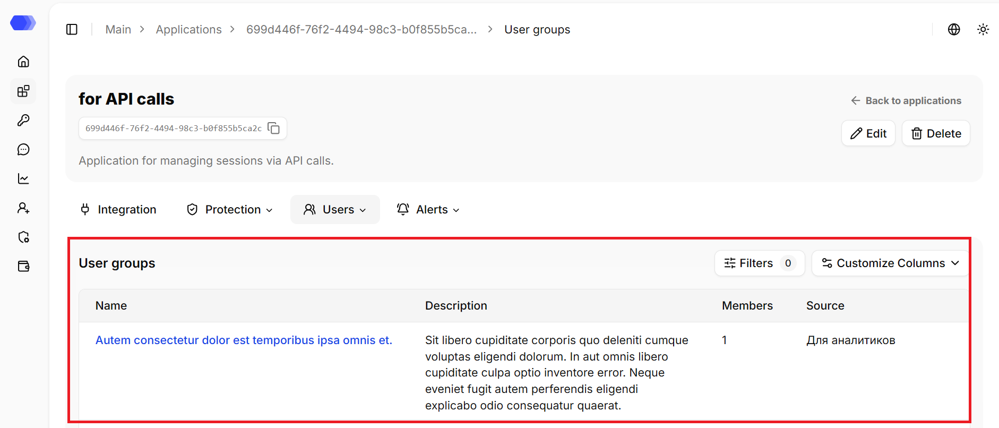
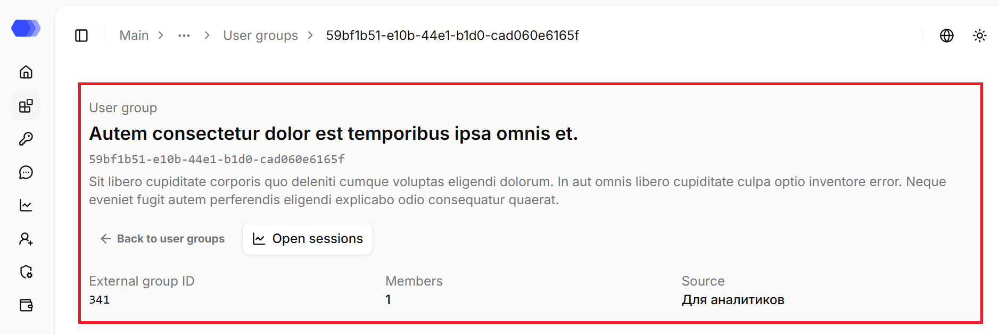
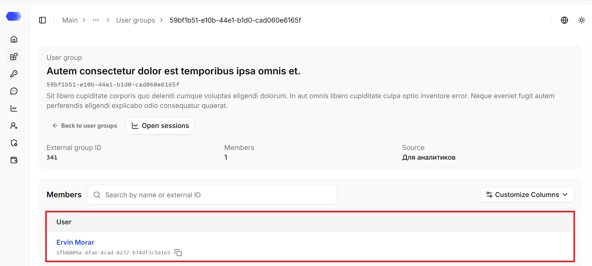

The **User groups** section shows the groups added to the application and helps you navigate to the group members.

## Required permissions

| Action | Area | Min. access level |
|---|---|---|
| Viewing the user groups page, opening a user group | `Applications` | `Read` |
| | `End users` | `Read` |
| Creating an end-user directory source | `API tokens and integrations` | `Edit` |
| Editing an application from the header | `Applications` | `Edit` |
| Deleting an application from the header | `Applications` | `Full` |

If the user does not have access to view the page, `403 — Access denied` is displayed.

## Opening the `User groups` section

1. In the sidebar, select **Applications**.
2. Open the required application by clicking its card or its name, depending on the selected view.
3. Hover over the **Users** tab.
4. Click **User groups**.



The page header displays the application's name, ID, and description (if any). The copy button is available next to the ID. The header also contains the `Back to applications` link that leads to the `Applications` section.

## Editing the application



1. Click `Edit`.
2. Change the required fields.
3. Click `Save`.

## Deleting the application



1. Click `Delete`.
2. Confirm the deletion in the confirmation dialog.

This action cannot be undone. Prior to deletion, please verify that integration traffic has been stopped or redirected and that the associated API tokens are no longer in use.

## End-user directory source creation

### Method and path

`POST /api/integration-sources/`

### Headers

| Header | Value |
|---|---|
| `Content-Type` | `application/json` |
| `Authorization` | `Bearer <access_token>` |
| `accept` | `*/*` |

### Request body

| Field | Type | Description |
|---|---|---|
| `application_id` | `string` (UUID) | Application ID |
| `name` | `string` | Source name |

## Example

```json
{
    "application_id": "{{application_id}}",
    "name": "OpenWebUI"
}
```

### Source credentials

A successful source creation returns HTTP 201 with `id`, `application_id`, `name`, and `token`. Use `id` as `source_id` and `token` as the Bearer token for directory synchronization. This is a separate source token, not the operator access token or an SDK API token. Save it securely: listing sources does not return the token. If it is lost, an operator with source-edit permission can call `POST /api/integration-sources/{source_id}/rotate-token` and update the integration with the new token.

## Full user-directory synchronization

Send the complete current directory for this source on every update. This endpoint reconciles users, groups, and memberships; it is not an append operation.

**Users and groups missing from the new snapshot are removed from this source's active directory, and memberships are rebuilt from the snapshot.** Other sources are not affected. Do not send only a newly created group or a single changed user. Existing session history is not deleted by this operation.


### Method and path

`POST /api/integrations/openwebui/directory/sync`

### Headers

| Header | Value |
|---|---|
| `Content-Type` | `application/json` |
| `Authorization` | `Bearer <integration_source_token>` |
| `Accept` | `*/*` |

### Request body

| Field | Type | Description |
|---|---|---|
| `application_id` | `string` (UUID) | ID of the application the data is synchronized to |
| `source_id` | `string` (UUID) | Source ID |
| `revision` | `integer` | Synchronization revision number; incremented on each directory update |
| `complete` | `true` | Required literal `true`; partial snapshots (`false`) are rejected |
| `users` | `array` | List of users |
| `groups` | `array` | List of user groups |

### Snapshot validation and revisions

- `revision` is a positive integer. Increment it whenever the snapshot changes.
- Repeating the same revision with the same content returns `unchanged: true`. An older revision or different content at the same revision returns HTTP 409.
- User IDs and group IDs must be unique within their lists. Every `user_ids` entry must occur in `users`; duplicate members in a group are rejected.
- Limits: 100,000 users, 20,000 groups, 100,000 members per group, and 500,000 memberships in the whole snapshot.
- `complete: false`, missing members, and invalid fields produce validation errors (HTTP 422). The source token must match both `source_id` and `application_id`.

### User object (`users[]`)

| Field | Type | Description |
|---|---|---|
| `id` | `string` | External user ID |
| `fio` | `string` | User full name |

### Group object (`groups[]`)

| Field | Type | Description |
|---|---|---|
| `id` | `string` | Group ID |
| `name` | `string` | Group name |
| `description` | `string` | Group description |
| `user_ids` | `string[]` | External IDs of the users in the group |

## Example

```json
{
    "application_id": "{{application_id}}",
    "source_id": "{{source_id}}",
    "revision": 1,
    "complete": true,
    "users": [
        {
            "id": "483cbf29-0178-4910-a999-0d903c651e25",
            "fio": "Olga Ivanova"
        }
    ],
    "groups": [
        {
            "id": "a1b2c3d4-e5f6-4a7b-8c9d-0e1f2a3b4c5d",
            "name": "Production",
            "description": "Team's production applications",
            "user_ids": [
                "483cbf29-0178-4910-a999-0d903c651e25"
            ]
        }
    ]
}
```

## User groups table

The table provides the following data:

- **Name** — group name; the blue clickable link leads to the group card;
- **Description** — group description; if no description is set, a dash (`—`) is displayed;
- **Members** — number of users in the group;
- **Source** — source from which the group was added.



Available actions:

1. Click `Filters` to filter groups by name or source; the counter on the button shows the number of active filters. Clicking `Reset` clears the filters and closes the form.
2. Open **Customize Columns** to choose the displayed columns.
3. At the bottom of the table, select the number of rows per page or navigate to another page.
4. Click the blue clickable link to navigate to the group's page.

## User group page

Click the blue clickable link to navigate to the group's page. The page header displays the group's name, ID, and description (if any), external group ID, member count, and source. The header also contains the `Back to user groups` link that leads to the `User groups` section.

There is also the `Open sessions` link, which leads to the session analytics page with filters applied for the current application group.



## Users table

The table provides the following data:

- **User** — the blue clickable link leads to the user's page. It displays the full name of the group user. The external user ID is displayed below the link. The copy button is available next to the ID.



Available actions:

1. Use the search to find records by user full name or external user ID — the search works by partial match.
2. Open **Customize Columns** to choose the displayed columns.
3. At the bottom of the table, select the number of rows per page or navigate to another page.
4. Click the blue clickable link to navigate to the user's page.
