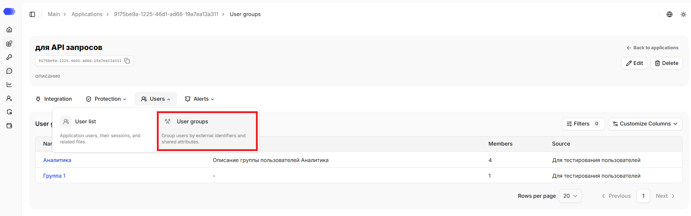
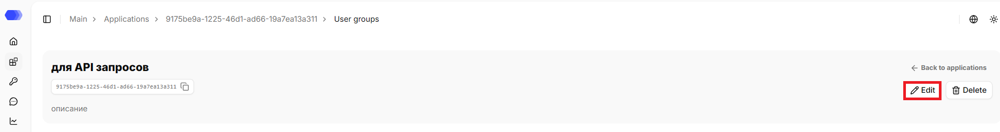
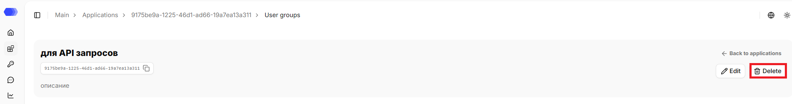
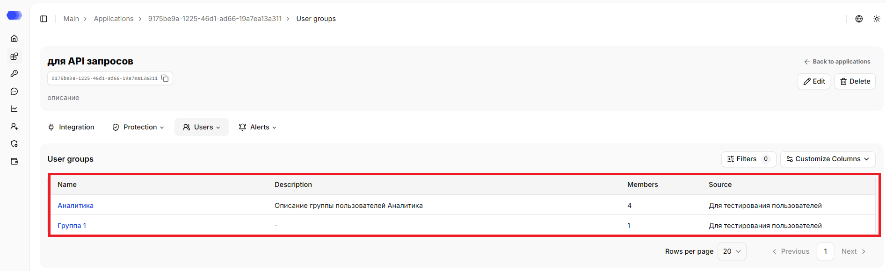
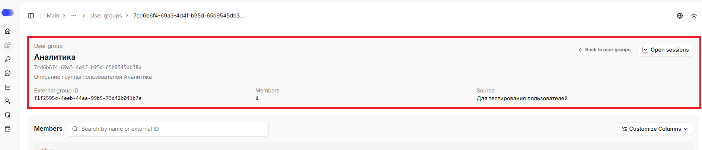
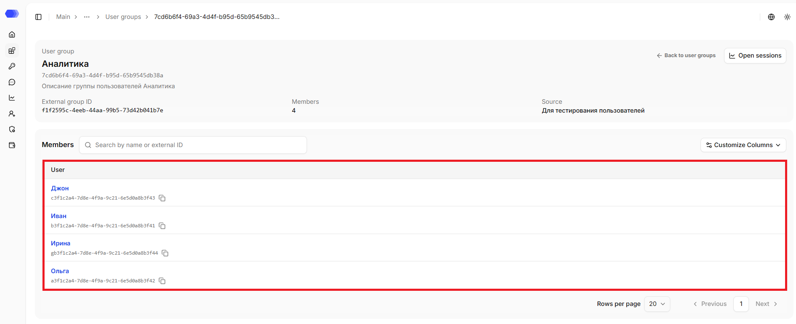

The **User groups** section shows the groups added to the application and helps you navigate to the group members.

## Opening the **User groups** section

1. In the sidebar, select **Applications**.
2. Open the required application by clicking its card or its name, depending on the selected view.
3. Hover over the **Users** tab.
4. Click **User groups**.

The page header displays the application's name, ID, and description (if any). The copy button is available next to the ID. The header also contains the `Back to applications` link that leads to the `Applications` section.

## Editing the application

1. Click `Edit`.
2. Change the required fields.
3. Click `Save`.

## Deleting the application

1. Click `Delete`.
2. Confirm the deletion in the confirmation dialog.

This action cannot be undone. Prior to deletion, please verify that integration traffic has been stopped or redirected and that the associated API tokens are no longer in use.

## User groups table

The table provides the following data:

- **Name** — group name; the blue clickable link leads to the group card;
- **Description** — group description; if no description is set, a dash (`—`) is displayed;
- **Members** — number of users in the group;
- **Source** — source from which the group was added.

Available actions:

1. Click `Filters` to filter groups by name or source; the counter on the button shows the number of active filters. Clicking `Reset` clears the filters and closes the form.
2. Open **Customize Columns** to choose the displayed columns.
3. At the bottom of the table, select the number of rows per page or navigate to another page.
4. Click the blue clickable link to navigate to the group's page.

## User group page

Click the blue clickable link to navigate to the group's page. The page header displays the group's name, ID, and description (if any), external group ID, member count, and source. The header also contains the `Back to user groups` link that leads to the `User groups` section.

There is also the `Open sessions` link, which leads to the session analytics page with filters applied for the current application group.

## Users table

The table provides the following data:

- **User** — the blue clickable link leads to the user's page. It displays the full name of the group user. The external user ID is displayed below the link. The copy button is available next to the ID.

Available actions:

1. Use the search to find records by user full name or external user ID — the search works by partial match.
2. Open **Customize Columns** to choose the displayed columns.
3. At the bottom of the table, select the number of rows per page or navigate to another page.
4. Click the blue clickable link to navigate to the user's page.

## Access to the page

To edit an application in the header, the following permissions are required:

- Area **Applications** — access level of at least `Edit`.

To delete an application in the header, the following permissions are required:

- Area **Applications** — `Full` access level.

To view the user groups page and open a user group, the following permissions are required:

- Area **Applications** — access level of at least `Read`;
- Area **End users** — access level of at least `Read`.

If the user does not have access to view the page, `403 — Access denied` is displayed.
