The **Users** section lists the end users of the selected AI application and provides access to their related sessions and files.

## Opening the **Users** section

1. In the sidebar, select **Applications**.
2. Open the required application by clicking its card or its name, depending on the selected view.
3. Hover over the **Users** tab.
4. Click **User list**.

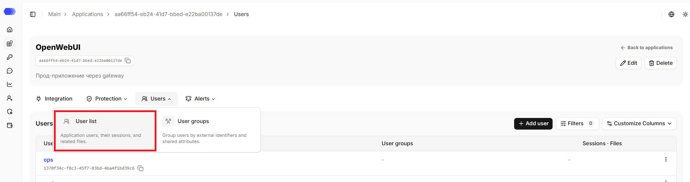

The page header displays the application's name, ID, and description (if any). The copy button is available next to the ID. The header also contains the `Back to applications` link that leads to the `Applications` section.

## Editing the application

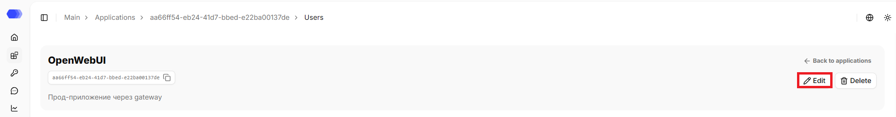

1. Click `Edit`.
2. Change the required fields.
3. Click `Save`.

## Deleting the application

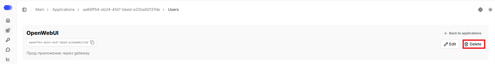

1. Click `Delete`.
2. Confirm the deletion in the confirmation dialog.

This action cannot be undone. Prior to deletion, please verify that integration traffic has been stopped or redirected and that the associated API tokens are no longer in use.

## Users table

The table contains:

- **User** — the blue clickable link leads to the user page. It displays the full name if it was added manually, or the user's external ID otherwise. The user's external ID is displayed below the link. The copy button is available next to the ID.
- **User groups** — group the user has been added to.
- **Sessions** — number of sessions associated with this user. Clicking it navigates to the `Sessions` section.
- **Files** — number of files the user has uploaded. Clicking it navigates to the `Files` section.

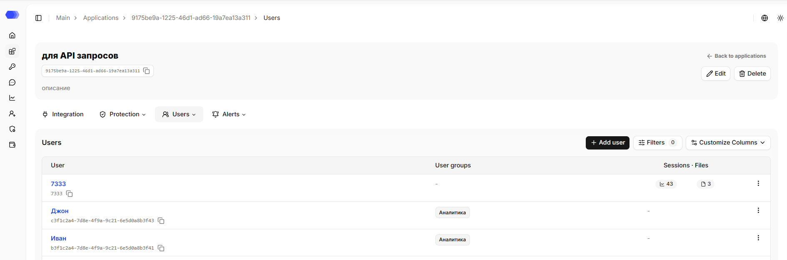

Available actions:

1. Click `Add user` to create a user manually.
2. Click **Filters** to filter users by full name, external ID, or group; the counter on the button shows the number of active filters. Clicking `Reset` clears the filters and closes the form.
3. Open **Customize Columns** to choose the displayed columns.
4. The row **⋮** menu is used to edit or delete a specific user.
5. At the bottom of the table, select the number of rows per page or navigate to another page.
6. Click the blue clickable link to navigate to the user's page.

## Automatic user creation

A user is automatically created if a new external user ID is passed in a HiveTrace request:

- in additional parameters when using the API or SDK;
- in HTTP headers when using a proxy.

An automatically created record may contain only the **Client ID**. Add the full name through the interface if needed.

## User Sessions

Click the blue clickable link to navigate to the user's page. The page header displays the user's name (if available) and the client's external ID, with the `Sessions` and `Files` tabs below. The copy button is available next to the ID. The header also contains the `Back to applications` link that leads to the `Applications` section.

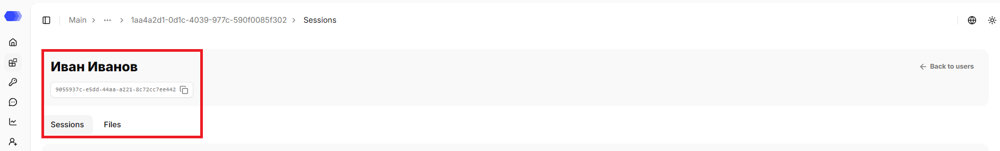

### Search

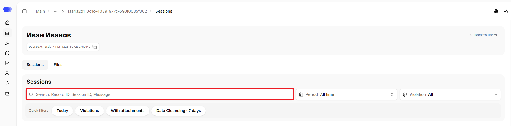

The search finds records by record ID, session ID, or message text. The exact match is required only for the record ID; for the other fields, a partial match is sufficient. The query must contain between 3 and 256 characters.

### Quick filters

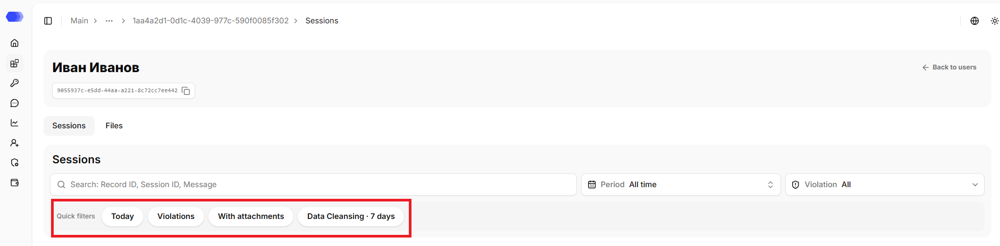

- **Today** — records for the current day;
- **Violations** — records with at least one violation;
- **With attachments** — records containing files;
- **Data cleansing · 7 days** — DataClean violations from the latest seven days.

### Period

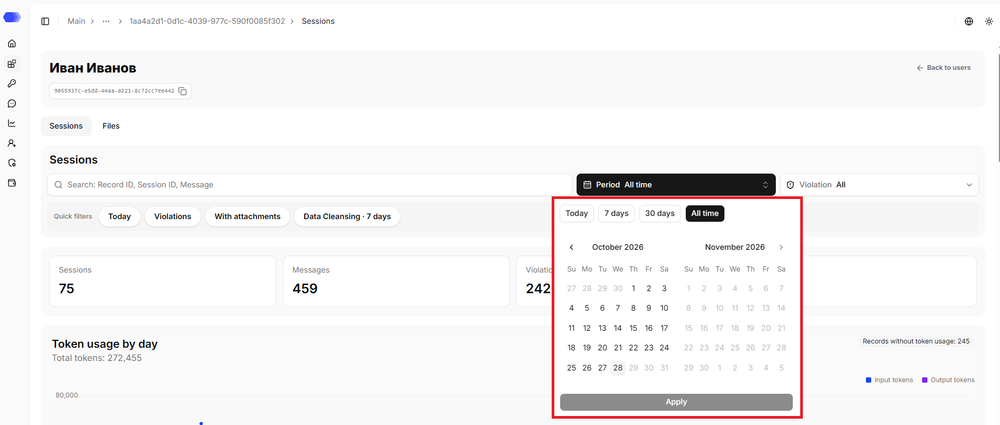

Choose **Today**, **7 days**, **30 days**, **All time**, or a custom calendar range. Month arrows navigate the calendar. Select both boundaries and then **Apply**. Future dates are disabled.

### Violation

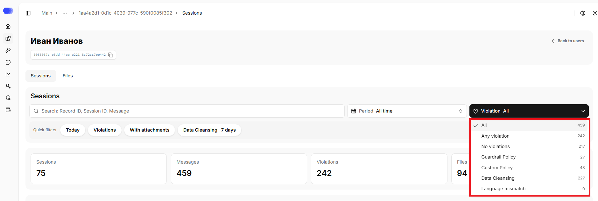

Options are **All**, **Any violation**, **No violations**, **Safety policy** (Guardrail), **Custom policy**, **Data cleansing**, and **Language mismatch**. The number on the right is the matching count for the current selection.

### User session summary

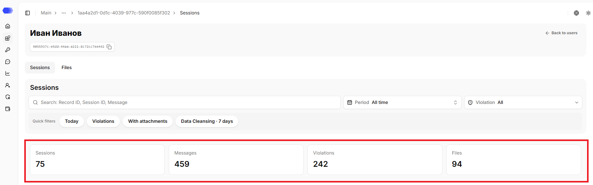

The user activity summary block consists of 4 sections:

`Sessions` — total number of the user's sessions;

`Messages` — total number of the user's messages;

`Violations` — total number of records with violations;

`Files` — total number of uploaded files.

### Token usage by day

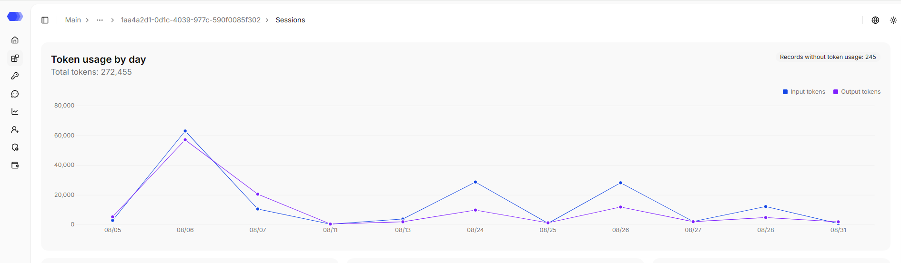

The section shows the dynamics of token usage by day as a chart:

`Total tokens` — total number of tokens used;

`Records without token usage` — total number of records for which token usage has not been recorded.

Dates are displayed on the horizontal axis, and the number of tokens on the vertical axis. The chart displays points; hovering over a point shows the value for a specific day.

> **Note:** chart values are updated when filters are applied.

### Violations

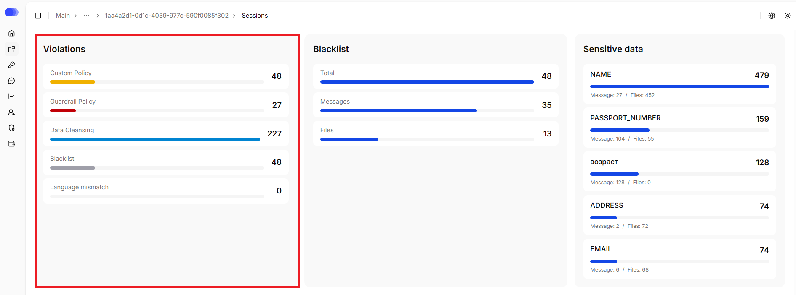

The section shows the number of records by violation type:

`Custom Policy` — custom policy violations;

`Guardrail Policy` — Guardrail violations;

`Data Cleansing` — DataClean violations;

`Blacklist` - blacklist violations for messages and files;;

`Language mismatch` — language mismatch violations.

### Blacklist

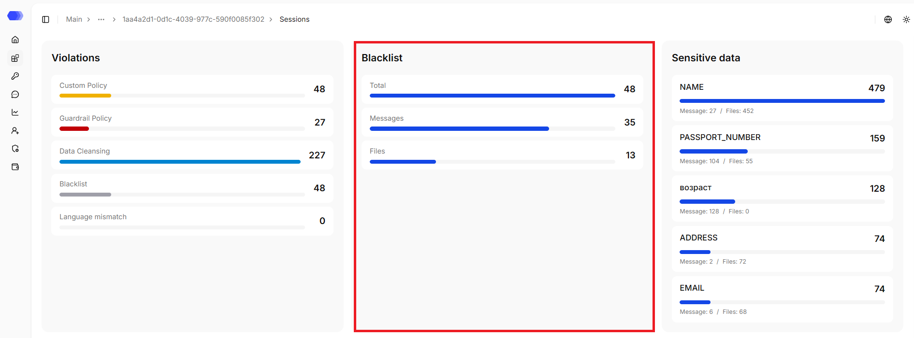

The section shows blacklist violations — for messages and files:

`Total` —  total number of records with blacklist violations;

`Messages` — total number of blacklist violations found in messages;

`Files` — total number of blacklist violations found in files.

### Sensitive data

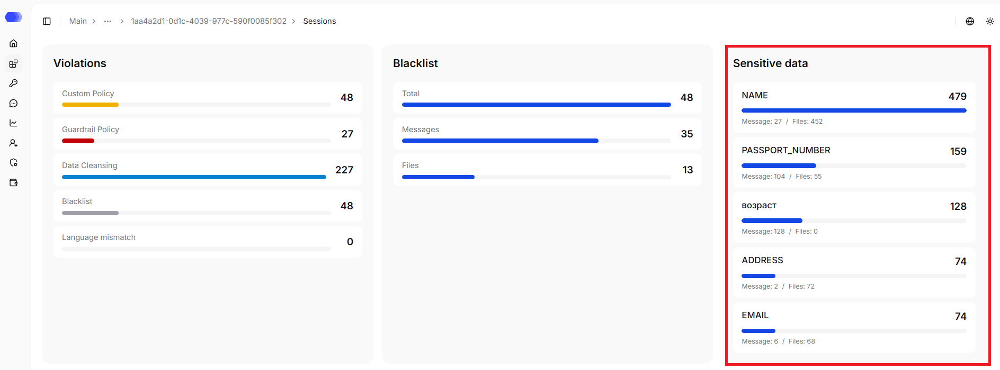

The section shows the 5 most common categories of sensitive data detected for the user and where exactly they were found — in messages or in files.

For each category, the following is displayed:

- name of the base or custom pattern that triggered the DataClean violation;

- total amount of detected data.

### User session table

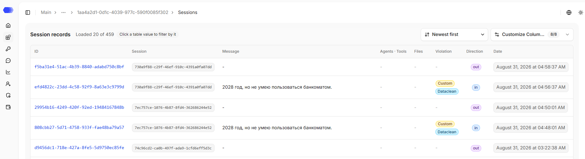

- **ID** — a link that opens the record details;
- **Session** — client session ID;
- **Message** — a shortened request or response; the full text is available in the record details;
- **Agents · Tools** — number of related tool calls, `—` is displayed if none;
- **Files** — number of files attached to the session, `—` is displayed if none;
- **Violation** — violation or `—` is displayed if none;
- **Direction** — `in` for a request and `out` for a response;
- **Date** — local date and time of the event.

Clicking a value in the `Session`, `Violation`, `Direction`, or `Date` cell adds a filter by that value.

Available actions:

1. Click a blue **record ID** to navigate to the session details page.
2. Sort sessions by date — ascending or descending. By default, descending sorting is applied.
3. Open **Customize Columns** to choose the displayed columns.
4. Select **Files** to view the user’s uploaded attachments.

## User files

### User file summary

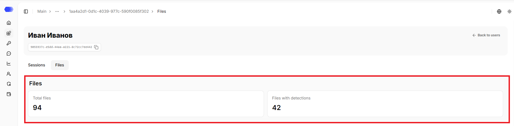

The block consists of 2 sections:

`Total files` — total number of files attached to the user's sessions;

`Files with detections` — total number of files in which violations were found.

### Check status

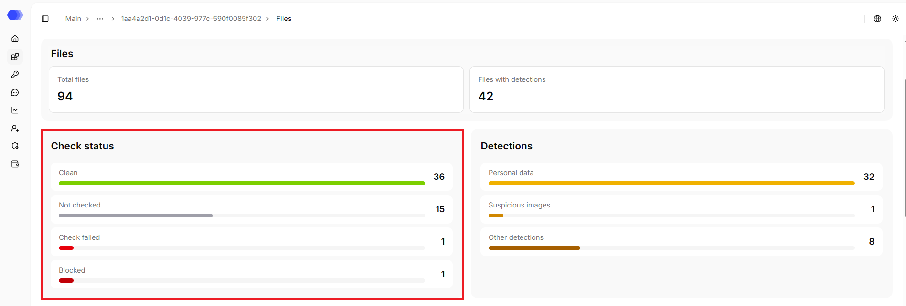

The block shows the distribution of files by verification results:

`Clean` — total number of files whose verification found no violations;

`Not checked` — total number of files that have not yet been verified;

`Check failed` — total number of files for which an error occurred during verification;

`Blocked` — total number of files blocked based on verification results.

### Detections

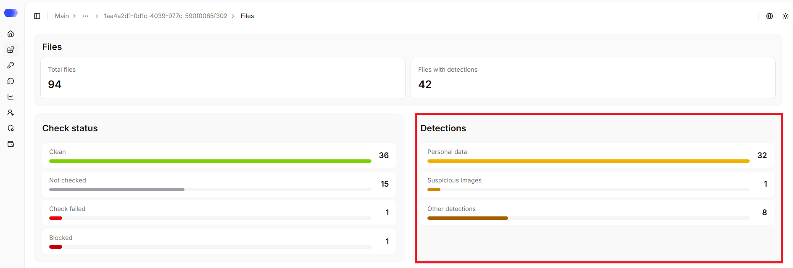

The block shows which types of detections were found in files:

`Personal data` — total number of files containing personal data;

`Suspicious images` — total number of files with images that the system considered suspicious;

`Other detections` — total number of files with detections that did not fall into the listed categories.

### Search by file name

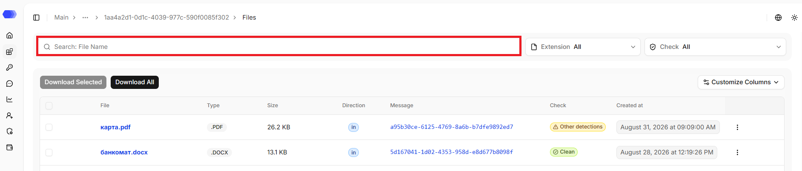

The search finds files by name — a partial match is sufficient.

### Extension

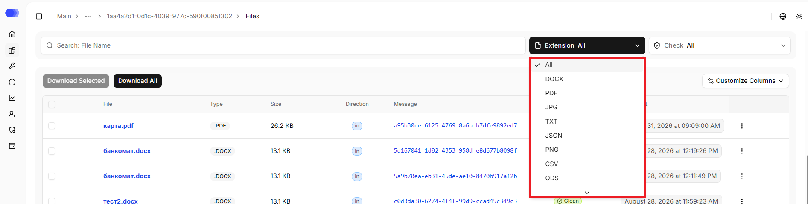

The list shows the available file extensions. **All** removes the extension restriction; selecting an extension updates the table.

### Check

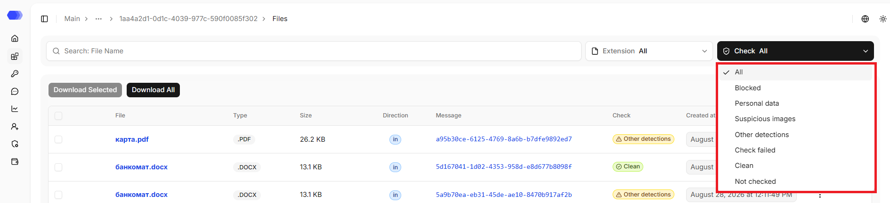

The list shows the available file verification statuses. **All** removes the verification status restriction; selecting a specific item updates the table.

### User file table

The table displays files uploaded to the user's sessions. For supported formats, you can open a preview or download the original file.

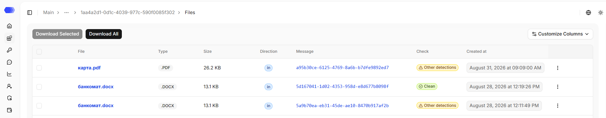

- **File** — file name with its extension; clicking it opens the file preview;
- **Type** — file extension;
- **Size** — file size;
- **Direction** — `in` for the request and `out` for the response;
- **Message** — session ID the file is attached to; clicking it navigates to the session details page;
- **Check** — file verification status;
- **Created at** — date and time of the event.

Available actions:

1. Click `Download selected` to download the files checked in the table. The button is disabled until at least one file is selected.
2. Click `Download all` to download all files.
3. Open **Customize Columns** to choose the displayed columns.
4. Click the **⋮** button in a table row to download the selected file.
5. Click the file name to open the file preview.

> **Important:** file content processing depends on the global **Custom file processing** setting and the selected application configuration. If processing is disabled, a file appearing on this tab does not by itself mean that its contents were checked by policies or Dataclean.

## Access to the page

To edit an application in the header, the following permissions are required:

- Area **Applications** — access level of at least `Edit`.

To delete an application in the header, the following permissions are required:

- Area **Applications** — `Full` access level.

To view application users, as well as their related sessions and files, the following permissions are required:

- Area **Applications** — access level of at least `Read`;
- Area **End users** — access level of at least `Read`;
- Area **Sessions and messages** — access level of at least `Read`.

Additionally, to preview and download files, the following is required:

- Enable the **Download analysis files** granular permission.

If the user does not have access to view the page, `403 — Access denied` is displayed.
