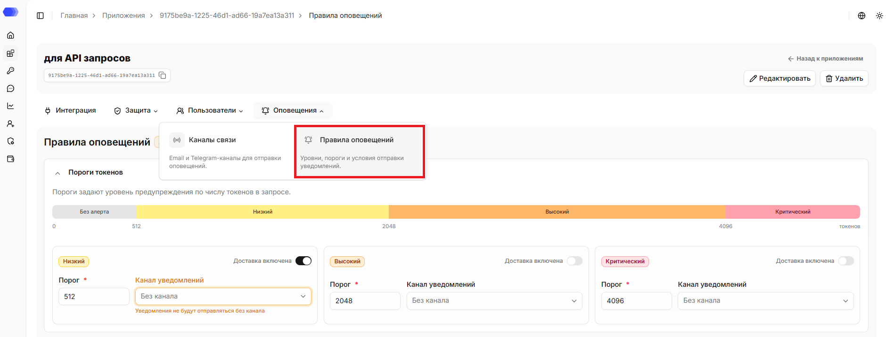
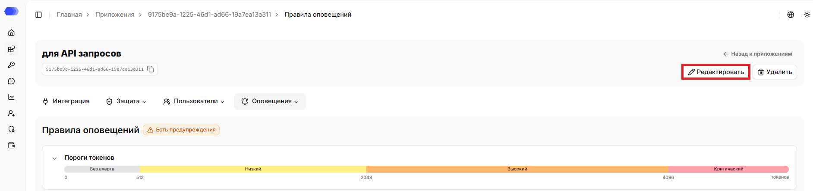
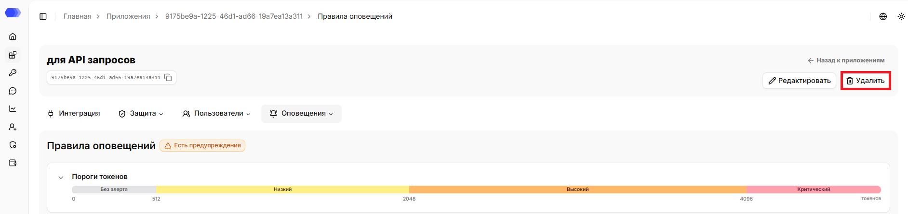
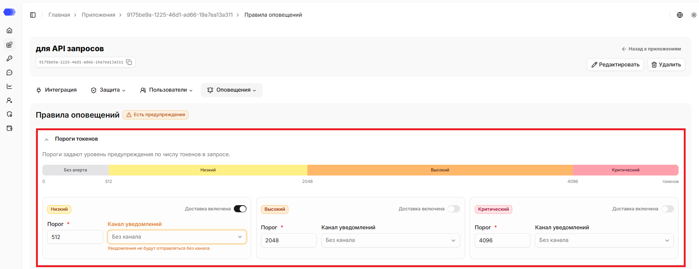
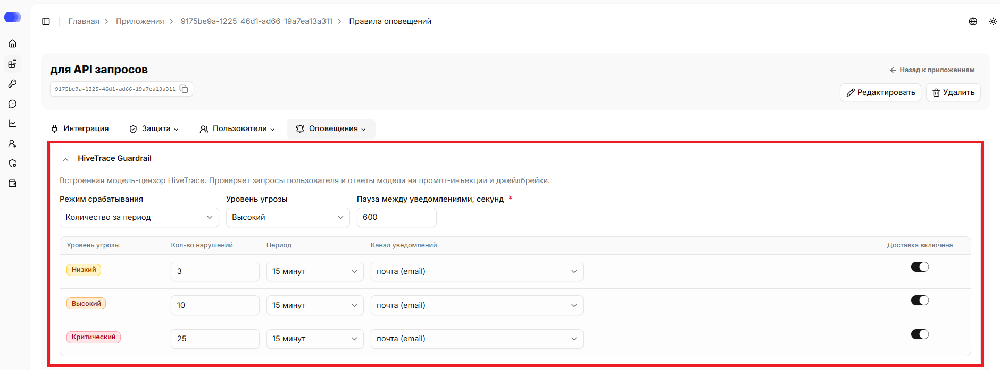
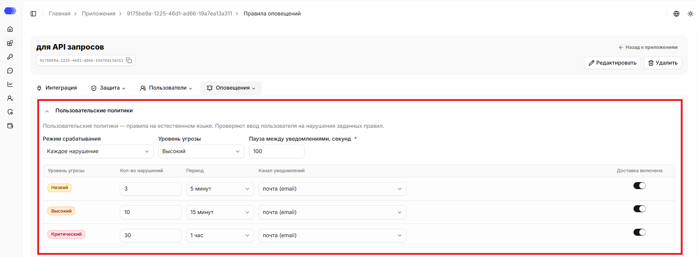
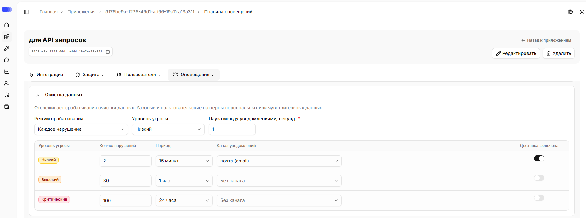
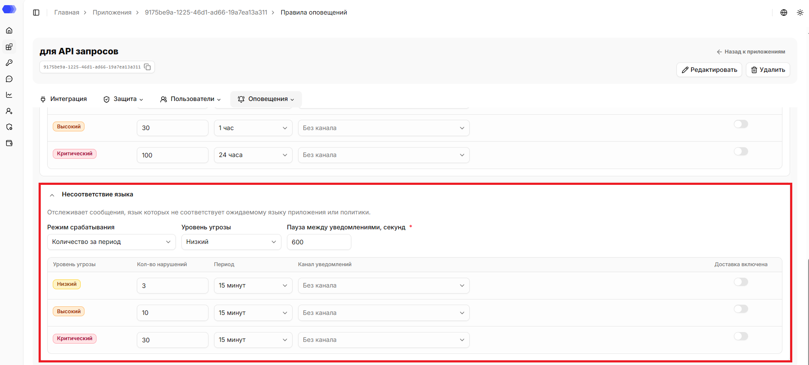

Раздел **«Правила оповещений»** определяет, как, когда и при каких условиях отправляются уведомления о нарушениях. Настройки задаются отдельно по каждому типу нарушений.

## Как открыть раздел **Правила оповещений**

1. В боковом меню выберите **Приложения**.
2. Откройте нужное приложение, нажав на карточку или на название приложения в зависимости от выбранного вида отображения.
3. Наведите на вкладку **Оповещения**.
4. Нажмите на **Правила оповещений**.

В верхней части страницы отображаются название, id, описание (при наличии) приложения. Рядом с ID доступна кнопка копирования. На странице также доступна ссылка `«Назад к приложениям»`, которая ведёт в раздел `«Приложения»`.

## Редактирование приложения

1. Нажмите `«Редактировать»`.
2. Измените нужные поля.
3. Нажмите `«Сохранить»`.

## Удаление приложения

1. Нажмите `«Удалить»`.
2. Подтвердите удаление в окне подтверждения.

Удаление необратимо. Сначала убедитесь, что интеграционный трафик остановлен или перенаправлен и связанные API-токены больше не используются.

## Пороги токенов

В данном блоке настраиваются **пороги токенов**, используемые для контроля размера отдельных запросов и ответов моделей. Пороги позволяют ограничивать и отслеживать потенциально аномальные или ресурсоемкие взаимодействия с моделью на уровне одного обращения. Задаётся уровень предупреждения по числу токенов в запросе: чем больше токенов, тем выше уровень.

Пороги токенов делят диапазон запроса на 4 зоны, каждой из которых соответствует свой уровень критичности:

- **Без алерта** — уведомления не отправляются;
- **Низкий** — предупреждающий уровень, сигнализирующий о приближении к лимиту;
- **Высокий** — указывает на существенное превышение ожидаемого размера сообщения;
- **Критический** — критический порог, требующий немедленного внимания и, при необходимости, блокирующих действий.

Если значения порогов некорректны (например, пересекаются или идут не по порядку), в заголовке блока отображается метка `«Есть ошибки в полях»`, а вместо шкалы отображается сообщение `«Исправьте значения порогов»`. Границы поля с некорректным значением подсвечиваются красным, а под ним выводится подсказка с причиной ошибки.

Таким образом, пороги позволяют задать несколько уровней критичности и получать предупреждения нарастающей важности — от раннего сигнала о приближении к лимиту до критического порога, требующего немедленной реакции.

Для каждого уровня доступны следующие настройки:

- **Доставка включена** — переключатель, включающий отправку уведомлений этого уровня;
- **Порог** — числовое значение в токенах, при котором срабатывает уровень (обязательное поле);
- **Канал уведомлений** — канал, по которому доставляется уведомление. По умолчанию — `«Без канала»`.

> **Примечание:** если для уровня выбран вариант «Без канала» — уведомление всё равно создаётся, но не отправляется пользователю. Чтобы получать уведомления, выберите канал для соответствующего уровня. Если канал не выбран, то отображается индикатор предупреждения.

## HiveTrace Guardrail

В данном блоке настраиваются уведомления о нарушениях политики безопасности:

- **Режим срабатывания** — `Каждое нарушение` или `Количество за период`;
- **Уровень угрозы** — `Низкий`, `Высокий` или `Критический`;
- **Пауза между уведомлениями** — интервал в секундах, в течение которого повторные уведомления не отправляются.

Для каждого уровня угрозы доступны следующие настройки:

- **Количество нарушений** — количество нарушений для отправки уведомлений;
- **Период** — интервал, за который считается количество нарушений;
- **Канал уведомлений** — канал, по которому доставляется уведомление. По умолчанию — `«Без канала»`;
- **Доставка включена** — переключатель, включающий отправку уведомлений этого уровня.

> **Примечание:** если для уровня выбран вариант «Без канала» — уведомление всё равно создаётся, но не отправляется пользователю. Чтобы получать уведомления, выберите канал для соответствующего уровня. Если канал не выбран, то отображается индикатор предупреждения. 

## Пользовательские политики

В данном блоке настраиваются уведомления о нарушениях пользовательских политик:

- **Режим срабатывания** — `Каждое нарушение` или `Количество за период`;
- **Уровень угрозы** — `Низкий`, `Высокий` или `Критический`;
- **Пауза между уведомлениями** — интервал в секундах, в течение которого повторные уведомления не отправляются.

Для каждого уровня угрозы доступны следующие настройки:

- **Количество нарушений** — количество нарушений для отправки уведомлений;
- **Период** — интервал, за который считается количество нарушений;
- **Канал уведомлений** — канал, по которому доставляется уведомление. По умолчанию — `«Без канала»`;
- **Доставка включена** — переключатель, включающий отправку уведомлений этого уровня.

> **Примечание:** если для уровня выбран вариант «Без канала» — уведомление всё равно создаётся, но не отправляется пользователю. Чтобы получать уведомления, выберите канал для соответствующего уровня. Если канал не выбран, то отображается индикатор предупреждения. 

## Очистка данных

В данном блоке настраиваются уведомления о нарушениях DataClean:

- **Режим срабатывания** — `Каждое нарушение` или `Количество за период`;
- **Уровень угрозы** — `Низкий`, `Высокий` или `Критический`;
- **Пауза между уведомлениями** — интервал в секундах, в течение которого повторные уведомления не отправляются.

Для каждого уровня угрозы доступны следующие настройки:

- **Количество нарушений** — количество нарушений для отправки уведомлений;
- **Период** — интервал, за который считается количество нарушений;
- **Канал уведомлений** — канал, по которому доставляется уведомление. По умолчанию — `«Без канала»`;
- **Доставка включена** — переключатель, включающий отправку уведомлений этого уровня.

> **Примечание:** если для уровня выбран вариант «Без канала» — уведомление всё равно создаётся, но не отправляется пользователю. Чтобы получать уведомления, выберите канал для соответствующего уровня. Если канал не выбран, то отображается индикатор предупреждения. 

## Несоответствие языка

В данном блоке настраиваются уведомления о нарушениях по проверке языка:

- **Режим срабатывания** — `Каждое нарушение` или `Количество за период`;
- **Уровень угрозы** — `Низкий`, `Высокий` или `Критический`;
- **Пауза между уведомлениями** — интервал в секундах, в течение которого повторные уведомления не отправляются.

Для каждого уровня угрозы доступны следующие настройки:

- **Количество нарушений** — количество нарушений для отправки уведомлений;
- **Период** — интервал, за который считается количество нарушений;
- **Канал уведомлений** — канал, по которому доставляется уведомление. По умолчанию — `«Без канала»`;
- **Доставка включена** — переключатель, включающий отправку уведомлений этого уровня.

> **Примечание:** если для уровня выбран вариант «Без канала» — уведомление всё равно создаётся, но не отправляется пользователю. Чтобы получать уведомления, выберите канал для соответствующего уровня. Если канал не выбран, то отображается индикатор предупреждения.

По умолчанию все блоки раскрыты. Если блок свернуть, в его заголовке отображается краткая сводка:

- **Пороги токенов** — зоны `«Без алерта»`, `«Низкий»`, `«Высокий»` и `«Критический»` с границами в токенах. Если значения порогов некорректны (например, пересекаются или идут не по порядку), вместо шкалы в свёрнутом виде отображается сообщение `«Исправьте значения порогов».`
- Для остальных разделов - режим срабатывания, уровень угрозы и пауза между уведомлениями (в секундах).

## Панель сохранения изменений

При изменениях на странице появляется панель с кнопками действий:

- **«Отмена»** — отменяет внесённые изменения и возвращает страницу к предыдущему сохранённому состоянию;
- **«Сохранить»** — сохраняет изменения.

## Доступ к странице

Для редактирования приложения из шапки нужны права:

- Область **Приложения** — уровень доступа не ниже `«Редактирование»`.

Для удаления приложения из шапки нужны права:

- Область **Приложения** — `Полный` уровень доступа.

Для просмотра страницы правил оповещений нужны права:

- Область **Приложения** — уровень доступа не ниже `«Чтение»`;
- Область **Политики приложения** — уровень доступа не ниже `«Чтение»`.

Для настройки уведомлений о нарушениях и использовании токенов нужны права:

- Область **Приложения** — уровень доступа не ниже `«Чтение»`;
- Область **Политики приложения** — уровень доступа не ниже `«Редактирование»`.

Если у пользователя нет доступа для просмотра страницы, отображается страница `403 - Нет доступа`.
