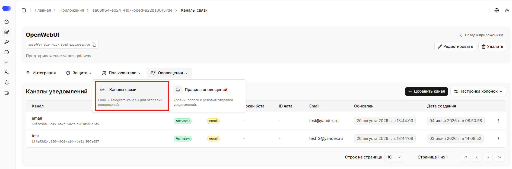
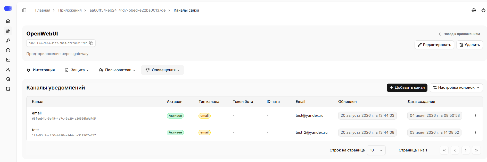
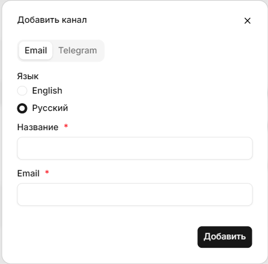
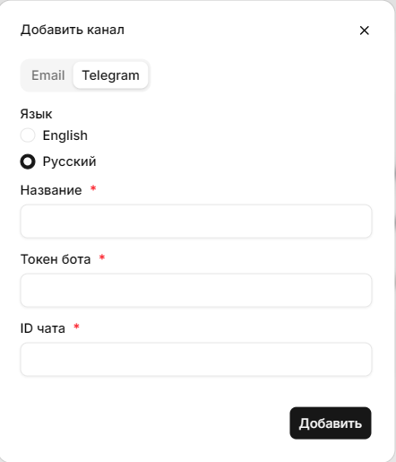

В разделе **«Каналы связи»** вы можете просматривать существующие каналы уведомлений и добавлять новые. В настоящее время поддерживаются два способа доставки оповещений: **Email** и **Telegram**.

## Как открыть раздел **Каналы связи**

1. В боковом меню выберите **Приложения**.
2. Откройте нужное приложение, нажав на карточку или на название приложения в зависимости от выбранного вида отображения.
3. Наведите на вкладку **Оповещения**.
4. Нажмите на **Каналы связи**.

В верхней части страницы отображаются название, id, описание (при наличии) приложения. Рядом с ID доступна кнопка копирования. На странице также доступна ссылка `«Назад к приложениям»`, которая ведёт в раздел `«Приложения»`.

Все настроенные уведомления также отображаются в разделе **«Оповещения»**, обеспечивая централизованный доступ к информации о событиях и инцидентах.

## Таблица с конфигурациями оповещений

Конфигурация оповещений определяет, куда HiveTrace отправляет уведомления выбранного приложения и на каком языке формируется сообщение.

На странице отображается таблица созданных каналов:

- **Канал** — название канала, уникальный идентификатор конфигурации.
- **Активен** — текущее состояние конфигурации.
- **Тип канала** — Email или Telegram.
- **Токен бота** и **ID чата** — параметры Telegram; для Email в этих колонках отображается дефис (`—`).
- **Email** — адрес получателя для конфигурации Email; для Telegram в этой колонке отображается дефис (`—`).
- **Обновлен** — дата последнего изменения.
- **Дата создания** — дата создания конфигурации.
- Кнопка **Настройка колонок** позволяет выбрать видимые столбцы таблицы.
- Меню **⋮** в строке открывает действия, доступные для этой конфигурации в текущей версии и для вашей роли.
- Внизу таблицы можно изменить число строк на странице и перейти между страницами.

### Создание Email-конфигурации

1. Нажмите **Добавить канал**.
2. Выберите вкладку **Email**.
3. Выберите язык уведомлений: **English** или **Русский**.
4. В поле **Название** укажите имя, по которому канал будет легко найти в таблице.
5. В поле **Email** укажите адрес получателя.
6. Нажмите **Добавить**.

Поля, отмеченные звездочкой, обязательны. После добавления конфигурация появляется в таблице; проверьте ее статус и адрес получателя.

### Создание Telegram-конфигурации

1. Нажмите **Добавить канал**.
2. Выберите вкладку **Telegram**.
3. Выберите язык уведомлений.
4. Заполните **Название**.
5. Укажите **Токен бота**, полученный для Telegram-бота.
6. Укажите **ID чата**, в который должны приходить уведомления.
7. Нажмите **Добавить**.

Корректно настроенные оповещения помогают оперативно реагировать на инциденты, контролировать состояние AI-приложений и поддерживать требуемый уровень безопасности. Не публикуйте токен Telegram-бота и не передавайте его в открытых каналах. Если токен был раскрыт, перевыпустите его и обновите конфигурацию.

> **Важно:** интеграция с SIEM-системой настраивается на этапе развертывания платформы вашим DevOps-инженером или специалистом HiveTrace. Поддерживаемый формат передачи логов — **Syslog**.

## Доступ к странице

Для редактирования приложения из шапки нужны права:

- Область **Приложения** — уровень доступа не ниже `«Редактирование»`.

Для удаления приложения из шапки нужны права:

- Область **Приложения** — `Полный` уровень доступа.

Для просмотра страницы каналов уведомлений нужны права:

- Область **Приложения** — уровень доступа не ниже `«Чтение»`;
- Область **Политики приложения** — уровень доступа не ниже `«Чтение»`.

Для добавления нового канала или редактирования существующего нужны права:

- Область **Приложения** — уровень доступа не ниже `«Чтение»`;
- Область **Политики приложения** — уровень доступа не ниже `«Редактирование»`.

Для удаления канала нужны права:

- Область **Приложения** — уровень доступа не ниже `«Чтение»`;
- Область **Политики приложения** — уровень доступа не ниже `«Полный»`.

Если у пользователя нет доступа для просмотра страницы, отображается страница `403 - Нет доступа`.
