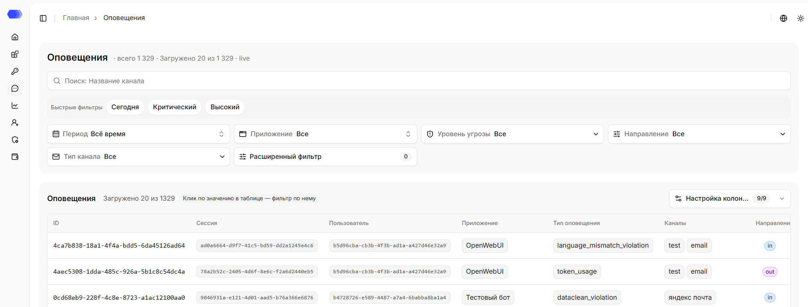
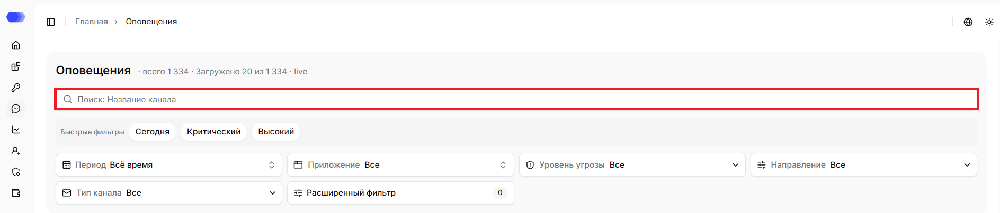
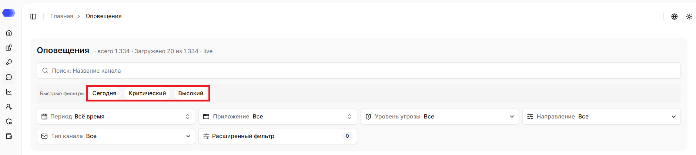
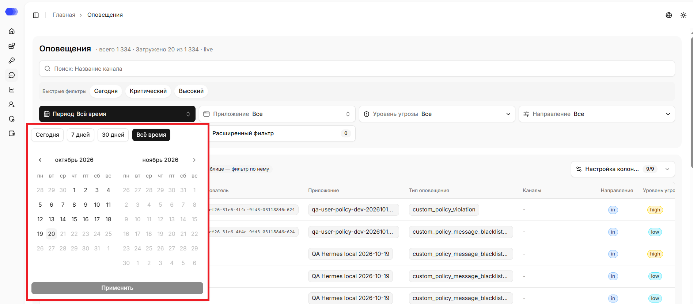
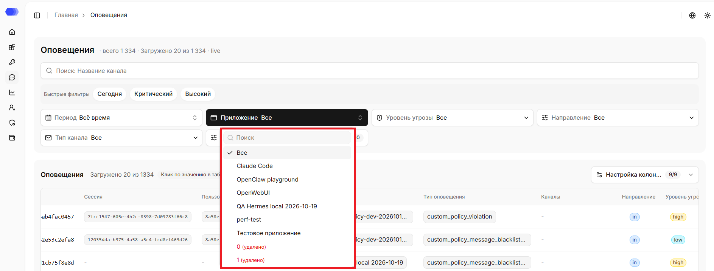
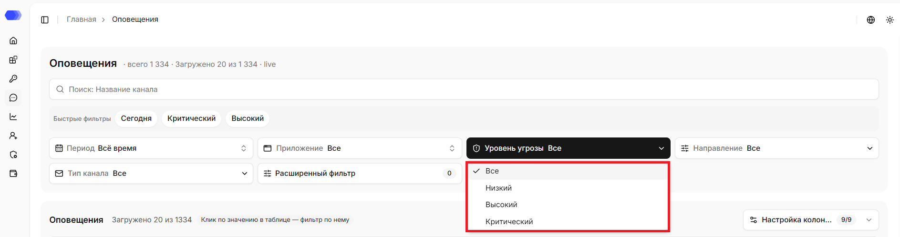
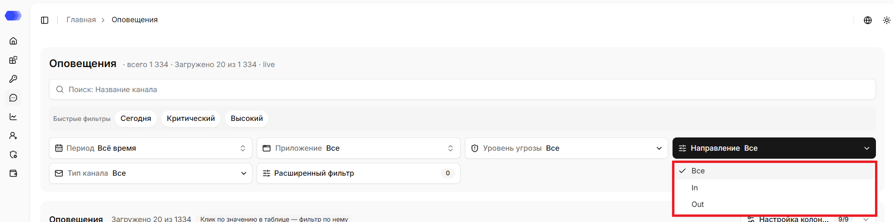
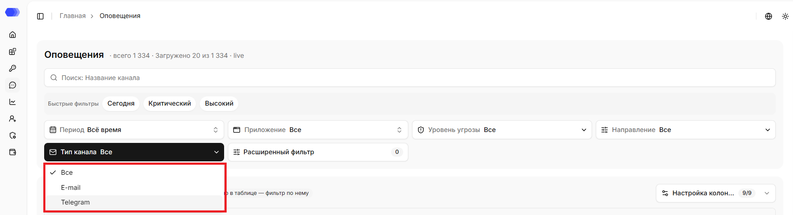
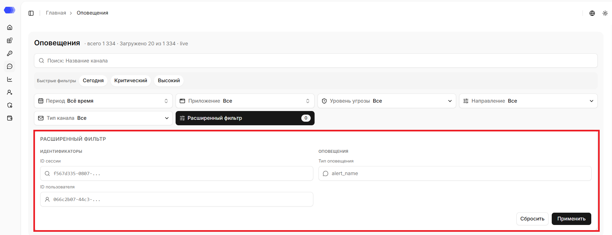

Раздел **«Оповещения»** содержит полный список всех событий и уведомлений, формируемых системой HiveTrace. Оповещения могут дублироваться во внешние каналы доставки — **электронную почту**, **Telegram**, а также передаваться в **SIEM-систему** при наличии соответствующей интеграции.

Основным элементом страницы является таблица с информацией об оповещениях.

## Столбцы таблицы

| Поле           | Описание                                                                     |
| -------------- | ---------------------------------------------------------------------------- |
| ID             | Уникальный идентификатор оповещения   
| Сессия         | Уникальный идентификатор сессии
| Пользователь   | Уникальный идентификатор  пользователя  
| Приложение     | Приложение, зарегистрировавшее событие                                    
| Тип оповещения | Категория события или инцидента |                                   
| Каналы         | Названия конфигураций, через которые отправлялось уведомление |
| Направление    | Направление события — **in** (входящее сообщение) или **out** (ответ модели) |
| Уровень угрозы | Уровень критичности оповещения: **Low**, **High**, **Critical**   
| Дата и время   | Время формирования оповещения       |

> **Примечание:** если для приложения не настроен ни один канал оповещений, поле **«Каналы»** будет пустым. При этом оповещение сохраняется в системе и остаётся доступным для просмотра на данной странице.

Типы `language_mismatch_violation`, `token_usage` и `dataclean_violation` на снимке являются примерами. Фактическое значение соответствует проверке или порогу, создавшему оповещение.

Горизонтальная прокрутка открывает столбцы, которые не помещаются одновременно.

## Поиск по названию канала

Поиск находит записи по точному названию канала.

## Быстрые фильтры

- **Сегодня** — только записи за текущий день;
- **Критический** — только записи с уровнем угрозы `«Критический»`;
- **Высокий** — только записи с уровнем угрозы `«Высокий»`.

Нажатие применяет заранее подготовленный набор условий.

## Период

Доступны пресеты **«Сегодня»**, **«7 дней»**, **«30 дней»** и **«Всё время»**, а также произвольный диапазон в календаре. Стрелки переключают месяцы. После выбора начала и конца нажмите **«Применить»**. Недоступные будущие даты отображаются приглушёнными.

## Приложение

Список показывает доступные приложения, в том числе и удалённые. Поле поиска сокращает список. Значение **«Все»** снимает ограничение по приложению; выбор конкретного пункта обновляет таблицу.

## Уровень угрозы

Оповещения можно фильтровать по уровню угрозы: `«Низкий»`, `«Высокий»`, `«Критический»`. Значение `«Все»` снимает ограничение по приложению; выбор конкретного пункта обновляет таблицу.

## Направление

Оповещения можно фильтровать по входящему (`in`) или исходящему (`out`) направлению. Значение `«Все»` снимает ограничение по приложению; выбор конкретного пункта обновляет таблицу.

## Тип канала

Оповещения можно фильтровать по типу канала: `«E-mail»` или `«Telegram»`. Значение `«Все»` снимает ограничение по приложению; выбор конкретного пункта обновляет таблицу.

## Расширенный фильтр

- **ID сессии** — точный идентификатор сессии;
- **ID пользователя** — точный идентификатор пользователя;
- **Тип оповещения** — имя события.

Счётчик на кнопке показывает число активных расширенных условий. `«Применить»` обновляет выдачу, `«Сбросить»` очищает поля этого блока.

## Фильтрация при клике по значению в таблице

Клик по значению в столбцах `Сессия`, `Пользователь`, `Приложение`, `Тип оповещения`, `Каналы`, `Направление`, `Уровень угрозы`, `Дата и время` фильтрует записи по этому значению.

Применение фильтров обновляет параметры URL страницы. Сброс очищает все условия. Заполненные поля комбинируются, поэтому слишком строгая комбинация может вернуть пустую таблицу.

## Настройка таблицы

**«Настройка колонок»** скрывает и возвращает столбцы, не удаляя данные. Пагинация внизу страницы позволяет выбрать число строк и перейти к предыдущей или следующей странице результатов.

Раздел **«Оповещения»** обеспечивает централизованную видимость событий безопасности, упрощает расследование инцидентов и помогает своевременно реагировать на потенциальные угрозы.
