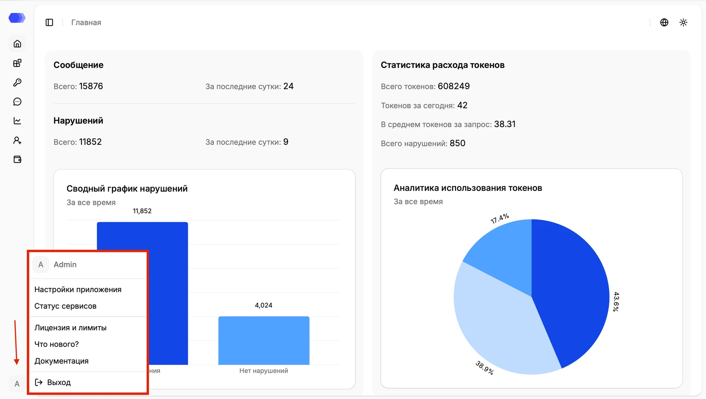
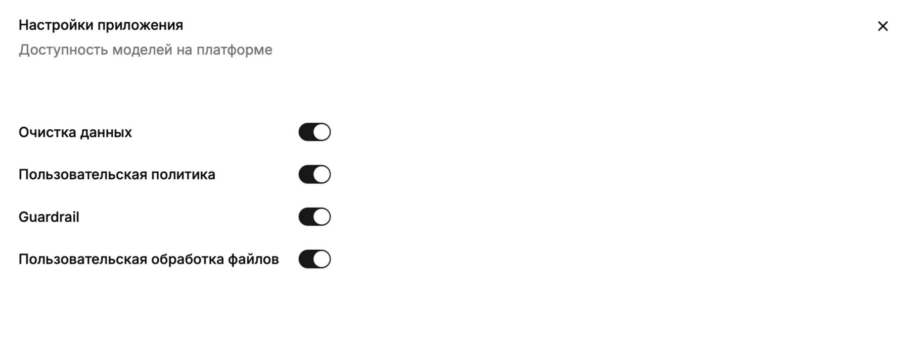

Раздел **Настройки приложения** содержит общие параметры экземпляра HiveTrace. Чтобы открыть его, нажмите значок профиля в левом нижнем углу и выберите **Настройки приложения**.

## Необходимые права

| Действие | Область | Мин. доступ |
|---|---|---|
| Просмотр страницы | **Платформа** | Чтение |
| Редактирование настроек приложения | **Платформа** | Редактирование |

Если у пользователя нет доступа для просмотра страницы, отображается страница `403 - Нет доступа`.

## Основные настройки

На странице можно проверить и изменить параметры, доступные пользователю платформы.

Переключатели в этом разделе имеют приоритет над настройками приложения. Если проверка отключена на уровне платформы, она не будет выполняться ни в одном приложении — даже если в настройках приложения соответствующий переключатель включён. При этом глобальные переключатели не изменяют сохранённые настройки приложений.

Перед сохранением убедитесь, что изменения соответствуют настройкам развертывания и политикам вашей организации.
