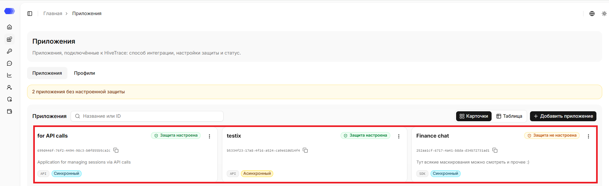
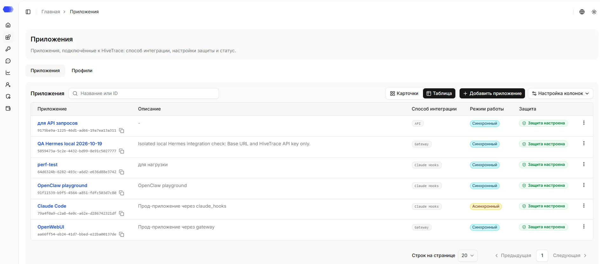
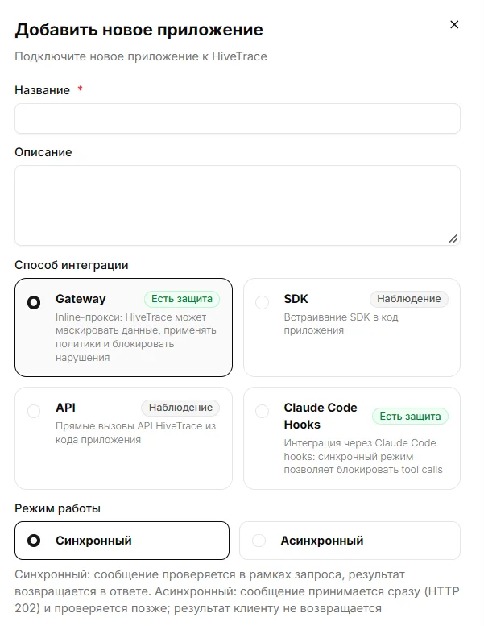
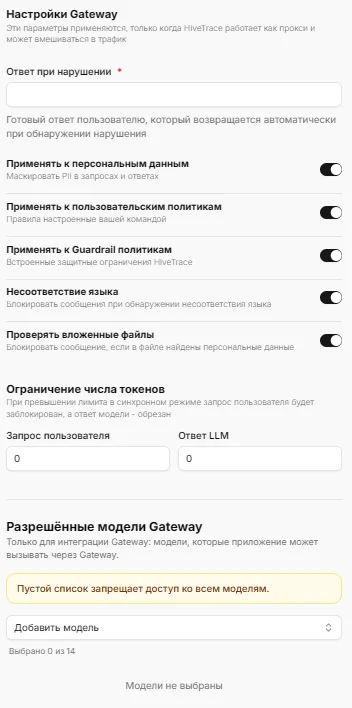
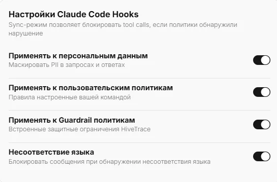

Раздел **«Приложения»** содержит AI-приложения, подключённые к HiveTrace. Для каждого приложения задаются способ интеграции, режим работы, проверки безопасности и ограничения трафика.

В верхней части страницы отображается баннер с общим количеством приложений без настроенной защиты. Баннер не отображается, если такие приложения отсутствуют. 

## Поиск приложений

Поиск работает по ID, названию и описанию приложения и не учитывает регистр.

## Таблица приложений

Откройте пункт **«Приложения»** в основном меню. Над таблицей находится кнопка **«Добавить приложение»**, а под таблицей — пагинация.

По умолчанию приложения отображаются в виде `карточек` — каждое приложение представлено отдельной карточкой с основной информацией.

Вы также можете переключить отображение на `табличный` вид, в котором данные представлены в виде строк и столбцов.

Независимо от выбранного вида отображения, для каждого приложения отображаются следующие данные:

- **ID** — уникальный идентификатор приложения. Значок копирования рядом с ID переносит его значение в буфер обмена. 
- **Название** — имя приложения; полный длинный текст показывается при наведении.
- **Описание** — назначение приложения; отображается опционально (при наличии).
- **Способ интеграции** — `Gateway`, `SDK`, `API` или `Claude Hooks`.
- **Режим работы** — синхронный или асинхронный.
- **Защита** — статус защиты приложения.
- **Меню действий** — редактирование и удаление приложения.

Способ открытия приложения зависит от выбранного вида отображения:

**Карточный вид** — нажмите на карточку приложения.

**Табличный вид** — нажмите на название приложения в соответствующей строке таблицы.

Пагинация изменяет только отображаемую часть списка.

Кнопка **«Настройка колонок»** скрывает или возвращает выбранные столбцы. Список **«Строк на странице»** задаёт размер страницы, а кнопки **«Предыдущая»** и **«Следующая»** переключают страницы. Три точки в конце строки открывают меню редактирования и удаления.

## Создание приложения

Нажмите **«Добавить приложение»** и заполните форму.

Поля формы:

- **Название** — обязательное отображаемое имя, не более 256 символов;
- **Описание** — необязательный текст, не более 1500 символов;
- **Способ интеграции** — обязательный выбор Gateway, SDK, API или Claude Code Hooks;
- **Режим работы** — обязательный выбор Синхронный или Асинхронный.

Выбор интеграции сразу меняет нижнюю часть формы. Настройки Gateway и Claude Code Hooks сохраняются при переключении вариантов до закрытия окна. Нажмите **«Добавить»**. При ошибке форма останется открытой и покажет сообщение рядом с полем.

Варианты **Gateway** и **Claude Code Hooks** помечены как **«Есть защита»**: в синхронном режиме HiveTrace может вмешиваться в обработку. **SDK** и **API** помечены как **«Наблюдение»** и только передают данные для регистрации и анализа.

### Gateway

Gateway пропускает запросы к модели через HiveTrace и может остановить небезопасный запрос до его выполнения.

Для Gateway доступны:

- **Синхронный режим** — проверки выполняются до передачи запроса; при выборе появляются остальные параметры Gateway;
- **Асинхронный режим** — анализ не блокирует основной запрос, а зависимые поля скрываются;
- **Ответ при нарушении** — обязательная фраза вместо заблокированного результата;
- переключатели **DataClean**, **Пользовательские политики**, **Guardrail**, **Несоответствие языка**, **Проверка вложенных файлов**;
- лимиты токенов для запроса пользователя и ответа LLM;
- **Разрешённые модели** — по умолчанию список моделей пустой. Пустой список запрещает доступ ко всем моделям. Чтобы добавить модель, нажмите `«Добавить модель»` — откроется список доступных моделей. В нём можно выбрать модель кликом из списка или воспользоваться поиском — ввести название вручную, чтобы быстро найти нужную модель.

Ответ при нарушении обязателен только для синхронного Gateway. Значение должно содержать хотя бы один непробельный символ.

Положение переключателя справа показывает, будет ли выполняться соответствующая проверка. Значение `0` в полях ограничения токенов означает отсутствие заданного положительного порога; при использовании ограничения укажите значение больше нуля.

### SDK и API

Эти варианты предназначены для наблюдаемости через клиентскую библиотеку или вызовы API. Дополнительных полей в форме для них нет. Настройки задаются в карточке приложения и могут быть переопределены через Override API.

### Claude Code Hooks

Этот способ позволяет проверять действия Claude Code, включая вызовы инструментов. В синхронном режиме отображаются переключатели DataClean, пользовательских политик, Guardrail, проверки языки. Ответ при нарушении и лимиты токенов для Claude Code Hooks не показываются.

Кнопка **«Добавить»** сохраняет приложение со всеми выбранными параметрами. Крестик в правом верхнем углу закрывает форму без создания приложения.

## Редактирование приложения

1. Откройте меню действий в строке приложения.
2. Нажмите `«Редактировать»`
3. Измените поля.
4. Нажмите `«Сохранить»`.

## Удаление приложения

1. Откройте меню действий и нажмите `«Удалить»`.
2. Подтвердите удаление в окне подтверждения.

Удаление необратимо. Сначала убедитесь, что интеграционный трафик остановлен или перенаправлен и связанные API-токены больше не используются.

## Карточка приложения

Откройте приложение, нажав на карточку или на название приложения в зависимости от выбранного вида отображения. В карточке отображаются название, id, описание (при наличии) и доступные разделы:

- **Интеграция** — способ интеграции, режим работы приложения;
- **Защита**:  

  `Цензурирующие политики` - Guardrail, пользовательские политики;

  `Чёрные списки` - чёрные списки сообщений и файлов;

  `Проверка языка` - список разрешённых языков, порог допустимых посторонних букв;

  `Очистка данных` - встроенные и пользовательские паттерны, белые списки, способы и глубина обработки;

- **Пользователи**:  

  `Список пользователей` - пользователи, взаимодействовавшие с приложением;

  `Группы пользователей` - список групп, добавленных в приложение;

- **Оповещения**:  

  `Каналы связи` - каналы доставки уведомлений;

  `Правила оповещений` - настройки, которые задают отправку уведомлений.

## Обработка файлов

Для приложения можно настроить проверку файлов из запросов и ответов. HiveTrace извлекает текст из поддерживаемых документов и применяет DataClean и чёрные списки.

Доступны отдельные настройки для входящих и исходящих файлов, ограничения размера и количества изображений, а также режим обнаружения без изменения исходного файла. Фактическая обработка зависит от доступности сервиса `file-extractor`.

## Рекомендации

- Используйте отдельное приложение для каждого независимого продукта или окружения.
- Не переиспользуйте API-токены между приложениями.
- После изменения политик проверяйте конфигурацию встроенными инструментами тестирования.
- Для расследования учитывайте конфигурацию, сохранённую в конкретной сессии: она не меняется задним числом при редактировании приложения.
