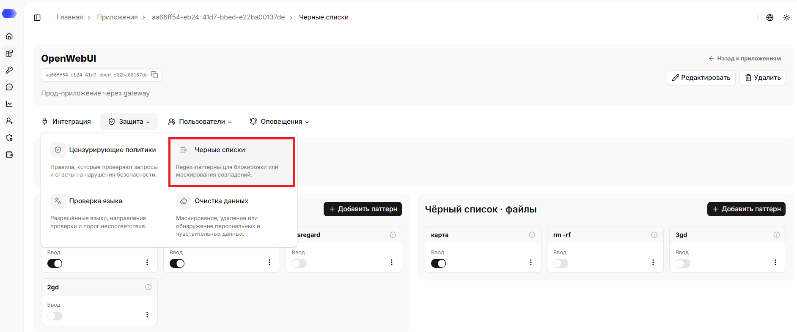
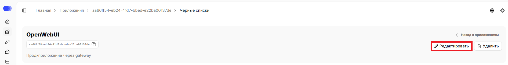
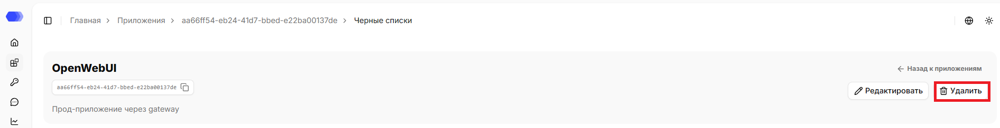
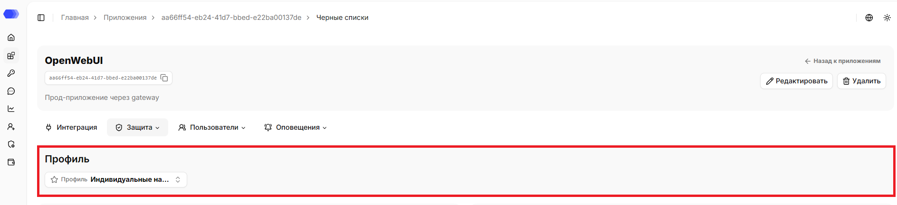
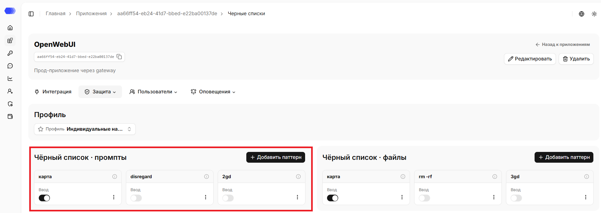
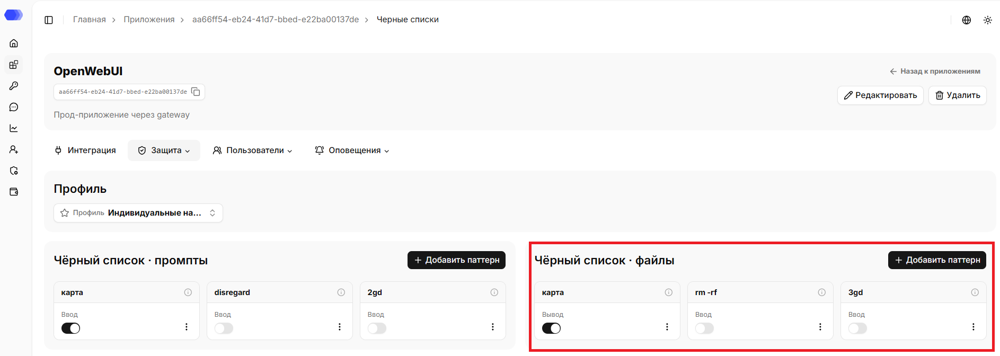
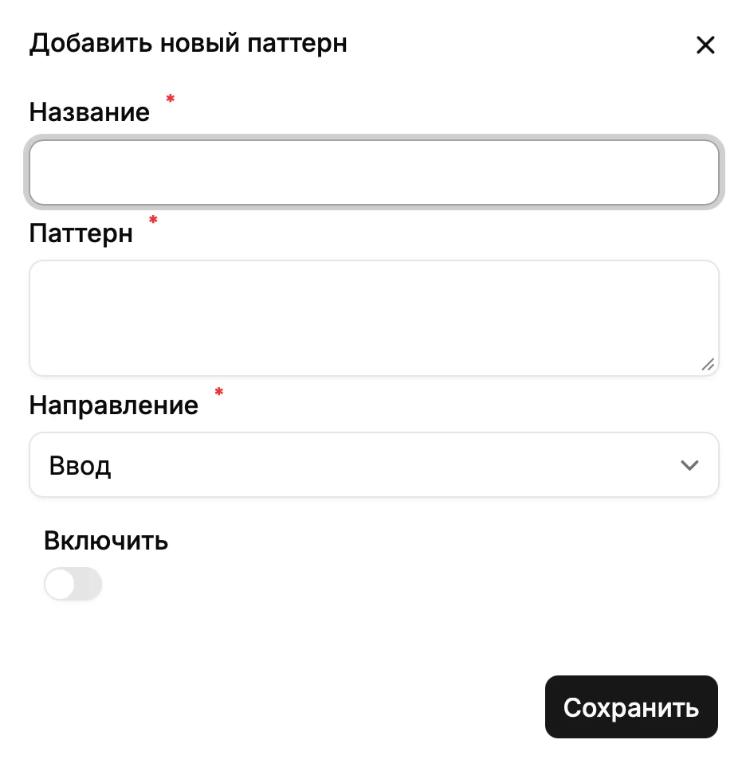

HiveTrace поддерживает чёрные списки - списки запрещённых паттернов, при обнаружении которых сообщение автоматически помечается, как нарушение. Чёрные списки настраиваются отдельно для сообщений и для файлов.

## Как открыть раздел **Черные списки**

1. В боковом меню выберите **Приложения**.
2. Откройте нужное приложение, нажав на карточку или на название приложения в зависимости от выбранного вида отображения.
3. Наведите на вкладку **Защита**.
4. Нажмите на **Черные списки**.

В верхней части страницы отображаются название, id, описание (при наличии) приложения. Рядом с ID доступна кнопка копирования.

На странице доступна ссылка `«Назад к приложениям»`, которая ведёт в раздел `Приложения`.

## Редактирование приложения

1. Нажмите `«Редактировать»`.
2. Измените нужные поля.
3. Нажмите `«Сохранить»`.

## Удаление приложения

1. Нажмите `«Удалить»`.
2. Подтвердите удаление в окне подтверждения.

Удаление необратимо. Сначала убедитесь, что интеграционный трафик остановлен или перенаправлен и связанные API-токены больше не используются.

## Профиль

Если профиль выбран, отображается его название. Если профиль не выбран — действуют индивидуальные настройки. При изменении настроек защиты приложения оно отвязывается от профиля, а текущие настройки переходят в индивидуальные.

Обновить профиль можно на странице: 
1. Нажмите кнопку `«Профиль»`.
2. Выберите нужный профиль из списка. Поле поиска помогает быстро сократить список.
3. Подтвердите привязку профиля к приложению в окне подтверждения.

## Чёрный список промптов

Паттерны из этого раздела применяются к тексту сообщений. Каждая карточка содержит название паттерна, переключатель **Включить**, кнопку информации и меню **⋮** для редактирования или удаления.

Нажмите **Добавить паттерн**, чтобы создать новое правило. Выключенный паттерн сохраняется в настройках, но не участвует в проверках.

## Чёрный список файлов

Раздел **Чёрный список · файлы** работает аналогично списку сообщений, но применяется к содержимому файлов, переданных в запросе. На карточках можно включать и отключать отдельные правила, просматривать информацию о них и открывать меню **⋮**.

## Добавление паттерна

Нажмите **Добавить паттерн** в нужном разделе и заполните форму:

1. **Название** — имя, по которому правило будет видно в списке.
2. **Паттерн** — регулярное выражение или другая поддерживаемая шаблонная конструкция.
3. **Направление** — **Ввод** для пользовательских запросов или **Вывод** для ответов модели.
4. **Включить** — активировать правило сразу после создания.
5. **Сохранить** — добавить паттерн. Кнопка **×** закрывает форму без сохранения.

Перед сохранением проверьте выражение на тестовых данных: слишком общий паттерн может приводить к ложным срабатываниям.

## Проверка результата

После сохранения настроек отправьте тестовый запрос через подключённое приложение. Результаты срабатываний доступны в **Аналитике сессий**: откройте запись и перейдите в разделы **Цензоры** или **Конфигурация валидации**. Для синхронных защищённых интеграций нарушение также может привести к блокировке запроса.
