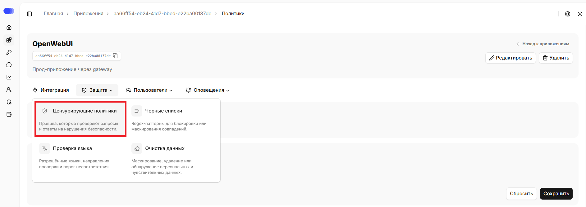
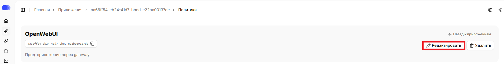
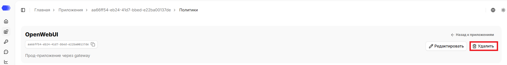
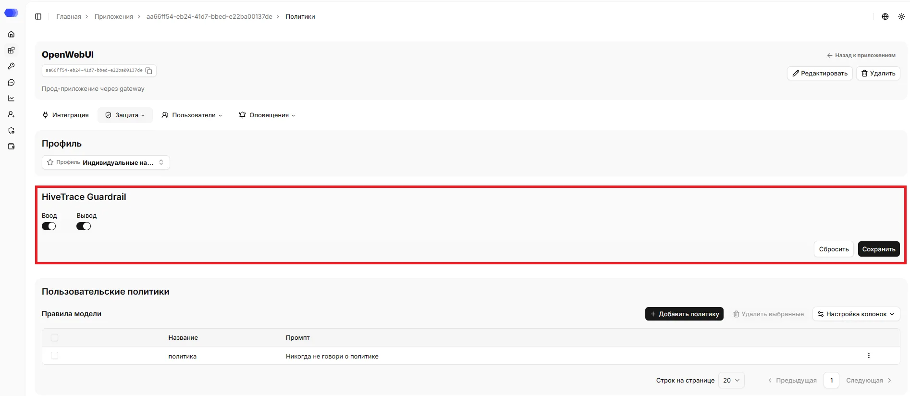
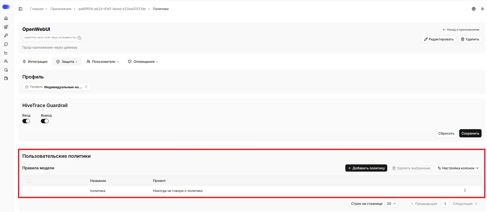
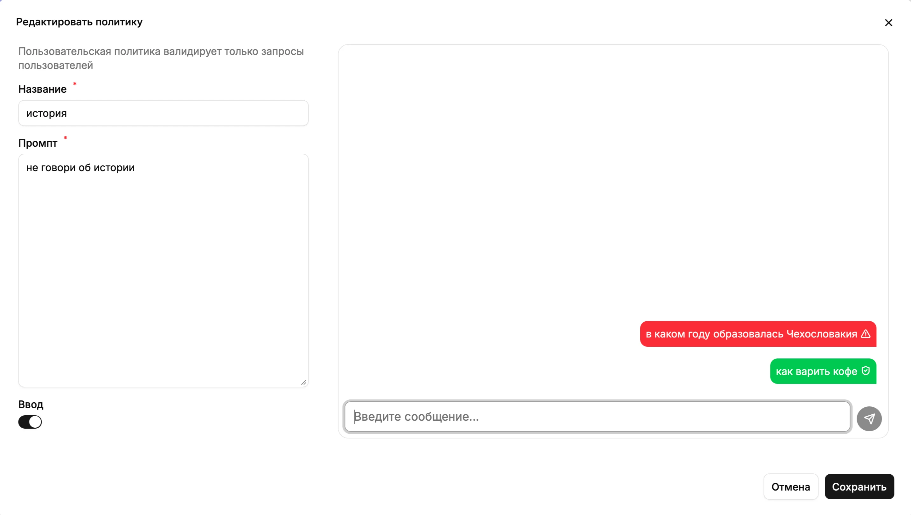

Политики задаются отдельно для каждого приложения. С их помощью можно включить встроенную защиту HiveTrace, настроить уровни угроз, создать собственные правила для запросов пользователей и проверить сообщения или файлы по чёрным спискам.

## Как открыть настройки политик

1. В боковом меню выберите **Приложения**.
2. Откройте нужное приложение, нажав на карточку или на название приложения в зависимости от выбранного вида отображения.
3. Наведите на вкладку **Защита**.
4. Нажмите на **Цензурирующие политики**.

В верхней части страницы отображаются название, id, описание (при наличии) приложения. Рядом с ID доступна кнопка копирования.

На странице доступна ссылка `«Назад к приложениям»`, которая ведёт в раздел `Приложения`.

## Редактирование приложения

1. Нажмите `«Редактировать»`.
2. Измените нужные поля.
3. Нажмите `«Сохранить»`.

## Удаление приложения

1. Нажмите `«Удалить»`.
2. Подтвердите удаление в окне подтверждения.

Удаление необратимо. Сначала убедитесь, что интеграционный трафик остановлен или перенаправлен и связанные API-токены больше не используются.

На странице находятся настройки **HiveTrace Guardrail** и пользовательские политики.

## HiveTrace Guardrail

HiveTrace Guardrail — встроенная защита от небезопасных запросов. Проверки включаются независимо для каждого направления:

- **Ввод** — проверять сообщения, поступающие от пользователя к модели.
- **Вывод** — проверять ответы модели перед передачей пользователю.

После изменения переключателей нажмите **Сохранить**. Кнопка **Сбросить** отменяет несохранённые изменения и возвращает значения по умолчанию.

## Пользовательские политики

Пользовательская политика проверяет запросы пользователей по заданной инструкции — промпту. Таблица **Правила модели** показывает название и промпт каждой политики.

Доступные действия:

- **Добавить политику** — открыть форму создания правила.
- Флажок в строке — выбрать политику; флажок в заголовке выбирает все видимые строки.
- **Удалить выбранные** — удалить отмеченные политики. Кнопка активируется после выбора хотя бы одной строки.
- **Настройка колонок** — выбрать столбцы, отображаемые в таблице.
- Меню **⋮** в строке — отредактировать или удалить конкретную политику.
- **Строк на странице**, **Предыдущая** и **Следующая** — управлять пагинацией.

### Создание, редактирование и тестирование политики

Нажмите **Добавить политику** или выберите редактирование в меню **⋮**. В форме укажите:

1. **Название** — понятное уникальное имя правила.
2. **Промпт** — инструкция, по которой валидируются пользовательские запросы.
3. **Ввод** — включить применение политики к входящим сообщениям.

Справа расположено окно тестирования. Введите проверочный запрос и нажмите кнопку отправки:

- красное сообщение со значком предупреждения означает, что политика обнаружила нарушение;
- зелёное сообщение со щитом означает, что запрос прошёл проверку.

Проверяйте как запрещённые, так и допустимые формулировки. После проверки нажмите **Сохранить**; **Отмена** закрывает форму без сохранения.

## Проверка результата

После сохранения настроек отправьте тестовый запрос через подключённое приложение. Результаты срабатываний доступны в **Аналитике сессий**: откройте запись и перейдите в разделы **Цензоры** или **Конфигурация валидации**. Для синхронных защищённых интеграций нарушение также может привести к блокировке запроса.
