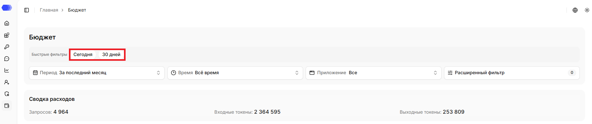
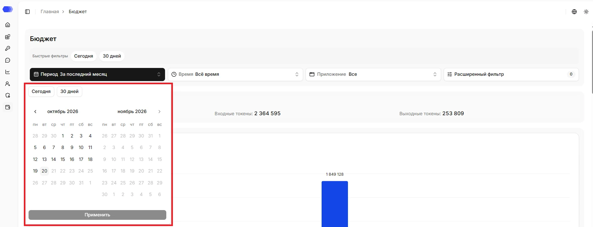
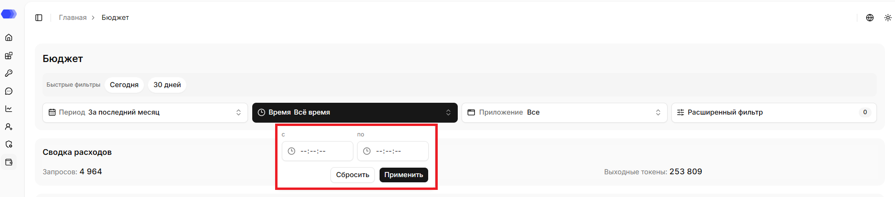
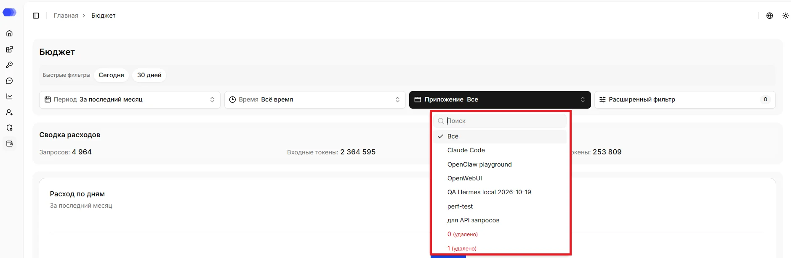
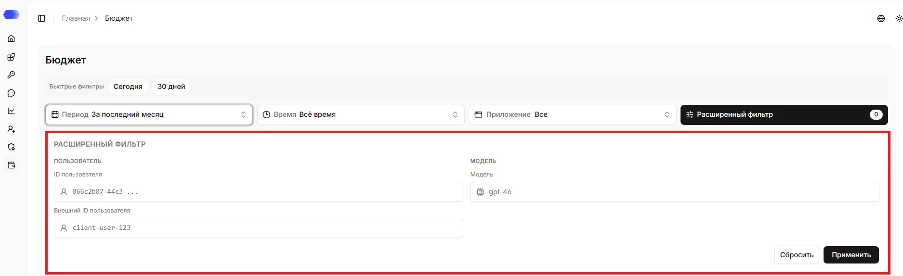
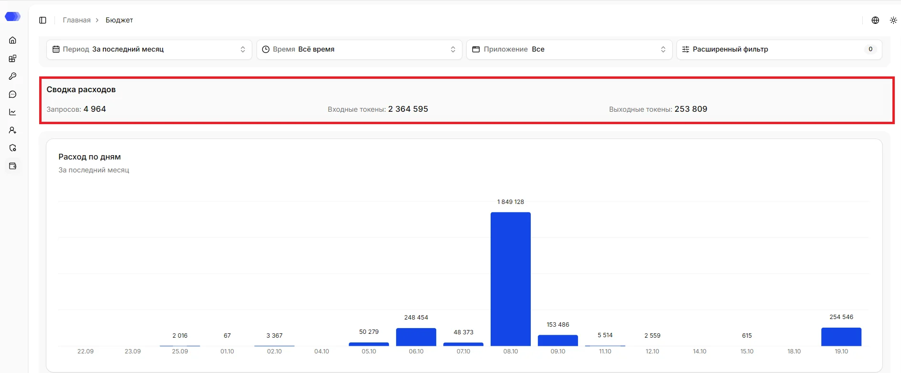
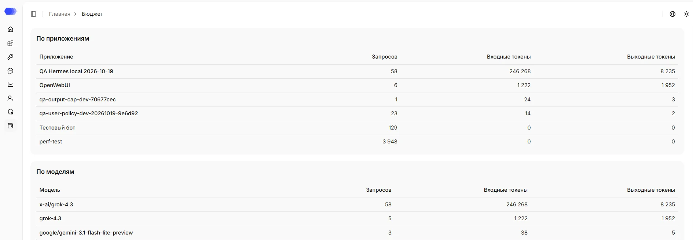
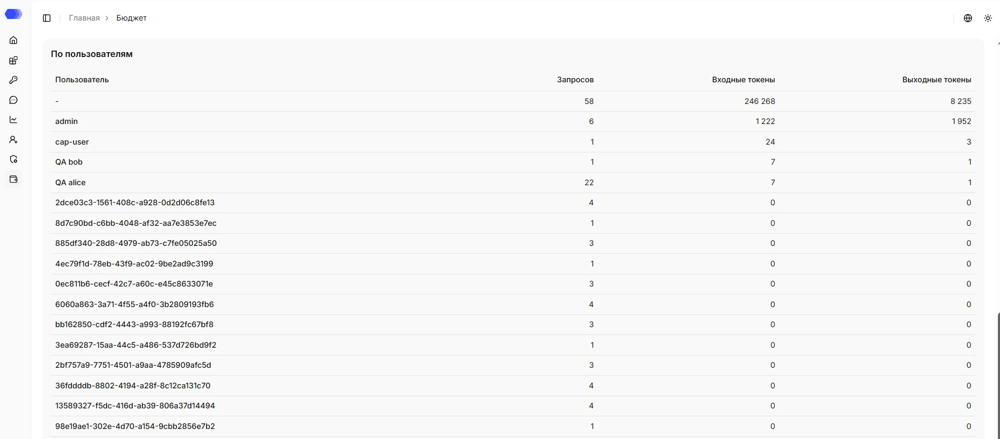

Раздел **«Бюджет»** показывает нагрузку на LLM в запросах и токенах, и помогает определить, какое приложение, модель или пользователь создаёт основную нагрузку.

## Быстрые фильтры

- **Сегодня** — только записи за текущий день;
- **30 дней** — только записи за последние 30 дней.

Нажатие на фильтр применяет заранее подготовленный набор условий.

## Период

Доступны пресеты **«Сегодня»**, **«30 дней»**, а также произвольный диапазон в календаре. Стрелки переключают месяцы. После выбора начала и конца нажмите **«Применить»**. Недоступные будущие даты отображаются приглушёнными.

## Время

При клике на поле `Время` открывается форма ввода периода.

В форме можно задать:

- время начала периода (например, 00:00:00);
- время окончания периода (например, 23:59:59).

Введённые значения применяются при нажатии кнопки `«Применить»`.

Кнопка `«Сбросить»` очищает введённые значения времени.

## Приложение

Список показывает доступные приложения, в том числе и удалённые. Поле поиска сокращает список. Значение **«Все»** снимает ограничение по приложению.

## Расширенный фильтр

- **ID пользователя** — точный идентификатор пользователя;
- **Внешний ID пользователя** — точный внешний идентификатор пользователя;
- **Модель** — модель, с которой взаимодействовал пользователь.

Счётчик на кнопке показывает число активных расширенных условий. **«Применить»** обновляет выдачу, **«Сбросить»** очищает поля этого блока.

После применения фильтров обновляются сводка, график и все таблицы ниже; сброс возвращает данные за всё время.

Исключение - блок `«Расход по дням»`. По умолчанию данный блок показывает данные за последний месяц.

## Сводка расходов

В верхнем блоке показаны итоговые значения за выбранный период:

- **Запросов** — количество обработанных обращений к моделям;
- **Входные токены** — токены, переданные модели в запросах;
- **Выходные токены** — токены, полученные в ответах модели.

Блок **Расход по дням** показывает динамику потребления. Подзаголовок сообщает активный период, например **За последний месяц**, даты находятся на горизонтальной оси, а значение подписано над каждым столбцом. Дни без потребления могут отображаться без столбца.

## По приложениям и моделям

Таблица **По приложениям** помогает определить, какое подключение создает основную нагрузку. Для каждого приложения приводятся число запросов, входные и выходные токены. Если вместо понятного названия отображается идентификатор, запись была получена без доступного отображаемого имени приложения.

Таблица **По моделям** группирует те же показатели по имени модели, переданному интеграцией. Сравнивайте число запросов и объем токенов вместе: небольшое количество длинных запросов может потреблять больше токенов, чем большое количество коротких.

## По пользователям

Последняя таблица распределяет нагрузку между пользователями. В первой колонке может отображаться ФИО, внешний идентификатор или внутренний ID — то значение, которое было доступно при обработке. Дефис означает, что связать запросы с конкретным пользователем не удалось.

Во всех трех таблицах используются одинаковые показатели: **Запросов**, **Входные токены** и **Выходные токены**. Нулевое количество токенов при ненулевом числе запросов означает, что для этих записей токенная статистика не была передана или зафиксирована.

## Как анализировать нагрузку

1. Откройте фильтры блока **«Период»**.
2. Выберите начало и конец периода. При необходимости ограничьте выбор одним приложением.
3. Примените фильтры и проверьте период под заголовком графика.
4. Найдите дни с пиковыми значениями.
5. Используйте таблицы по приложениям, моделям и пользователям, чтобы определить источник нагрузки.

Пустая таблица означает отсутствие данных для выбранных условий. В версии 4.4 страница показывает потребление, но не рассчитывает денежную стоимость и не предоставляет экспорт.

## Доступ к странице

Для просмотра страницы бюджета нужны права:

- Область **Аналитика** — уровень доступа не ниже `«Чтение»`.

Для фильтрации по приложению нужны права:

- Область **Приложения** — уровень доступа не ниже `«Чтение»`;
- Область **Аналитика** — уровень доступа не ниже `«Чтение»`.

Если у пользователя нет доступа для просмотра страницы, отображается страница `403 - Нет доступа`.
