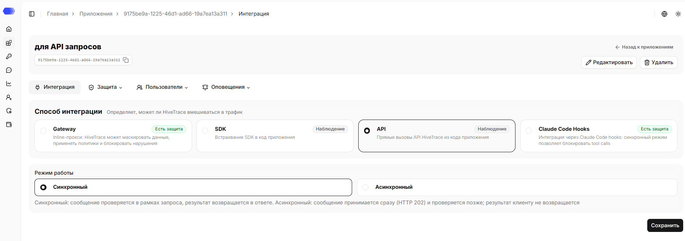
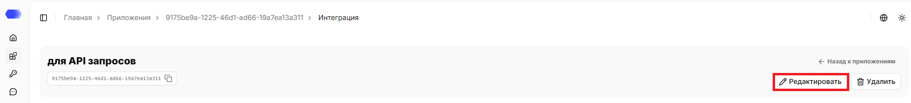
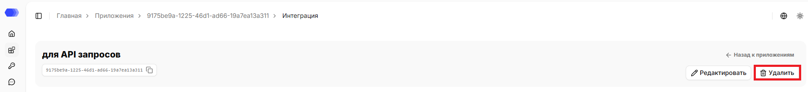
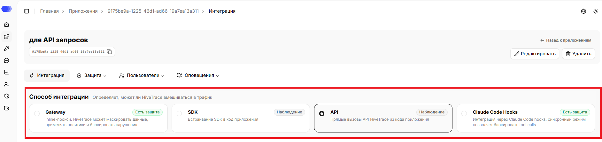
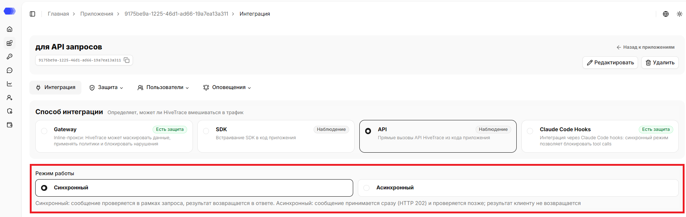
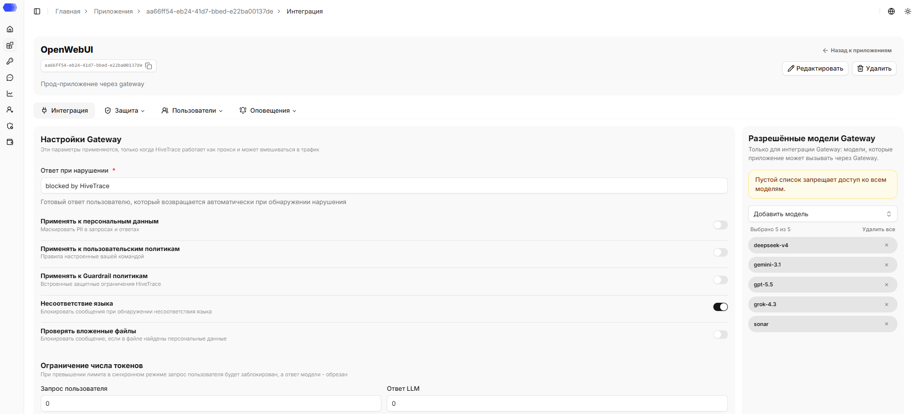
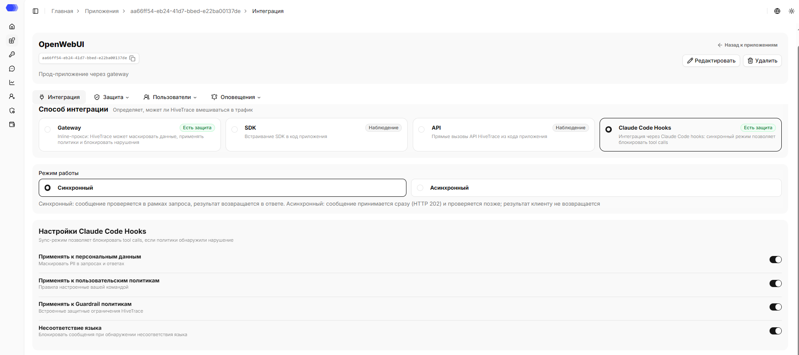

Раздел **«Интеграция»** позволяет выбрать способ интеграции приложения с HiveTrace и режим работы.

## Как открыть раздел **Интеграция**

1. В боковом меню выберите **Приложения**.
2. Откройте нужное приложение, нажав на карточку или на название приложения в зависимости от выбранного вида отображения.
3. Происходит переход на вкладку `«Интеграция»`.

В верхней части страницы отображаются название, id, описание (при наличии) приложения. Рядом с ID доступна кнопка копирования. На странице также доступна ссылка `«Назад к приложениям»`, которая ведёт в раздел `Приложения`.

## Редактирование приложения

1. Нажмите `«Редактировать»`.
2. Измените нужные поля.
3. Нажмите `«Сохранить»`.

## Удаление приложения

1. Нажмите `«Удалить»`.
2. Подтвердите удаление в окне подтверждения.

Удаление необратимо. Сначала убедитесь, что интеграционный трафик остановлен или перенаправлен и связанные API-токены больше не используются.

## Способ интеграции

Данный раздел определяет, может ли HiveTrace вмешиваться в трафик.

Доступны 4 варианта: **Gateway**, **SDK**, **API**, **Claude Code Hooks**.

Варианты **Gateway** и **Claude Code Hooks** помечены как **«Есть защита»**: в синхронном режиме HiveTrace может вмешиваться в обработку. **SDK** и **API** помечены как **«Наблюдение»** и только передают данные для регистрации и анализа.

## Режим работы

Данный раздел определяет, как обрабатывается сообщение при проверке.

- **Синхронный** — сообщение проверяется в рамках запроса, результат возвращается в ответе;;
- **Асинхронный** — сообщение принимается сразу (HTTP 202) и проверяется позже; результат клиенту не возвращается.

### Gateway

Gateway пропускает запросы к модели через HiveTrace и может остановить небезопасный запрос до его выполнения.

Для Gateway доступны:

- **Синхронный режим** — проверки выполняются до передачи запроса; при выборе появляются остальные параметры Gateway;
- **Асинхронный режим** — анализ не блокирует основной запрос, а зависимые поля скрываются;
- **Ответ при нарушении** — обязательная фраза вместо заблокированного результата;
- переключатели **DataClean**, **Пользовательские политики**, **Guardrail**, **Несоответствие языка**, **Проверка вложенных файлов**;
- лимиты токенов для запроса пользователя и ответа LLM;
- **Разрешённые модели** — пустой список запрещает доступ ко всем моделям. Чтобы добавить модель, нажмите `«Добавить модель»` — откроется список доступных моделей. В нём можно выбрать модель кликом из списка или воспользоваться поиском — ввести название вручную, чтобы быстро найти нужную модель. Чтобы разрешить сразу все модели, воспользуйтесь опцией `«Добавить все модели»`.

Ответ при нарушении обязателен только для синхронного Gateway. Значение должно содержать хотя бы один непробельный символ.

Положение переключателя справа показывает, будет ли выполняться соответствующая проверка. Значение `0` в полях ограничения токенов означает отсутствие заданного положительного порога; при использовании ограничения укажите значение больше нуля.

### SDK и API

Эти варианты предназначены для наблюдаемости через клиентскую библиотеку или вызовы API. Дополнительных полей в форме для них нет. Настройки задаются в карточке приложения и могут быть переопределены через Override API.

### Claude Code Hooks

Этот способ позволяет проверять действия Claude Code, включая вызовы инструментов. В синхронном режиме отображаются переключатели DataClean, пользовательских политик, Guardrail, проверки языка. Ответ при нарушении и лимиты токенов для Claude Code Hooks не показываются.

## Доступ к странице

Для редактирования приложения из шапки нужны права:

- Область **Приложения** — уровень доступа не ниже `«Редактирование»`.

Для удаления приложения из шапки нужны права:

- Область **Приложения** — `Полный` уровень доступа.

Для просмотра страницы **Интеграция** нужны права:

- Область **Приложения** — уровень доступа не ниже `«Чтение»`.

Для обновления настроек приложения и его редактирования нужны права:

- Область **Приложения** — уровень доступа не ниже `«Редактирование»`.

Для удаления приложения нужны права:

- Область **Приложения** — `Полный` уровень доступа.

Если у пользователя нет доступа для просмотра страницы, отображается страница `403 - Нет доступа`.
