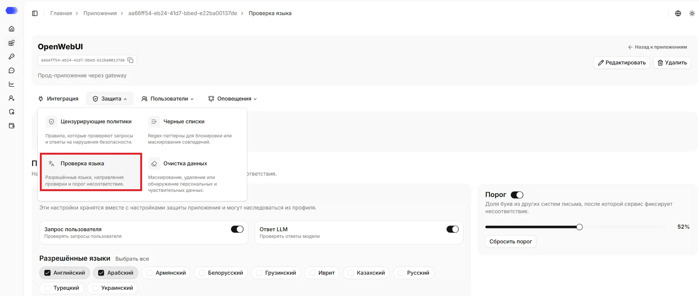
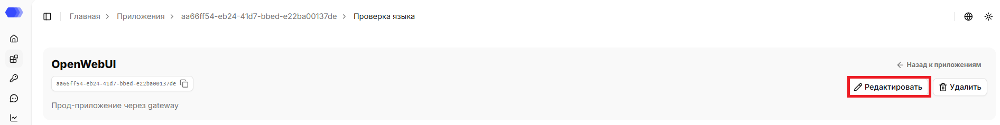
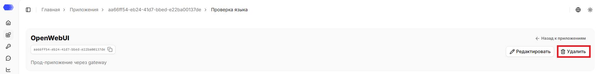
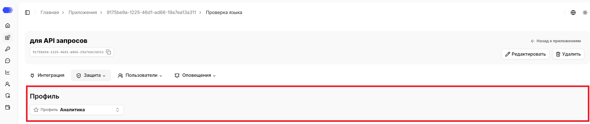
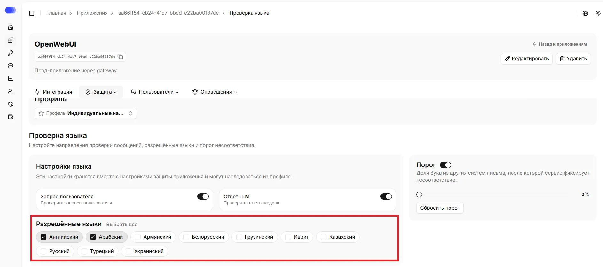
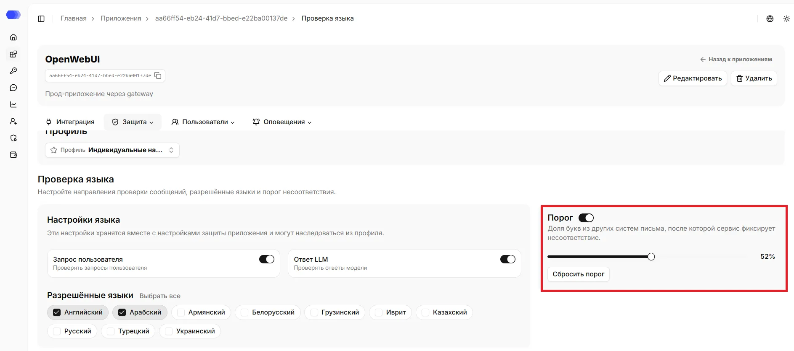

Раздел **«Проверка языка»** позволяет контролировать язык запросов и ответов: задать список разрешённых языков и выявлять текст на посторонних языках. 

## Как открыть раздел **Проверка языка**

1. В боковом меню выберите **Приложения**.
2. Откройте нужное приложение, нажав на карточку или на название приложения в зависимости от выбранного вида отображения.
3. Наведите на вкладку **Защита**.
4. Нажмите на **Проверка языка**.

В верхней части страницы отображаются название, id, описание (при наличии) приложения. Рядом с ID доступна кнопка копирования.

На странице доступна ссылка `«Назад к приложениям»`, которая ведёт в раздел `Приложения`.

## Редактирование приложения

1. Нажмите `«Редактировать»`.
2. Измените нужные поля.
3. Нажмите `«Сохранить»`.

## Удаление приложения

1. Нажмите `«Удалить»`.
2. Подтвердите удаление в окне подтверждения.

Удаление необратимо. Сначала убедитесь, что интеграционный трафик остановлен или перенаправлен и связанные API-токены больше не используются.

## Профиль

Если профиль выбран, отображается его название. Если профиль не выбран — действуют индивидуальные настройки. При изменении настроек защиты приложения оно отвязывается от профиля, а текущие настройки переходят в индивидуальные.

Обновить профиль можно на странице: 
1. Нажмите кнопку `«Профиль»`.
2. Выберите нужный профиль из списка. Поле поиска помогает быстро сократить список.
3. Подтвердите привязку профиля к приложению в окне подтверждения.

## Разрешённые языки

В разделе доступны следующие языки: `Английский`, `Арабский`, `Армянский`, `Белорусский`, `Грузинский`, `Иврит`, `Казахский`, `Русский`, `Турецкий`, `Украинский`

Чтобы разрешить язык, отметьте его чекбокс; можно выбрать один язык или несколько — вплоть до всех.

## Проверка запросов и ответов

Проверки для входящих и исходящих сообщений включаются отдельно.

> **Примечание:** чтобы перевести переключатель проверки запросов или ответов в активное состояние, необходимо выбрать хотя бы один язык.

## Порог допустимых посторонних букв

Порог задаёт допустимую долю букв на постороннем языке, при которой текст ещё не считается нарушением. Его можно установить от `0%` до `100%`: чем ниже значение, тем строже проверка — при `0%` любая чужая буква приводит к нарушению. Смешанный текст проверяется с учётом этого порога: пока доля посторонних букв не превышена, нарушение не фиксируется.

Сбросить установленный порог можно кнопкой `«Сбросить порог»` или с помощью переключателя. После сброса поле порога возвращается к значению по умолчанию — `25%`. Нажмите `Сохранить`, чтобы применить изменения.

