Раздел **Очистка данных** задаёт правила обработки конфиденциальной информации отдельно для каждого приложения. Настройки применяются к новым сообщениям и файлам после сохранения конфигурации.

## Как открыть раздел **Очистка данных**

1. В боковом меню выберите **Приложения**.
2. Откройте нужное приложение, нажав на карточку или на название приложения в зависимости от выбранного вида отображения.
3. Наведите на вкладку **Защита**.
4. Нажмите на **Очистка данных**.

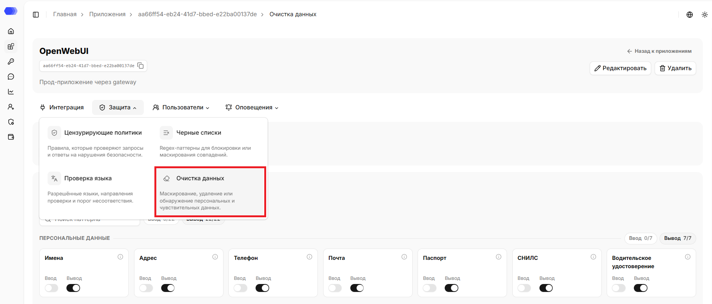

В верхней части страницы отображаются название, id, описание (при наличии) приложения. Рядом с ID доступна кнопка копирования. На странице также доступна ссылка `«Назад к приложениям»`, которая ведёт в раздел `Приложения`.

## Редактирование приложения

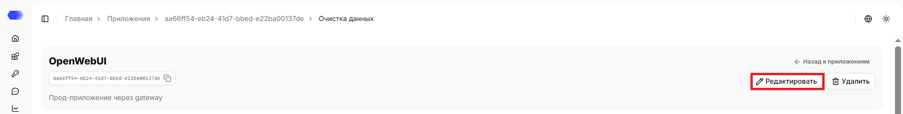

1. Нажмите `«Редактировать»`.
2. Измените нужные поля.
3. Нажмите `«Сохранить»`.

## Удаление приложения

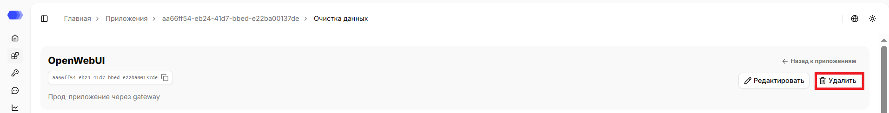

1. Нажмите `«Удалить»`.
2. Подтвердите удаление в окне подтверждения.

Удаление необратимо. Сначала убедитесь, что интеграционный трафик остановлен или перенаправлен и связанные API-токены больше не используются.

## Профиль

Если профиль выбран, отображается его название. Если профиль не выбран — действуют индивидуальные настройки. При изменении настроек защиты приложения оно отвязывается от профиля, а текущие настройки переходят в индивидуальные.

Обновить профиль можно на странице: 
1. Нажмите кнопку `«Профиль»`.
2. Выберите нужный профиль из списка. Поле поиска помогает быстро сократить список.
3. Подтвердите привязку профиля к приложению в окне подтверждения.

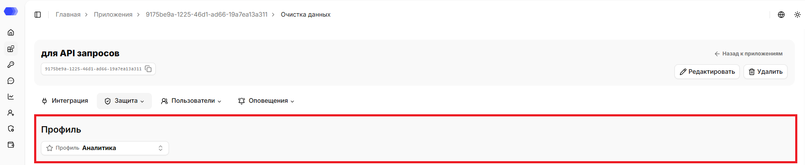

## Базовые паттерны

В блоке **Базовые паттерны** находятся 22 встроенных типа данных. Они разделены по подразделам, что упрощает выбор нужного паттерна.

- **Персональные данные** — `Имена`, `Адрес`, `Телефон`, `Почта`, `Паспорт`, `СНИЛС`, `Водительское удостоверение`;
- **Банковская тайна** — `Банковская карта`, `Код карты`, `БИК`, `Корреспондентский счёт`, `Расчётный счёт`;
- **Реквизиты организаций** — `ИНН`, `КПП`, `ОГРН`, `ОГРНИП`;
- **Технические данные** — `IP-адрес`, `Доменное имя`, `Ссылка`, `Токен доступа`;
- **Прочее** — `Госномер авто`, `VIN`.

Счётчики показывают общее количество паттернов и сколько подключено для каждого направления — как по всему блоку, так и по каждому подразделу.

Поиск работает по названию базового паттерна, не учитывает регистр и находит по частичному совпадению.

У каждой карточки есть два переключателя:

- **Ввод** — проверять запросы пользователя;
- **Вывод** — проверять ответы модели.

Значок информации на карточке открывает описание паттерна. Включайте только нужные направления: это делает результат обработки предсказуемым и упрощает анализ срабатываний.

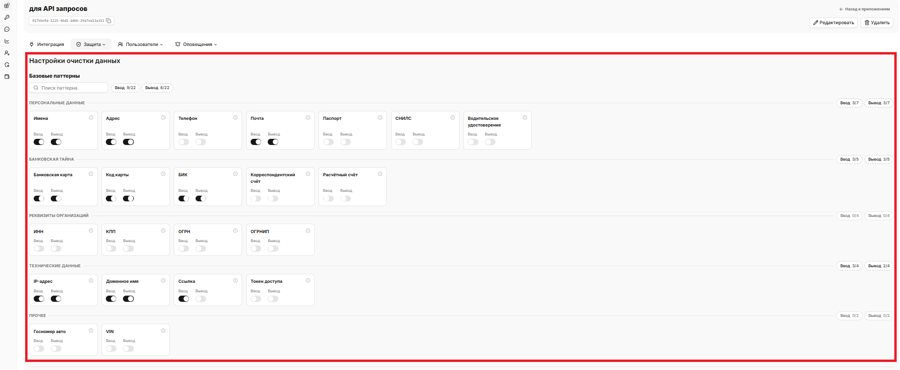

## Пользовательские паттерны

**Пользовательские паттерны** дополняют встроенный набор регулярными выражениями вашей команды.

Нажмите **Добавить паттерн** в нужном разделе и заполните форму:

1. **Название** — название, по которому правило будет видно в списке.
2. **Псевдоним** — метка, которой заменяется найденное значение при псевдонимизации.
2. **Описание** — описание паттерна (опционально).
3. **Паттерн** — регулярное выражение.
4. **Направление** — **Ввод** для пользовательских запросов или **Вывод** для ответов модели.
5. **Включить** — активировать правило сразу после создания.
6. **Сохранить** — добавить паттерн. Кнопка **×** закрывает форму без сохранения.

После сохранения на карточке паттерна проверку ввода и вывода можно включать и отключать независимо.

Меню с тремя точками используется для редактирования и удаления, а также для работы с историей версий паттерна: в ней можно просмотреть предыдущие версии и восстановить нужную.

Счётчик показывает число паттернов в разделе, при отсутствии паттернов отображается `«Пользовательских паттернов пока нет. Добавьте паттерн, чтобы настроить правила очистки данных для этого приложения.»`.

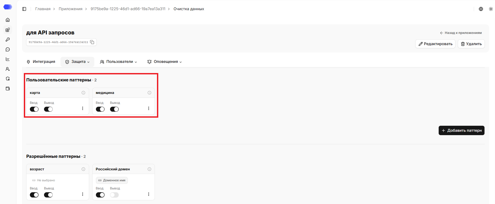

## Разрешённые паттерны

**Разрешённые паттерны** задают исключения. Их следует применять, когда строка похожа на конфиденциальные данные, но допустима в вашем сценарии. 

Нажмите **Добавить паттерн** в нужном разделе и заполните форму:

1. **Название** — название, по которому правило будет видно в списке.
2. **Описание** — описание паттерна (опционально).
3. **Паттерн** — регулярное выражение.
4. **Целевое правило** — позволяет указать, к какому базовому или пользовательскому паттерну привязывается создаваемый паттерн. По умолчанию в поле отображается `«Не выбрано»`. При клике на него открывается выпадающий список, в котором можно выбрать нужный паттерн кликом из списка.
5. **Направление** — **Ввод** для пользовательских запросов или **Вывод** для ответов модели.
6. **Включить** — активировать правило сразу после создания.
7. **Сохранить** — добавить паттерн. Кнопка **×** закрывает форму без сохранения.

После сохранения на карточке паттерна проверку ввода и вывода можно включать и отключать независимо.

Меню с тремя точками используется для редактирования и удаления.

Счётчик показывает число паттернов в разделе, при отсутствии паттернов отображается `«Разрешённых паттернов пока нет.Добавьте паттерн, чтобы доверенные значения не очищались.»`.

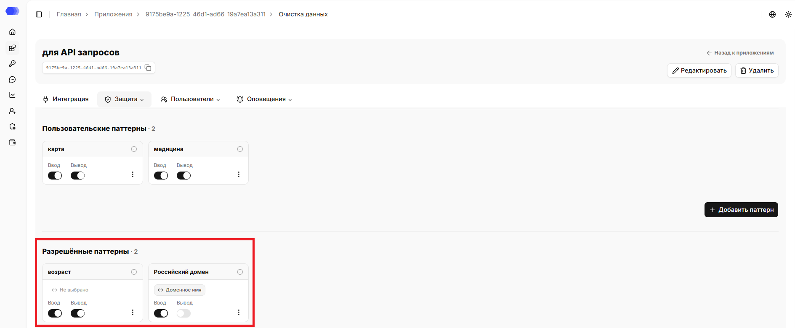

## Тип обработки

Для входящих и исходящих сообщений тип обработки настраивается отдельно:

- **Маскирование** заменяет найденное значение символами `X`;
- **Удаление** удаляет найденное значение из текста;
- **Детекция** только обнаруживает совпадения, без изменения текста;
- **Псевдонимизация** заменяет значение устойчивой меткой типа `NAME_1` или `EMAIL_1`.

Выбранный режим применяется только к направлениям, включённым на карточках паттернов. После изменения проверьте результат в тестовом блоке ниже на странице.

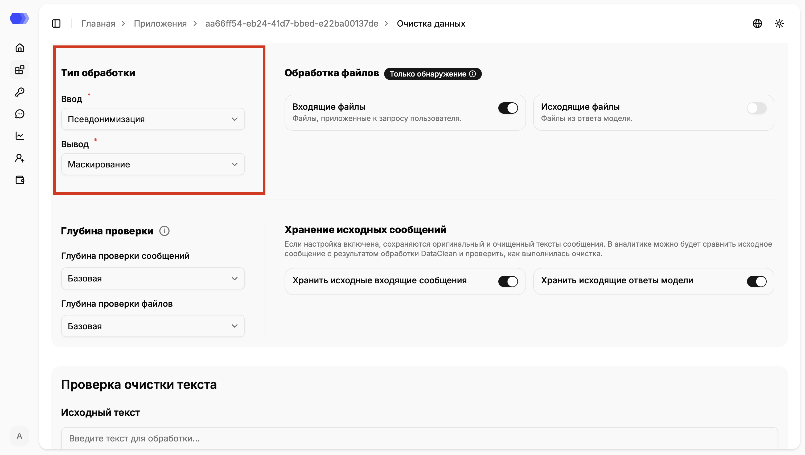

## Обработка файлов

Переключатели **Входящие файлы** и **Исходящие файлы** определяют, нужно ли извлекать и проверять текст из вложений пользователя и файлов в ответе модели. Метка **Только обнаружение** означает, что система находит сущности, но не изменяет содержимое файла.

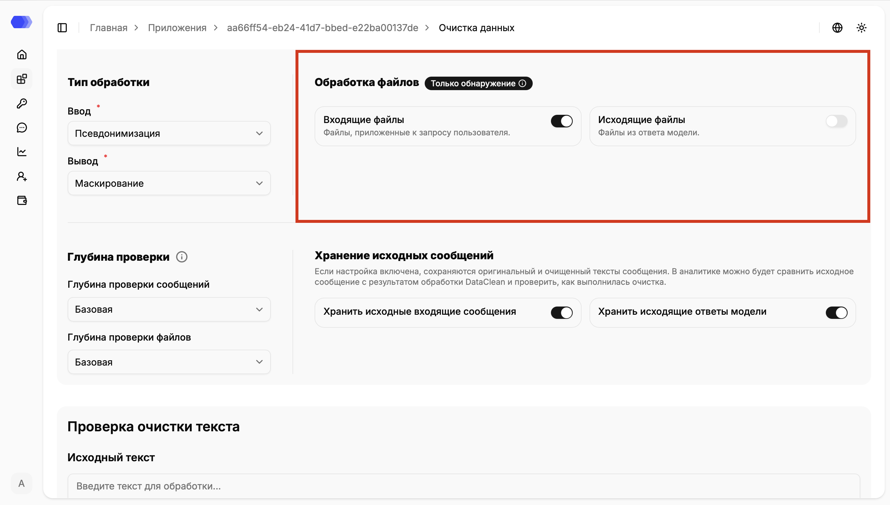

## Глубина проверки и хранение исходных сообщений

Поля **Глубина проверки сообщений** и **Глубина проверки файлов** задают объём анализа. Используйте более глубокую проверку, когда сущность может быть определена только из контекста; учитывайте, что она требует больше времени и ресурсов.

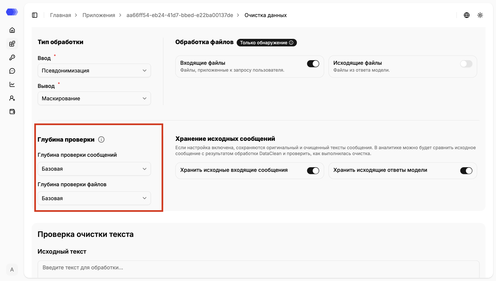

В блоке **Хранение исходных сообщений** можно сохранить оригинальный и очищенный варианты входящих сообщений и ответов модели. Это помогает сравнивать результат в аналитике. Включайте хранение только в соответствии с политикой доступа и сроками хранения данных вашей организации.

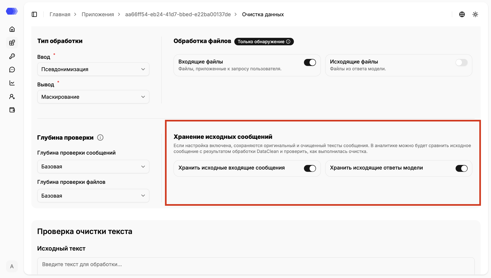

## Проверка очистки текста

Перед применением настроек к рабочему трафику выполните тест:

1. Введите пример в поле **Исходный текст**.
2. Нажмите **Очистить**.
3. Сравните блоки **Очищенный текст (Ввод)** и **Очищенный текст (Вывод)**.
4. Проверьте результат: псевдонимизация создаёт метки, маскирование заменяет значение символами `X`, удаление удаляет найденное значение, детекция фиксирует без изменения текста.
5. Просмотрите таблицу **Найденные конфиденциальные данные**. Вкладки **Входящие** и **Исходящие** разделяют результаты по направлению.

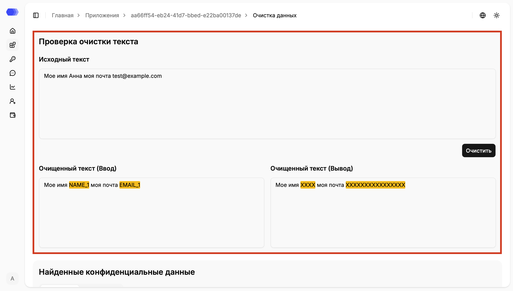

В таблице результата доступны тип сущности, исходный фрагмент и очищенное значение. **Настройка колонок** позволяет оставить только нужные поля.

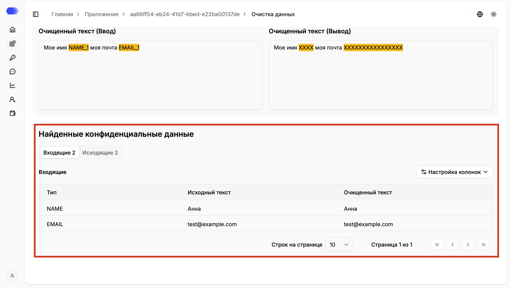

## Рекомендуемый порядок настройки

1. Включите нужные базовые паттерны для ввода и вывода.
2. Добавьте пользовательские паттерны и необходимые исключения.
3. Выберите тип обработки сообщений.
4. Настройте проверку файлов, глубину анализа и хранение оригиналов.
5. Проверьте конфигурацию на тестовом тексте.
6. Отправьте тестовый запрос через приложение и убедитесь в ожидаемом результате в **Аналитике сессий**.
