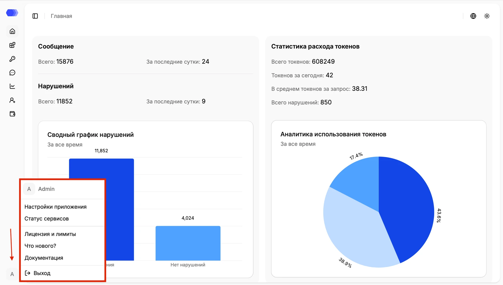

Раздел **Настройки приложения** содержит общие параметры экземпляра HiveTrace. Чтобы открыть его, нажмите значок профиля в правом верхнем углу и выберите **Настройки приложения**.

## Основные настройки

На странице можно проверить и изменить параметры, доступные пользователю платформы. Состав полей зависит от версии и конфигурации HiveTrace.

Перед сохранением убедитесь, что изменения соответствуют настройкам развертывания и политикам вашей организации.

