Раздел **«Профили»** позволяет один раз настроить защиту и применять её к нескольким приложениям — без повторной настройки для каждого приложения отдельно.

## Как открыть раздел **Профили**

1. В боковом меню выберите **Приложения**.
2. Нажмите вкладку **Профили**.

## Поиск профилей

Поиск работает по названию или описанию профиля и не учитывает регистр.

## Таблица профилей

Над таблицей находится кнопка **«Создать профиль»**, а под таблицей — пагинация.

По умолчанию профили отображаются в виде `карточек` — каждый профиль представлен отдельной карточкой с основной информацией.

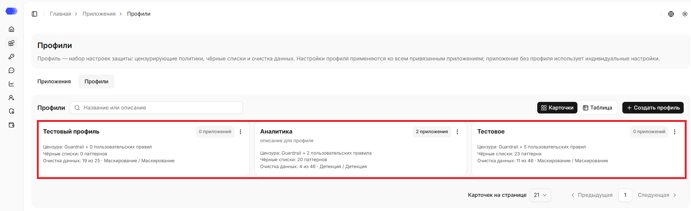

Вы также можете переключить отображение на `табличный` вид, в котором данные представлены в виде строк и столбцов.

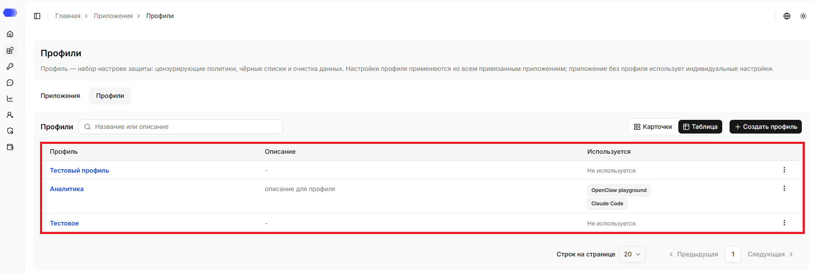

Независимо от выбранного вида отображения, для каждого профиля отображаются следующие данные:

- **Название** — имя профиля; полный длинный текст показывается при наведении.
- **Описание** — назначение профиля; отображается опционально (при наличии).
- **Меню действий** — три точки открывают меню редактирования и удаления.

В карточном виде для каждого профиля дополнительно отображаются:

- **Цензура** — была ли подключена политика безопасности, а также количество подключённых пользовательских политик;
- **Чёрные списки** — количество подключённых правил чёрных списков для сообщений и файлов;
- **Очистка данных** — количество подключённых базовых, пользовательских и разрешённых паттернов, тип обработки для ввода и вывода;
- **Количество приложений** — количество приложений, к которым применён текущий профиль.

В табличном виде отображается список приложений, для которых используется профиль. Если профиль пока не используется, отображается `«Не используется»`.

Размер страницы задаётся параметром `«Строк на странице»` или `«Карточек на странице»` в зависимости от выбранного вида отображения, а кнопки **«Предыдущая»** и **«Следующая»** переключают страницы.

## Создание профиля

Нажмите **«Добавить профиль»** и заполните форму.

Поля формы:

- **Название** — обязательное отображаемое имя, не более 256 символов;
- **Описание** — необязательный текст, не более 1500 символов;

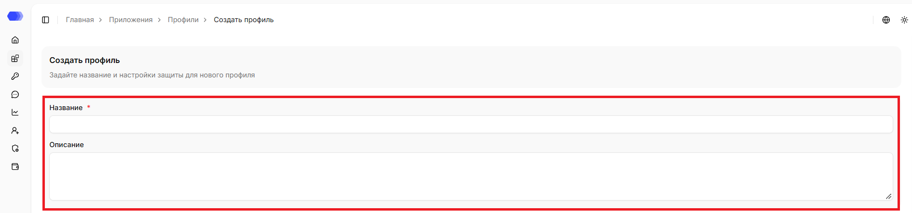

### HiveTrace Guardrail

**HiveTrace Guardrail** — встроенная защита от небезопасных запросов. Проверки включаются независимо для каждого направления:

- `Ввод` — проверять сообщения, поступающие от пользователя к модели.
- `Вывод` — проверять ответы модели перед передачей пользователю.

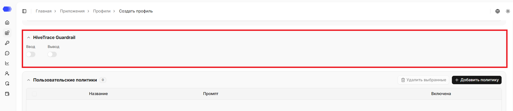

### Пользовательские политики

`Пользовательская политика` проверяет запросы пользователей по заданной инструкции — промпту. Таблица показывает название, промпт каждой политики, а также её статус. Счётчик на кнопке показывает число политик в разделе, при отсутствии политик отображается сообщение `«Нет данных»`.

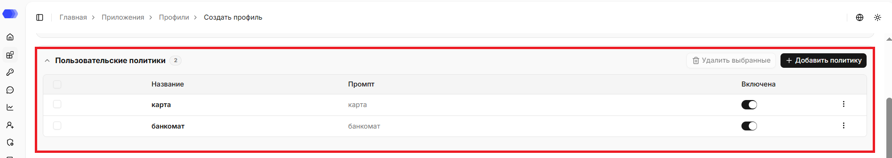

Доступные действия:

- **Добавить политику** — открыть форму создания правила.
- Флажок в строке — выбрать политику; флажок в заголовке выбирает все видимые строки.
- **Удалить выбранные** — удалить отмеченные политики. Кнопка активируется после выбора хотя бы одной строки.
- Меню **⋮** в строке — отредактировать или удалить конкретную политику.

### Чёрный список промптов

Паттерны из этого блока применяются к тексту сообщений. Каждая карточка содержит название паттерна, направление, переключатель **Включить**, кнопку информации и меню **⋮** для редактирования или удаления.

Нажмите **Добавить паттерн**, чтобы создать новое правило. Выключенный паттерн сохраняется в настройках, но не участвует в проверках.

Счётчик на кнопке показывает число паттернов в блоке, при отсутствии паттернов отображается `«Паттернов нет»`.

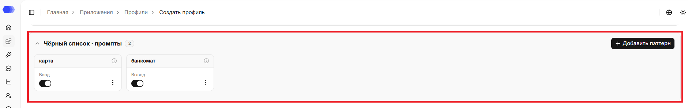

### Чёрный список файлов

Блок **Чёрный список · файлы** работает аналогично списку сообщений, но применяется к содержимому файлов, переданных в запросе. 

Нажмите **Добавить паттерн**, чтобы создать новое правило. Выключенный паттерн сохраняется в настройках, но не участвует в проверках.

Счётчик на кнопке показывает число паттернов в блоке, при отсутствии паттернов отображается `«Паттернов нет»`.

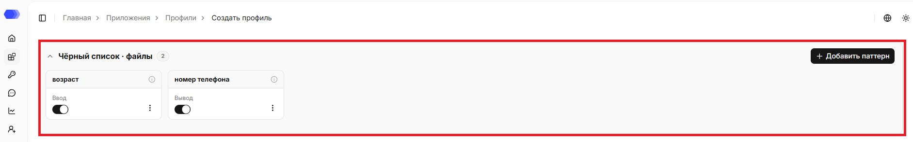

### Проверка языка

Блок **«Проверка языка»** позволяет контролировать язык запросов и ответов: задать список разрешённых языков и выявлять текст на посторонних языках.

**Проверка запросов и ответов** — входящие и исходящие сообщения проверяются отдельно.

> **Примечание:** чтобы перевести переключатель проверки запросов или ответов в активное состояние, необходимо выбрать хотя бы один язык.

**Разрешённые языки** — отметьте нужные языки чекбоксами. Доступны следующие языки: `Английский`, `Арабский`, `Армянский`, `Белорусский`, `Грузинский`, `Иврит`, `Казахский`, `Русский`, `Турецкий`, `Украинский`

**Порог** — доля букв других систем письма, при которой текст ещё не считается нарушением. После сброса поле порога возвращается к значению по умолчанию — `25%`, а переключатель становится неактивным.

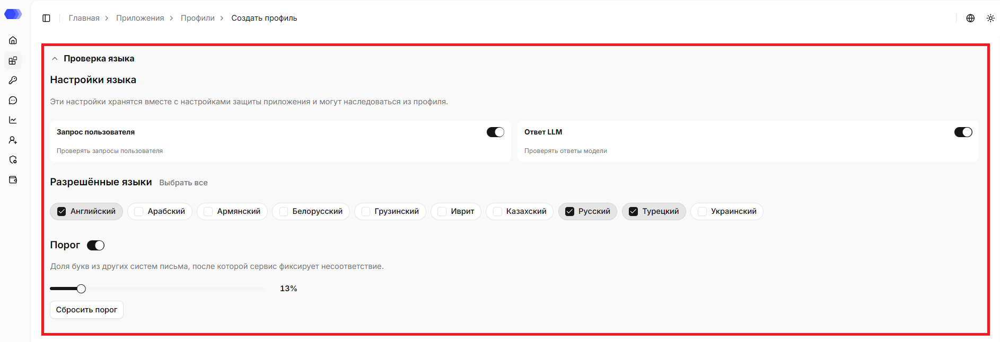

### Очистка данных

Блок **Очистка данных** задаёт правила обработки конфиденциальной информации отдельно для каждого приложения. Настройки применяются к новым сообщениям и файлам после сохранения конфигурации.

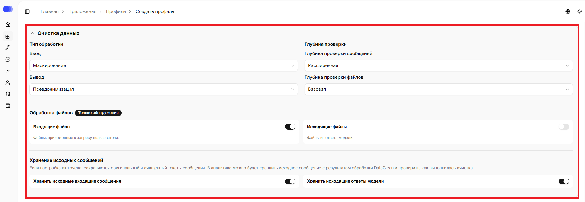

**Тип обработки**

По умолчанию для обоих направлений выбран вариант `«Отключено»` — обработка данных не выполняется.

Для входящих и исходящих сообщений тип обработки настраивается отдельно:

- **Маскирование** заменяет найденное значение символами `X`;
- **Удаление** удаляет найденное значение из текста;
- **Детекция** только обнаруживает совпадения, без изменения текста;
- **Псевдонимизация** заменяет значение устойчивой меткой типа `NAME_1` или `EMAIL_1`.

Выбранный режим применяется только к направлениям, включённым на карточках паттернов.

**Обработка файлов**

Переключатели **Входящие файлы** и **Исходящие файлы** определяют, нужно ли извлекать и проверять текст из вложений пользователя и файлов в ответе модели. Метка **Только обнаружение** означает, что система находит сущности, но не изменяет содержимое файла.

**Глубина проверки и хранение исходных сообщений**

Поля **Глубина проверки сообщений** и **Глубина проверки файлов** задают объём анализа. Используйте более глубокую проверку, когда сущность может быть определена только из контекста; учитывайте, что она требует больше времени и ресурсов.

В блоке **Хранение исходных сообщений** можно сохранить оригинальный и очищенный варианты входящих сообщений и ответов модели. Это помогает сравнивать результат в аналитике. Включайте хранение только в соответствии с политикой доступа и сроками хранения данных вашей организации.

## Базовые паттерны

В блоке **Базовые паттерны** находятся встроенные типы данных. Они разделены по разделам, что упрощает выбор нужного паттерна.

- **Персональные данные** — `Имена`, `Адрес`, `Телефон`, `Почта`, `Паспорт`, `СНИЛС`;
- **Банковская тайна** — `Банковская карта`, `Код карты`;
- **Реквизиты организаций** — `ИНН`, `КПП`, `ОГРН`, `ОГРНИП`;
- **Технические данные** — `IP-адрес`, `Доменное имя`, `Ссылка`, `Токен доступа`.

Поиск работает по названию базового паттерна, не учитывает регистр и находит по частичному совпадению.

У каждой карточки есть два переключателя:

- **Ввод** — проверять запросы пользователя;
- **Вывод** — проверять ответы модели.

Включайте только нужные направления: это делает результат обработки предсказуемым и упрощает анализ срабатываний.

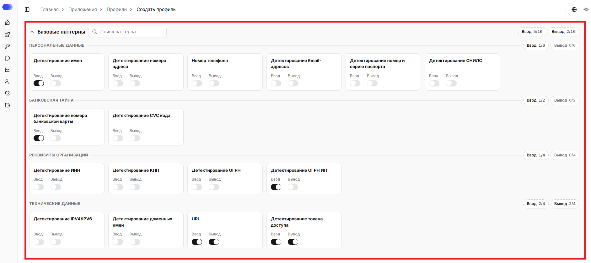

## Пользовательские паттерны

**Пользовательские паттерны** дополняют встроенный набор регулярными выражениями вашей команды.

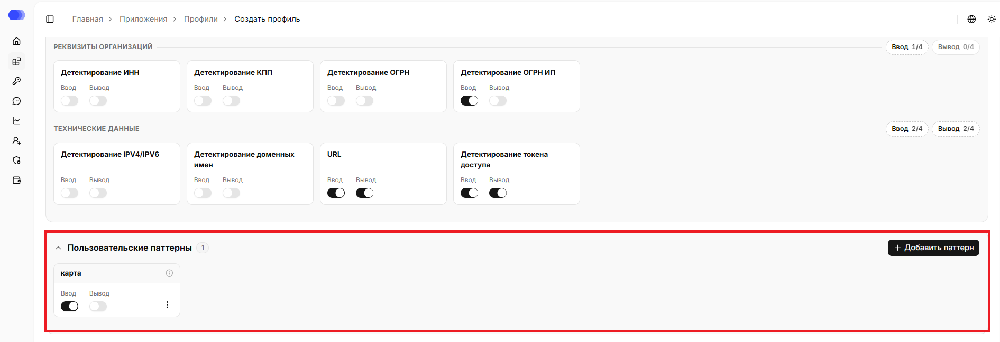

Нажмите **Добавить паттерн** в нужном разделе и заполните форму:

1. **Название** — название, по которому правило будет видно в списке.
2. **Псевдоним** — метка, которой заменяется найденное значение при псевдонимизации.
2. **Описание** — описание паттерна (опционально).
3. **Паттерн** — регулярное выражение.
4. **Направление** — **Ввод** для пользовательских запросов или **Вывод** для ответов модели.
5. **Включить** — активировать правило сразу после создания.
6. **Сохранить** — добавить паттерн. Кнопка **×** закрывает форму без сохранения.

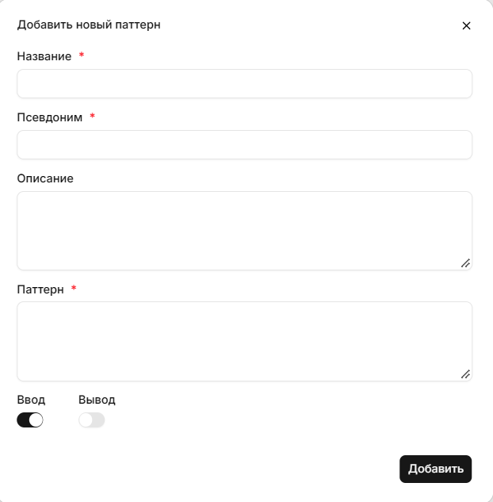

После сохранения на карточке паттерна проверку ввода и вывода можно включать и отключать независимо. Меню с тремя точками используется для редактирования и удаления. Счётчик показывает число паттернов в разделе, при отсутствии паттернов отображается `«Паттернов нет»`.

## Разрешённые паттерны

**Разрешённые паттерны** задают исключения. Их следует применять, когда строка похожа на конфиденциальные данные, но допустима в вашем сценарии.

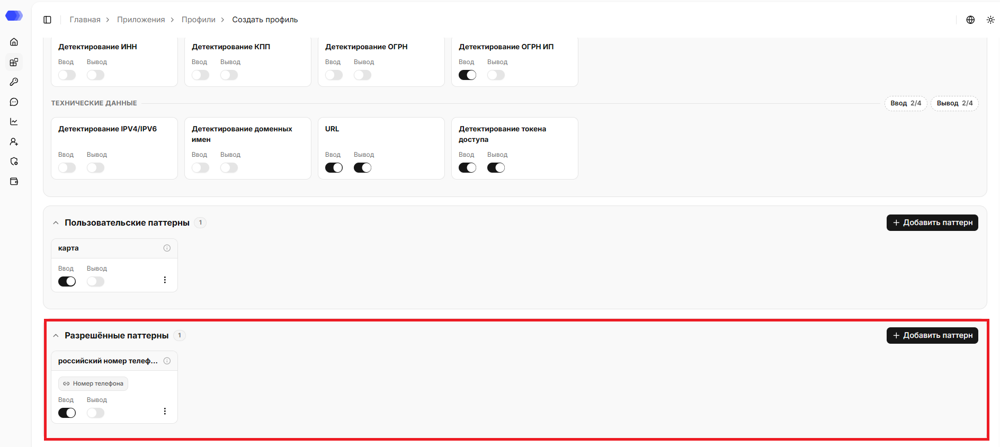

Нажмите **Добавить паттерн** в нужном разделе и заполните форму:

1. **Название** — название, по которому правило будет видно в списке.
2. **Описание** — описание паттерна (опционально).
3. **Паттерн** — регулярное выражение.
4. **Целевое правило** — позволяет указать, к какому базовому или пользовательскому паттерну привязывается создаваемый паттерн. По умолчанию в поле отображается `«Не выбрано»`. При клике на него открывается выпадающий список, в котором можно выбрать нужный паттерн кликом из списка.
5. **Направление** — **Ввод** для пользовательских запросов или **Вывод** для ответов модели.
6. **Включить** — активировать правило сразу после создания.
7. **Сохранить** — добавить паттерн. Кнопка **×** закрывает форму без сохранения.

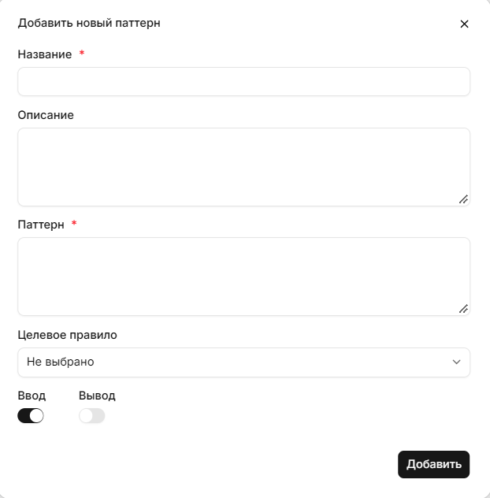

После сохранения на карточке паттерна проверку ввода и вывода можно включать и отключать независимо. Меню с тремя точками используется для редактирования и удаления. Счётчик показывает число паттернов в разделе, при отсутствии паттернов отображается `«Разрешённых паттернов пока нет. Добавьте паттерн, чтобы доверенные значения не очищались.»`.

По умолчанию все блоки профиля раскрыты — так видно полную картину настроек. При необходимости любой блок можно свернуть. При клике на `«Создать профиль»` создаётся профиль с указанными значениями.

## Карточка профиля

Способ открытия профиля зависит от выбранного вида отображения:

**Карточный вид** — нажмите на карточку профиля.

**Табличный вид** — нажмите на название профиля в соответствующей строке таблицы.

В верхней части указаны название и описание (при наличии) профиля.

Ссылка `«Назад к профилям»` ведёт в раздел **«Профили»**.

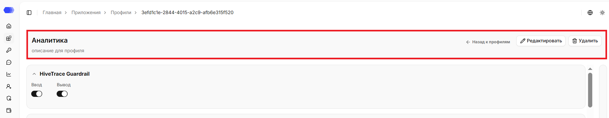

### Редактирование профиля

1. Нажмите `«Редактировать»`.
2. Измените нужные поля.
3. Нажмите `«Сохранить»`.

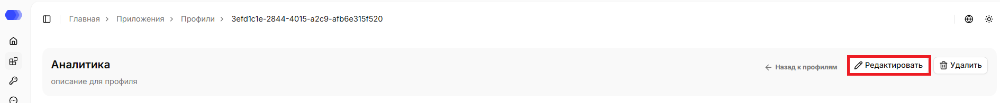

### Удаление профиля

1. Нажмите `«Удалить»`.
2. Подтвердите удаление в окне подтверждения.

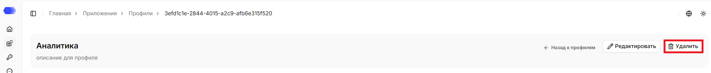

### Добавление приложения к профилю

По умолчанию панель **Приложения** открыта, её можно свернуть. Чтобы снова открыть панель, нажмите свёрнутую панель.

Чтобы применить профиль к приложению, нажмите `«Добавить приложение»`. Откроется список доступных приложений, из которого можно выбрать нужное — оно будет привязано к профилю и получит его настройки. Поле поиска сокращает список. Чтобы добавить сразу все приложения, нажмите `«Добавить все»`.

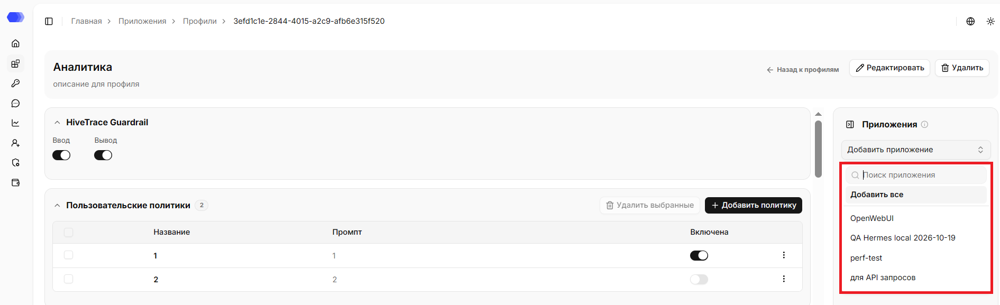

> **Примечание:** после привязки изменения профиля применяются к приложению автоматически. Если изменить настройки защиты приложения вручную, оно отвяжется от профиля, а текущие настройки перейдут в индивидуальные.

### Отвязка приложений от профиля

Привязанные к профилю приложения можно удалить из списка: нажмите крестик рядом с приложением, чтобы убрать одно приложение, или `«Удалить все»`, чтобы очистить список полностью.

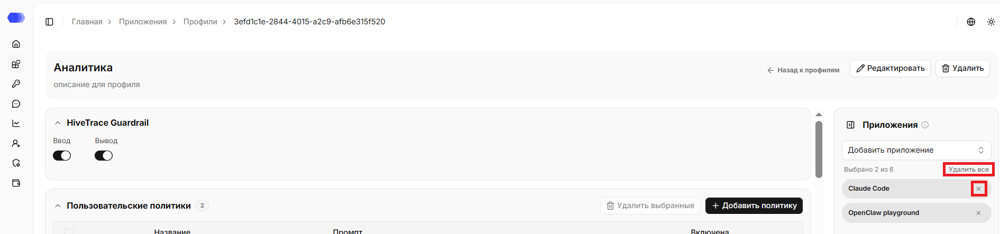

### Сохранённые настройки

В разделе также отображаются ранее сохранённые настройки:

**HiveTrace Guardrail** — включённые направления проверки (ввод и вывод);

**Пользовательские политики** — сохранённые политики с их названиями, промптами и статусом включения;

**Чёрный список промптов** — сохранённые паттерны для текста сообщений;

**Чёрный список файлов** — сохранённые паттерны для содержимого файлов;

**Проверка языка** — выбранные разрешённые языки, состояние проверки запросов и ответов, значение порога;

**Очистка данных** — типы обработки для ввода и вывода, настройки обработки файлов, глубина проверки и параметры хранения исходных сообщений;

**Базовые паттерны** — состояние переключателей «Ввод» и «Вывод» для каждого базового паттерна;

**Пользовательские паттерны** — сохранённые пользовательские паттерны с настройками направлений;

**Разрешённые паттерны** — сохранённые исключения с настройками направлений.

По умолчанию все блоки профиля раскрыты — так видно полную картину настроек. При необходимости любой блок можно свернуть.

### Сохранение изменений

При изменениях в профиле внизу страницы появляется панель с информацией о несохранённых разделах и кнопками действий:

- **Счётчик и список разделов** — информация о несохранённых разделах.
- **Сбросить** — отменяет все несохранённые изменения.
- **Сохранить настройки** — сохраняет изменения.
