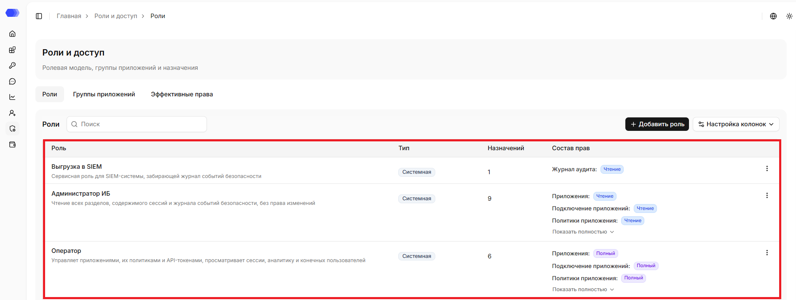
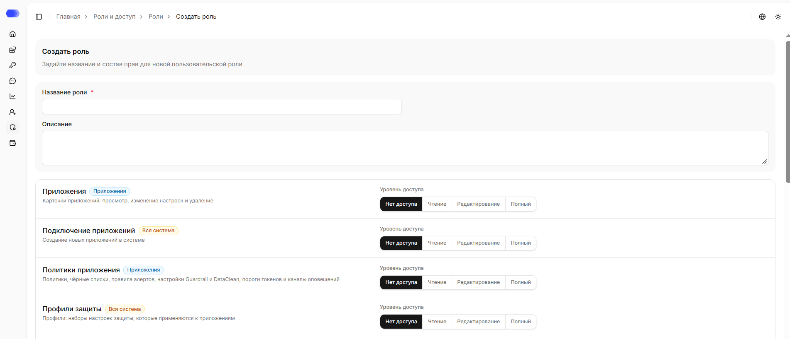
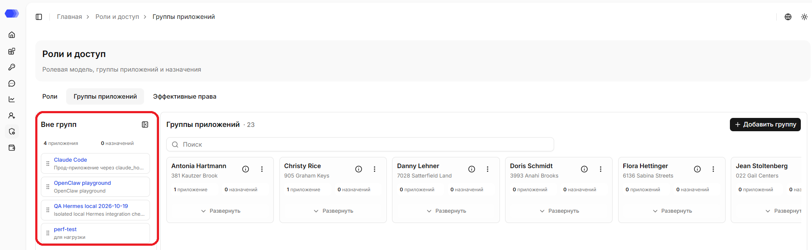
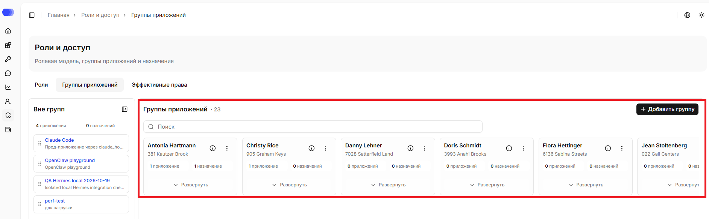
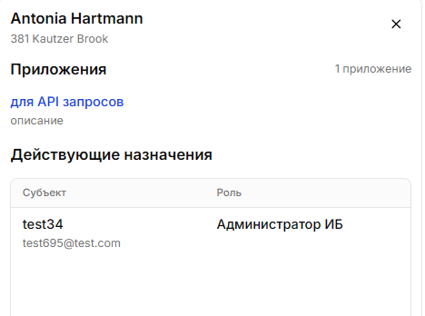
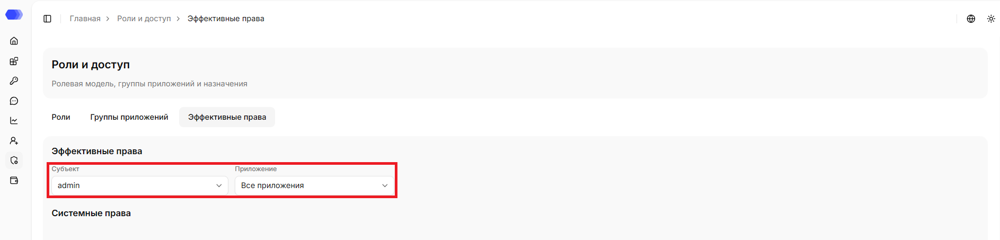
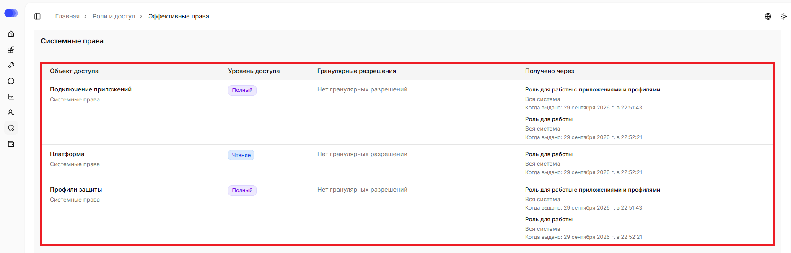
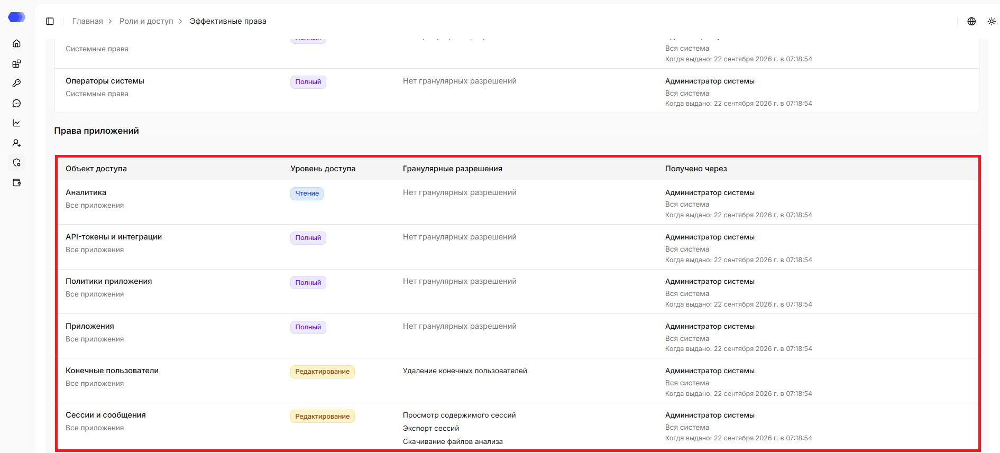

Раздел **«Роли и доступы»** используется для управления ролями, группами приложений и просмотра итоговых прав системных пользователей. В разделе есть несколько вкладок и экранов. Сначала удобно разобраться, что показывает каждый из них, а уже потом выполнять конкретные сценарии настройки.

## Вкладка **Роли**

На вкладке `«Роли»` можно просматривать список созданных ролей, создавать новые роли и редактировать существующие.

Поле поиска используется для быстрого поиска нужной записи в таблице.

На странице отображается таблица ролей:

- **Роль** — название и описание роли.
- **Тип** — `Системная` или `Пользовательская`.
- **Назначений** — количество назначений роли системным пользователям.
- **Состав прав** — краткая сводка прав, которые входят в роль.
- **Меню действий** — редактирование, дублирование и удаление конкретной роли.

**Настройка колонок** скрывает или возвращает столбцы. **Строк на странице**, **Предыдущая** и **Следующая** управляют пагинацией.

> **Примечание:** для системной роли доступно только действие `Дублировать`. Системные роли нельзя редактировать или удалять напрямую, но их можно использовать как основу для новой пользовательской роли.

Если у пользовательской роли есть активные назначения, удалить ее нельзя. Сначала нужно отозвать эти назначения у системных пользователей. Если попробовать удалить такую роль, интерфейс покажет ошибку `У роли остались активные назначения`.

Если у роли много прав, список показывает только краткую сводку. Чтобы увидеть полный состав доступа, раскройте строку через `Показать полностью`.

Системные роли поставляются вместе с системой и обычно используются, как преднастроенные наборы доступа.Пользовательские роли создаются под конкретные рабочие задачи.

### Создание и редактирование пользовательской роли

Нажмите на `«Добавить роль»` или выберите редактирование в меню **⋮**.

В верхней части формы заполняется общая информация:

- `Название роли` - обязательное поле. По названию администраторы будут находить роль в списке и выбирать ее при назначении доступа.
- `Описание` - необязательное поле. Его удобно использовать, чтобы объяснить, для какой команды или задачи создана роль.

Ниже находится список функциональных областей. Каждая строка отвечает за один набор возможностей в интерфейсе.

- **Приложения** - просмотр, изменение и удаление приложений;
- **Подключение приложений** - создание новых приложений в системе;
- **Политики приложения** - создание новых приложений в системе;
- **Профили защиты** - наборы настроек защиты, которые применяются к приложениям;
- **Сессии и сообщения** - сессии, сообщения, алерты и экспорт;
- **Аналитика** - аналитические отчёты и сводные показатели по приложениям;
- **Конечные пользователи** - пользователи приложений и их группы;
- **API-токены и интеграции** - SDK-ключи приложений и источники каталога конечных пользователей;
- **Операторы системы** - учётные записи операторов системы;
- **Роли и назначения** - роли, их состав и назначения ролей операторам;
- **Группы приложений** - группы приложений и состав этих групп;
- **Журнал аудита** - выгрузка журнала событий безопасности во внешние системы;
- **Платформа** - системные настройки, состояние сервисов, очистка данных и лицензия.

У каждой области есть метка:

- `Приложения` - права относятся к приложениям. При назначении такой роли нужно будет выбрать, где она действует: на все приложения, на одно приложение или на группу приложений.
- `Вся система` - права системные и не привязаны к конкретному приложению. Например, такие права используются для управления системными пользователями, ролями, группами приложений или другими общими настройками.

Для каждой функциональной области выбирается уровень доступа:

- `Нет доступа` - системный пользователь не увидит соответствующий раздел или не сможет выполнять действия из этой области.
- `Чтение` - системный пользователь сможет просматривать данные.
- `Редактирование` - системный пользователь сможет просматривать и изменять данные.
- `Полный` - системный пользователь получит максимальный доступ в рамках этой области, включая дополнительные действия, если они доступны.

У некоторых областей есть отдельные гранулярные разрешения. Они отображаются справа от основного уровня доступа и позволяют точнее настроить роль.

Например, для области **Сессии и сообщения** можно отдельно разрешить:

- просмотр содержимого сессий;
- экспорт сессий;
- скачивание файлов анализа.

Такие разрешения не заменяют общий уровень доступа, а уточняют его. Если для области нет дополнительных чекбоксов, достаточно выбрать только уровень доступа.

### Удаление пользовательской роли

1. Найдите роль, которую нужно удалить.
2. Проверьте количество назначений в строке роли.
3. Если назначений больше `0`, сначала отзовите назначения этой роли у системных пользователей.
4. Откройте меню действий роли через 3 точки.
5. Выберите `Удалить`.
6. Подтвердите удаление.

Удалить можно только пользовательскую роль без активных назначений. Если у роли остались назначения, удаление будет заблокировано. После удаления роль пропадет из списка и ее нельзя будет назначать новым системным пользователям.

## Вкладка **Группы приложений**

На вкладке `«Группы приложений»` пользователь просматривает, создает и редактирует группы приложений. Группы удобны, когда нескольким системным пользователям нужно выдать одинаковый доступ к одному набору приложений. Например, можно создать группу `Продакшен`, добавить в нее рабочие приложения и назначать роли сразу на эту группу, а не на каждое приложение отдельно.

Слева находится колонка `Вне групп`. В ней показаны приложения, которые сейчас не входят ни в одну группу. Над списком отображаются счетчики приложений и назначений. По умолчанию данная колонка открыта, её можно свернуть. Чтобы снова открыть её, нажмите свёрнутую панель.

### Создание группы

1. Нажмите `«Добавить группу»`.
2. Заполните нужные поля.
3. Нажмите `«Добавить»`.

### Добавление приложений в группу

Чтобы добавить приложение в группу, возьмите его за иконку с точками и перетащите в нужную группу. Курсор при этом меняется на «захват», показывая, что элемент можно переместить. При добавлении приложения в группу оно получит доступ, назначенный на эту группу. 

### Группы приложений

Основная область страницы содержит карточки групп приложений. В карточке видно:

- название группы;
- описание группы;
- количество приложений в группе;
- количество назначений на эту группу;
- кнопку раскрытия списка приложений;
- меню действий.

Поле поиска используется для быстрого поиска нужной группы в таблице.

Иконка информации открывает боковую панель группы. В ней отображаются:

- название и описание группы;
- список приложений группы;
- действующие назначения ролей на эту группу.

Если назначений нет, в боковой панели отображается `Нет данных`. Кнопка **×** закрывает панель.

В меню действий группы можно отредактировать или удалить группу. Удалить можно только группу без активных назначений. Если на группу еще выданы роли, удаление будет заблокировано, а интерфейс покажет ошибку `У группы приложений остались активные назначения`. Перед удалением откройте боковую панель группы и проверьте блок с действующими назначениями. При удалении группы приложения не удаляются из системы, а возвращаются в `Вне групп`. Приложения также можно переносить между колонкой `Вне групп` и группами.

Каждое приложение — как в колонке `«Вне групп»`, так и внутри группы — отображается с названием (синяя кликабельная ссылка, ведущая на карточку приложения) и описанием (при наличии).

## Вкладка **Эффективные права**

На вкладке `«Эффективные права»` можно выбрать системного пользователя и посмотреть, какие права он фактически получил после всех назначений. Эта вкладка используется для проверки и диагностики. На ней нельзя изменить права напрямую: изменения делаются через роли, группы приложений и назначения ролей.

В верхней части вкладки есть два фильтра:

- `Субъект` - системный пользователь, для которого нужно проверить итоговый доступ.
- `Приложение` - область проверки. Можно выбрать `Все приложения` или конкретное приложение.

### Системные права

Системные права - права без привязки к приложению.

В таблице отображаются следующие данные:

- `Объект доступа` - функциональная область, например приложения, политики, сессии, группы приложений или операторы системы.
- `Уровень доступа` - `Нет доступа`, `Чтение`, `Редактирование` или `Полный`.
- `Гранулярные разрешения` - дополнительные разрешения внутри области, если они есть. Если дополнительных разрешений нет, отображается текст `Нет гранулярных разрешений`.
- `Получено через` - источник права: роль, область назначения и дата выдачи. Данная колонка помогает понять, почему системный пользователь получил конкретное право.

### Права приложений

Права приложений - права, которые относятся к приложениям.

В таблице отображаются следующие данные:

- `Объект доступа` - функциональная область, например приложения, политики, сессии, группы приложений или операторы системы.
- `Уровень доступа` - `Нет доступа`, `Чтение`, `Редактирование` или `Полный`.
- `Гранулярные разрешения` - дополнительные разрешения внутри области, если они есть. Если дополнительных разрешений нет, отображается текст `Нет гранулярных разрешений`.
- `Получено через` - источник права: роль, область назначения и дата выдачи. Данная колонка помогает понять, почему системный пользователь получил конкретное право.

## Доступ к странице

Для просмотра ролей и их назначений нужны права:

- Область **Роли и назначения** — уровень доступа не ниже `«Чтение»`.

Для редактирования, дублирования и удаления ролей нужны права:

- Область **Роли и назначения** — `Полный` уровень доступа.

Для просмотра групп приложений нужны права:

- Область **Роли и назначения** — уровень доступа не ниже `«Чтение»`;
- Область **Группы приложений** — уровень доступа не ниже `«Чтение»`.

Для создания групп приложений, добавления приложений в группы, удаления приложений из групп нужны права:

- Область **Роли и назначения** — уровень доступа не ниже `«Чтение»`;
- Область **Группы приложений** — `Полный` уровень доступа.

Для просмотра назначений системных пользователей нужны права:

- Область **Роли и назначения** — уровень доступа не ниже `«Чтение»`;
- Область **Операторы системы** — уровень доступа не ниже `«Чтение»`.

Если у пользователя нет доступа для просмотра страницы, отображается страница `403 - Нет доступа`.
