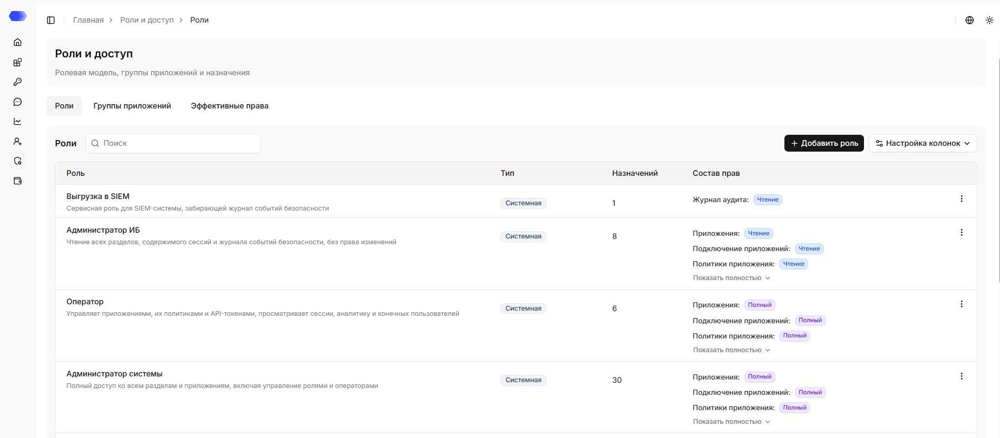
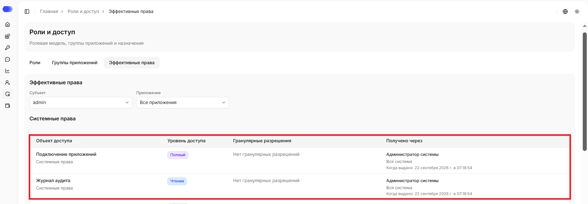

Раздел **«Роли и доступы»** используется для управления ролями, группами приложений и просмотра итоговых прав системных пользователей. В разделе есть несколько вкладок и экранов. Сначала удобно разобраться, что показывает каждый из них, а уже потом выполнять конкретные сценарии настройки.

### Вкладка **«Роли»**

На вкладке `«Роли»` администратор просматривает список созданных ролей, создает новые роли и редактирует существующие.

В списке ролей отображаются:

- название и описание роли;
- тип роли, например `Системная` или `Пользовательская`;
- количество назначений роли системным пользователям;
- краткая сводка прав, которые входят в роль;
- меню действий для роли.

Поле поиска используется для быстрого поиска нужной записи в таблице.

Меню действий зависит от типа роли.

Для пользовательской роли доступны действия:

- `Редактировать` - открыть роль и изменить ее название, описание или состав
  прав;
- `Дублировать` - создать новую роль на основе выбранной;
- `Удалить` - удалить роль, если она больше не нужна и у нее нет активных
  назначений.

Для системной роли доступно только действие `Дублировать`. Системные роли нельзя редактировать или удалять напрямую, но их можно использовать как основу для новой пользовательской роли.

Если у пользовательской роли есть активные назначения, удалить ее нельзя. Сначала нужно отозвать эти назначения у системных пользователей. Если попробовать удалить такую роль, интерфейс покажет ошибку `У роли остались активные назначения`.

Если у роли много прав, список показывает только краткую сводку. Чтобы увидеть полный состав доступа, раскройте строку через `Показать полностью`.

Системные роли поставляются вместе с системой и обычно используются как преднастроенные наборы доступа. Пользовательские роли создает администратор под конкретные рабочие задачи.

### Экран создания и редактирования роли

Экран создания и редактирования роли открывается с вкладки **Роли**.

В верхней части формы заполняется общая информация:

- `Название роли` - обязательное поле. По названию администраторы будут находить роль в списке и выбирать ее при назначении доступа.
- `Описание` - необязательное поле. Его удобно использовать, чтобы объяснить, для какой команды или задачи создана роль.

Ниже находится список функциональных областей. Каждая строка отвечает за один набор возможностей в интерфейсе.

У каждой области есть метка:

- `Приложения` - права относятся к приложениям. При назначении такой роли нужно будет выбрать, где она действует: на все приложения, на одно приложение или на группу приложений.
- `Вся система` - права системные и не привязаны к конкретному приложению. Например, такие права используются для управления системными пользователями, ролями, группами приложений или другими общими настройками.

Для каждой функциональной области выбирается уровень доступа:

- `Нет доступа` - системный пользователь не увидит соответствующий раздел или не
  сможет выполнять действия из этой области.
- `Чтение` - системный пользователь сможет просматривать данные.
- `Редактирование` - системный пользователь сможет просматривать и изменять
  данные.
- `Полный` - системный пользователь получит максимальный доступ в рамках этой
  области, включая дополнительные действия, если они доступны.

У некоторых областей есть отдельные гранулярные разрешения. Они отображаются справа от основного уровня доступа и позволяют точнее настроить роль.

Например, для области **Сессии и сообщения** можно отдельно разрешить:

- просмотр содержимого сессий;
- экспорт сессий;
- скачивание файлов анализа.

Такие разрешения не заменяют общий уровень доступа, а уточняют его. Если для области нет дополнительных чекбоксов, достаточно выбрать только уровень доступа.

### Удалить пользовательскую роль

1. Откройте раздел "Роли и доступы".
2. Перейдите на вкладку "Роли".
3. Найдите роль, которую нужно удалить.
4. Проверьте количество назначений в строке роли.
5. Если назначений больше `0`, сначала отзовите назначения этой роли у системных
   пользователей.
6. Откройте меню действий роли.
7. Выберите `Удалить`.
8. Подтвердите удаление.

Удалить можно только пользовательскую роль без активных назначений. Если у роли
остались назначения, удаление будет заблокировано.

После удаления роль пропадет из списка и ее нельзя будет назначать новым
системным пользователям.

### Вкладка **«Группы приложений»**

На вкладке `«Группы приложений»` администратор просматривает, создает и редактирует группы приложений.

Группы удобны, когда нескольким системным пользователям нужно выдать одинаковый доступ к одному набору приложений.

Например, можно создать группу "Продакшен", добавить в нее рабочие приложения и назначать роли сразу на эту группу, а не на каждое приложение отдельно.

Слева находится колонка `Вне групп`. В ней показаны приложения, которые сейчас не входят ни в одну группу. Над списком отображаются счетчики приложений и назначений. По умолчанию данная колонка открыта, её можно свернуть. Чтобы снова открыть её, нажмите свёрнутую панель.

Основная область вкладки содержит карточки групп приложений. В карточке видно:

- название группы;
- описание группы;
- количество приложений в группе;
- количество назначений на эту группу;
- кнопку раскрытия списка приложений;
- меню действий.

Если раскрыть карточку, внутри появится список приложений группы. Приложения можно переносить между колонкой `Вне групп` и группами. У приложения внутри группы есть действие `Убрать`, которое возвращает приложение из группы обратно в `Вне групп`.

Иконка информации открывает боковую панель группы. В ней отображаются:

- название и описание группы;
- список приложений группы;
- действующие назначения ролей на эту группу.

Если назначений нет, в боковой панели отображается пустое состояние.

В меню действий группы можно отредактировать или удалить группу. При удалении группы приложения не удаляются из системы, а возвращаются в `Вне групп`.

Удалить можно только группу без активных назначений. Если на группу еще выданы роли, удаление будет заблокировано, а интерфейс покажет ошибку `У группы приложений остались активные назначения`. Перед удалением откройте боковую панель группы и проверьте блок с действующими назначениями.

### Вкладка **«Эффективные права»**

На вкладке `«Эффективные права»` можно выбрать системного пользователя и посмотреть, какие права он фактически получил после всех назначений.

Эта вкладка используется для проверки и диагностики. На ней нельзя изменить права напрямую: изменения делаются через роли, группы приложений и назначения ролей.

В верхней части вкладки есть два фильтра:

- `Субъект` - системный пользователь, для которого нужно проверить итоговый
  доступ.
- `Приложение` - область проверки. Можно выбрать `Все приложения` или конкретное
  приложение.

Системные права отображаются независимо от выбранного приложения, если они есть у системного пользователя. Фильтр `Приложение` влияет на прикладные права: при выборе `Все приложения` показываются права, которые действуют на все приложения, а при выборе конкретного приложения - права именно для этого приложения.

Права отображаются в таблице. Они могут быть разделены на блоки:

- `Системные права` - права без привязки к приложению;
- `Права приложений` - права, которые относятся к приложениям.

В таблице есть несколько колонок:

- `Объект доступа` - функциональная область, например приложения, политики,
  сессии, группы приложений или операторы системы.
- `Уровень доступа` - итоговый уровень: `Нет доступа`, `Чтение`,
  `Редактирование` или `Полный`.
- `Гранулярные разрешения` - дополнительные разрешения внутри области, если они
  есть. Если дополнительных разрешений нет, отображается текст `Нет гранулярных
разрешений`.
- `Получено через` - источник права: роль, область назначения и дата выдачи.

Колонка `Получено через` помогает понять, почему системный пользователь получил конкретное право. Например, право может быть выдано через системную роль на всю систему, через роль на все приложения, через роль на конкретное приложение или через роль на группу приложений.

Если у выбранного системного пользователя нет прав в выбранной области, отображается пустое состояние `Нет данных`.

Если системный пользователь не видит нужный раздел или действие, сначала проверьте его итоговые права здесь.
