Страница **«Аналитика сессий»** — рабочее пространство для поиска и расследования запросов, ответов модели, нарушений, файлов и вызовов инструментов. Счётчики в заголовке показывают общее количество записей и записей с нарушениями; метка `live` означает потоковое поступление новых событий.

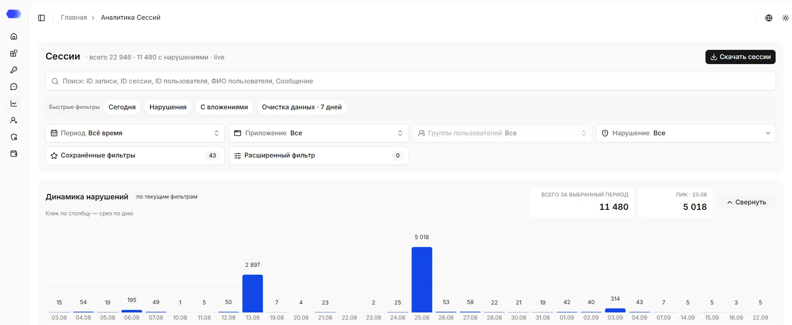

## Поиск и экспорт

Общий поиск находит записи по ID записи, ID сессии, ID или ФИО пользователя и тексту сообщения. Точное совпадение необходимо только для ID записи, для остальных полей достаточно частичного совпадения. Строка должна содержать от 3 до 256 символов. Для точного UUID удобнее использовать расширенный фильтр.

Кнопка **«Скачать сессии»** выгружает записи с текущими условиями. Перед скачиванием проверьте период, приложение и активные фильтры: экспорт может содержать исходные сообщения и персональные данные.

## Быстрые фильтры

- **Сегодня** — только записи за текущий день;
- **Нарушения** — только записи хотя бы с одним нарушением;
- **С вложениями** — только записи с файлами;
- **Очистка данных · 7 дней** — нарушения DataClean за последние семь дней.

Нажатие применяет заранее подготовленный набор условий. Повторно проверьте выбранные значения в основных фильтрах перед экспортом.

## Период

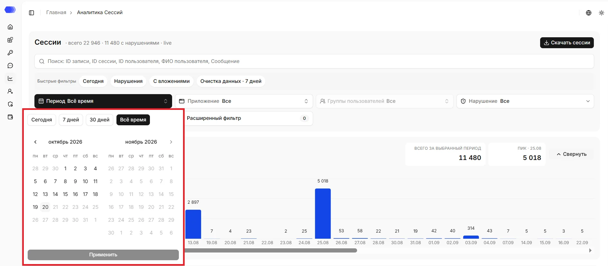

Доступны пресеты **«Сегодня»**, **«7 дней»**, **«30 дней»** и **«Всё время»**, а также произвольный диапазон в календаре. Стрелки переключают месяцы. После выбора начала и конца нажмите **«Применить»**. Недоступные будущие даты отображаются приглушёнными.

## Приложение

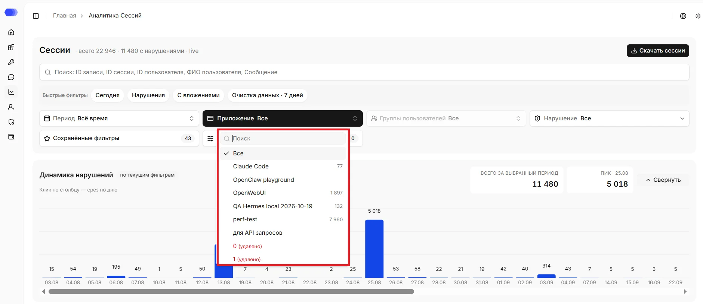

Список показывает доступные приложения, в том числе удалённые, а также количество подходящих записей. Поле поиска сокращает список. Значение **«Все»** снимает ограничение по приложению; выбор конкретного пункта обновляет график и таблицу.

## Группы пользователей

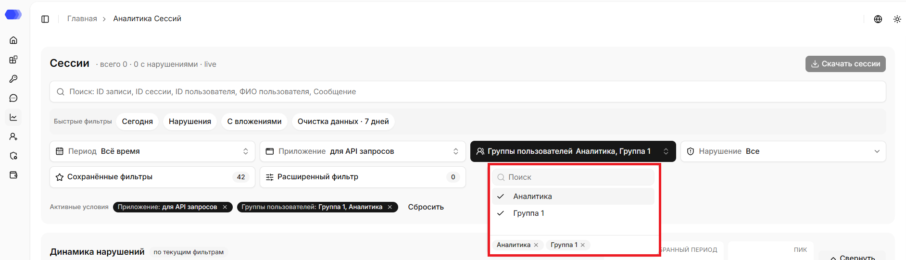

Список показывает группы пользователей. В нём можно выбрать несколько групп — выбранные группы добавляются в поле.Поле поиска сокращает список. Группу можно убрать из списка, нажав на **×** рядом с её названием. Фильтр становится активным после выбора приложения: пока приложение не выбрано, поле неактивно.

## Нарушение

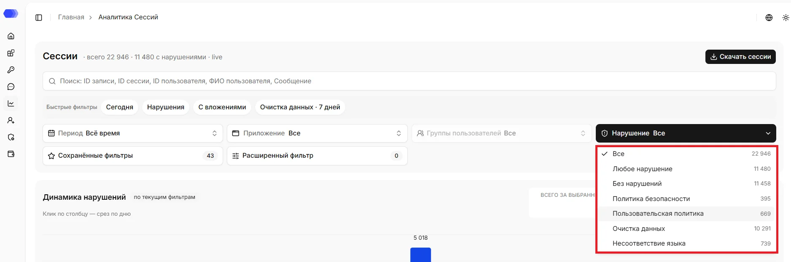

- **Все** — записи с нарушениями и без них;
- **Любое нарушение** — только записи с любым срабатыванием;
- **Без нарушений** — только чистые записи;
- **Политика безопасности** — нарушения Guardrail;
- **Пользовательская политика** — срабатывания пользовательских правил;
- **Очистка данных** — срабатывания DataClean;
- **Несоответствие языка** — нарушения по несоответствию разрешённым языкам.

Число справа показывает количество записей для варианта в текущей выборке.

## Сохранённые фильтры

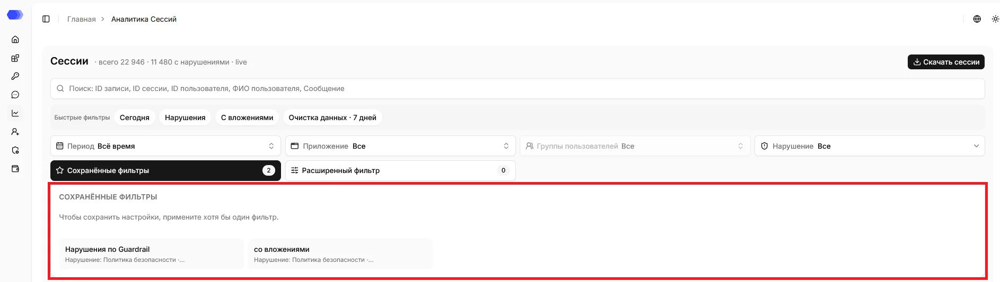

Раздел хранит именованные наборы условий. Число на кнопке показывает количество сохранённых наборов. Чтобы создать набор, сначала примените хотя бы один фильтр, затем сохраните текущую конфигурацию. Нажатие на карточку применяет её условия. Набор можно переименовать, обновить текущими условиями или удалить через доступное для него меню.

## Расширенный фильтр

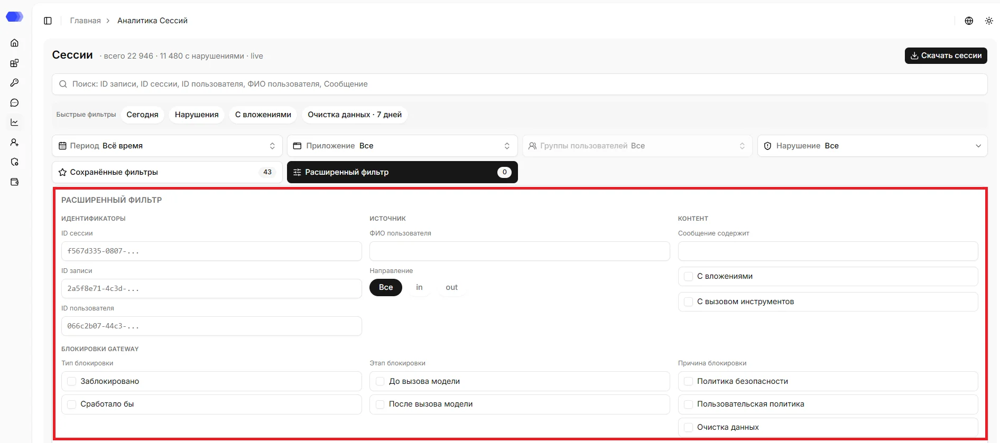

- **ID сессии**, **ID записи**, **ID пользователя** — точный поиск по идентификаторам;
- **ФИО пользователя** — фильтрация по отображаемому имени;
- **Направление** — все записи, `in` (запрос) или `out` (ответ);
- **Сообщение содержит** — поиск фрагмента текста;
- **С вложениями** — только записи с файлами;
- **С вызовом инструментов** — только записи с tool calls;
- **Тип блокировки** — `Заблокировано`, `Сработало бы`;
- **Этап блокировки** — `До вызова модели`, `После вызова модели`;
- **Причина блокировки** — `Политика безопасности`, `Пользовательская политика`, `Очистка данных`.

Счётчик на кнопке показывает число активных расширенных условий. **«Применить»** обновляет выдачу, **«Сбросить»** очищает поля этого блока.

## Динамика нарушений

График строится по текущим фильтрам. **«Всего за выбранный период»** показывает сумму нарушений, а **«Пик»** — максимальное дневное значение и его дату. Нажатие на столбец добавляет срез по выбранному дню. **«Свернуть»** скрывает график и освобождает место для таблицы.

## Таблица записей

Таблица загружает данные порциями; над ней отображается количество уже загруженных записей и общий объём. Нажатие на значение в ячейке добавляет фильтр по этому значению.

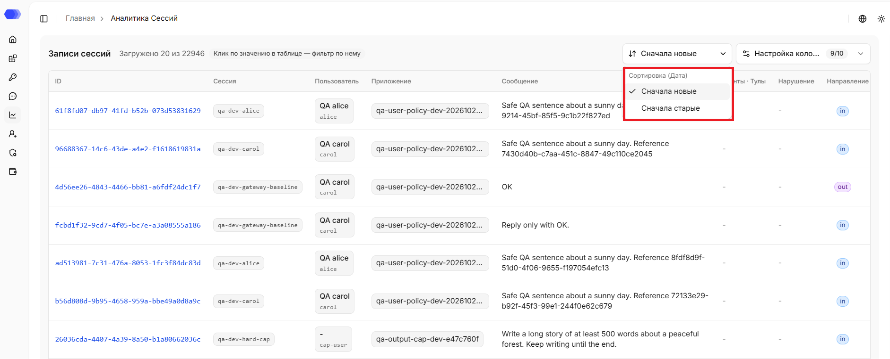

Сессии можно сортировать по дате — по возрастанию или по убыванию. По умолчанию применяется сортировка по убыванию. Если выбрать `«Сначала новые»`, применяется сортировка по убыванию; если выбрать `«Сначала старые»` — по возрастанию.

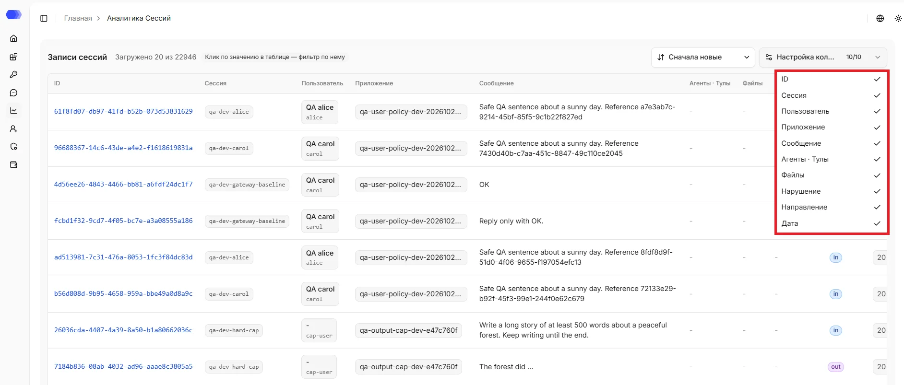

**«Настройка колонок»** показывает число видимых столбцов и позволяет включать или отключать:

- ID записи;
- сессию;
- пользователя;
- приложение;
- сообщение;
- агентов и вызовы инструментов;
- файлы;
- нарушение;
- направление;
- дату.

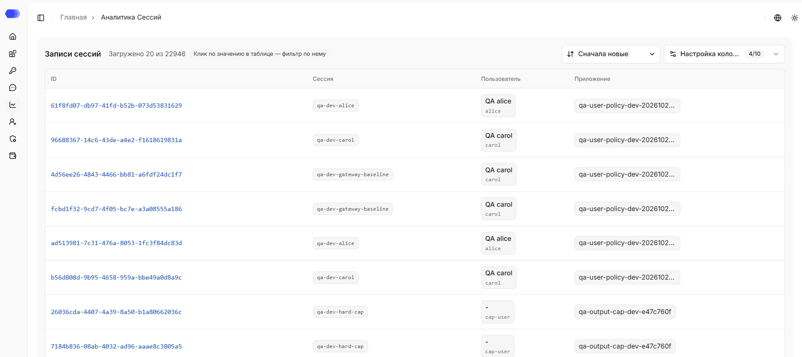

- **ID** — ссылка на детализацию записи;
- **Сессия** — клиентский идентификатор сессии;
- **Пользователь** — ФИО и дополнительный идентификатор, если они переданы;
- **Приложение** — приложение, зарегистрировавшее событие.

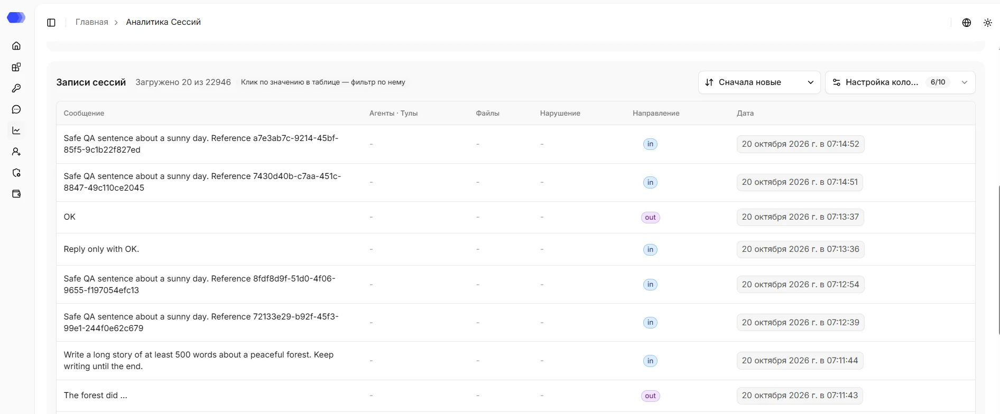

- **Сообщение** — сокращённый запрос или ответ; полный текст доступен в детализации;
- **Агенты · Тулы** — количество связанных вызовов инструментов, `—` при их отсутствии;
- **Файлы** — количество файлов, приложенных к сессии, `—` при их отсутствии;
- **Нарушение** — тип сработавшей проверки или `—`;
- **Направление** — `in` для запроса и `out` для ответа;
- **Дата** — локальные дата и время события.

Горизонтальная прокрутка открывает столбцы, которые не помещаются одновременно. Устаревшая отдельная трассировка агентов удалена; агентные сценарии анализируются через tool calls.

## Детализация

Нажмите ID записи, чтобы открыть [детализацию сессии](./session-details.md).
