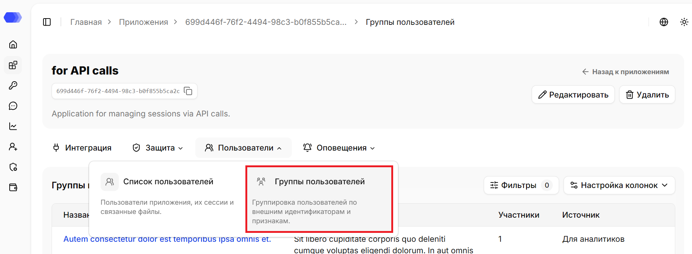
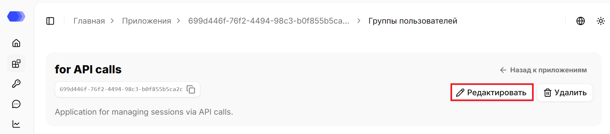
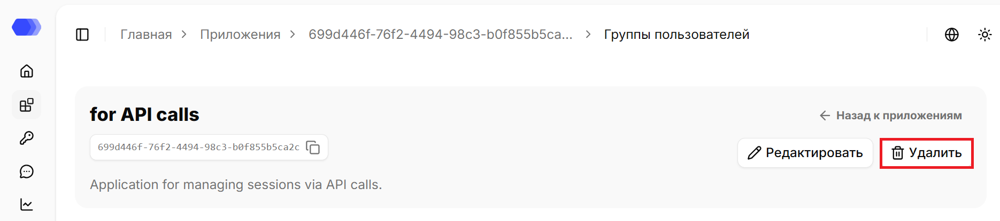
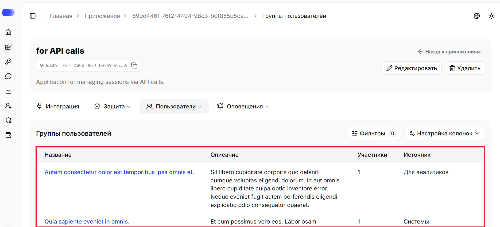
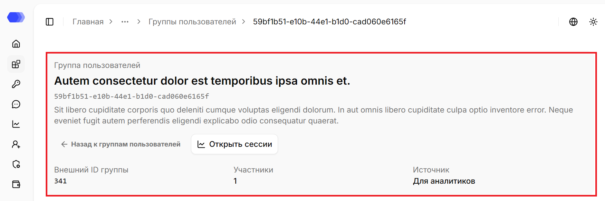
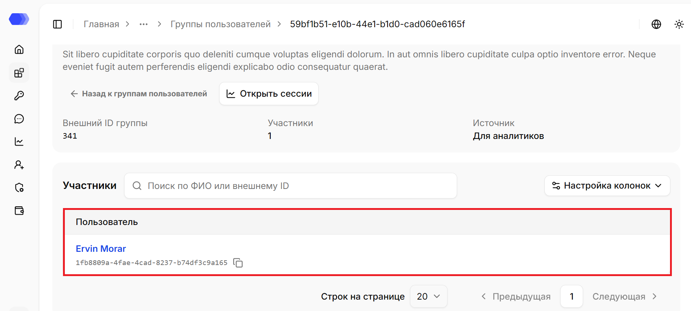

Раздел **«Группы пользователей»** показывает группы, добавленные в приложение и помогает перейти к участникам группы.

## Необходимые права

| Действие | Область | Мин. доступ |
|---|---|---|
| Просмотр группы пользователей и карточки группы | `Приложения` | `Чтение` |
| | `Конечные пользователи` | `Чтение` |
| Создание источника каталога конечных пользователей | `API-токены и интеграции` | `Редактирование` |
| Редактирование приложения из шапки | `Приложения` | `Редактирование` |
| Удаление приложения из шапки | `Приложения` | `Полный` |

Если у пользователя нет доступа для просмотра страницы, отображается страница `403 - Нет доступа`.

## Как открыть раздел `Группы пользователей`

1. В боковом меню выберите **Приложения**.
2. Откройте нужное приложение, нажав на карточку или на название приложения в зависимости от выбранного вида отображения.
3. Наведите на вкладку **Пользователи**.
4. Нажмите на **Группы пользователей**.



В верхней части страницы отображаются название, id, описание (при наличии) приложения. Рядом с ID доступна кнопка копирования. На странице также доступна ссылка `«Назад к приложениям»`, которая ведёт в раздел `Приложения`.

## Редактирование приложения



1. Нажмите `«Редактировать»`.
2. Измените нужные поля.
3. Нажмите `«Сохранить»`.

## Удаление приложения



1. Нажмите `«Удалить»`.
2. Подтвердите удаление в окне подтверждения.

Удаление необратимо. Сначала убедитесь, что интеграционный трафик остановлен или перенаправлен и связанные API-токены больше не используются.

## Создание источника каталога конечных пользователей

### Метод и путь 

`POST /api/integration-sources/`

### Заголовки

| Заголовок | Значение |
|---|---|
| `Content-Type` | `application/json` |
| `Authorization` | `Bearer <access_token>` |
| `Accept` | `*/*` |

### Тело запроса

| Поле | Тип | Описание |
|---|---|---|
| `application_id` | `string` (UUID) | Идентификатор приложения |
| `name` | `string` (UUID) | Название источника |

## Пример 

```json
{
    "application_id": "{{application_id}}",
    "name": "OpenWebUI"  
}
```

## Автоматическое создание группы пользователей

### Метод и путь 

`POST /api/integrations/openwebui/directory/sync`

### Заголовки

| Заголовок | Значение |
|---|---|
| `Content-Type` | `application/json` |
| `Authorization` | `Bearer <integration_source_token>` |
| `accept` | `*/*` |

### Тело запроса

| Поле | Тип | Описание |
|---|---|---|
| `application_id` | `string` (UUID) | Идентификатор приложения, в которое синхронизируются данные |
| `source_id` | `string` (UUID) | Идентификатор источника |
| `revision` | `integer` | Номер ревизии синхронизации; увеличивается при каждом обновлении каталога |
| `complete` | `boolean` | Признак полноты снимка: `true` — передан полный каталог |
| `users` | `array` | Список пользователей |
| `groups` | `array` | Список групп пользователей |

### Объект пользователя (`users[]`)

| Поле | Тип | Описание |
|---|---|---|
| `id` | `string` | Внешний идентификатор пользователя |
| `fio` | `string` | ФИО пользователя |

### Объект группы (`groups[]`)

| Поле | Тип | Описание |
|---|---|---|
| `id` | `string` | Идентификатор группы |
| `name` | `string` | Название группы |
| `description` | `string` | Описание группы |
| `user_ids` | `string[]` | Внешние идентификаторы пользователей, входящих в группу |

## Пример 

```json
{
    "application_id": "{{application_id}}",
    "source_id": "{{source_id}}",
    "revision": 1,
    "complete": true,
    "users": [
        {
            "id": "483cbf29-0178-4910-a999-0d903c651e25",
            "fio": "Иванова Ольга Ивановна"
        }
    ],
    "groups": [
        {
            "id": "a1b2c3d4-e5f6-4a7b-8c9d-0e1f2a3b4c5d",
            "name": "Продакшен",
            "description": "Рабочие приложения команды",
            "user_ids": [
                "483cbf29-0178-4910-a999-0d903c651e25"
            ]
        }
    ]
}
```

## Таблица группы пользователей

В таблице доступны следующие данные:

- **Название** — название группы; синяя кликабельная ссылка ведёт на карточку группы;
- **Описание** — описание группы; если описание не задано, отображается дефис `(—)`;
- **Участники** — количество пользователей в группе;
- **Источник** — источник, из которого была добавлена группа.



Доступные действия:

1. Нажмите **«Фильтры»**, чтобы отфильтровать группы по названию или источнику; счётчик на кнопке показывает число активных фильтров. При нажатии на кнопку `Сбросить` фильтры сбрасываются, форма закрывается.
2. Откройте **«Настройка колонок»**, чтобы выбрать отображаемые столбцы.
3. В нижней части таблицы выберите число строк на странице или перейдите на другую страницу.
4. Нажмите синюю кликабельную ссылку, чтобы открыть карточку группы.

## Карточка группы пользователей

После нажатия на название группы открывается карточка группы. В верхней части указаны название, ID, описание (при наличии), внешний ID, количество участников, источник. Ссылка `«Назад к группам пользователей»` ведёт на страницу списка групп пользователей выбранного приложения.

На странице также доступна ссылка `«Открыть сессии»`, которая ведёт на страницу аналитики сессий с применёнными фильтрами по текущей группе приложения.



## Таблица пользователей

В таблице доступны следующие данные:

- **Пользователь** — синяя кликабельная ссылка ведёт на карточку пользователя. В ней отображается ФИО пользователя группы. Под синей ссылкой отображается внешний ID пользователя. Рядом с ID доступна кнопка копирования.



Доступные действия:

1. Воспользуйтесь поиском, чтобы найти записи по ФИО пользователя, внешнему ID пользователя — поиск работает по частичному совпадению.
2. Откройте **«Настройка колонок»**, чтобы выбрать отображаемые столбцы.
3. В нижней части таблицы выберите число строк на странице или перейдите на другую страницу.
4. Нажмите синюю кликабельную ссылку, чтобы открыть карточку пользователя.
