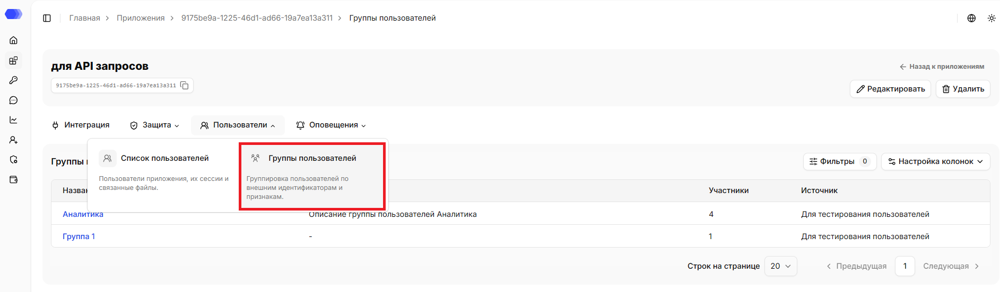
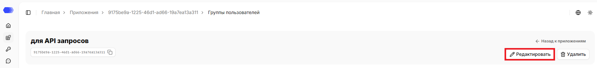
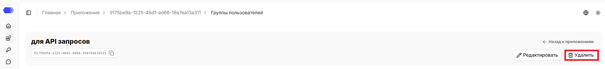
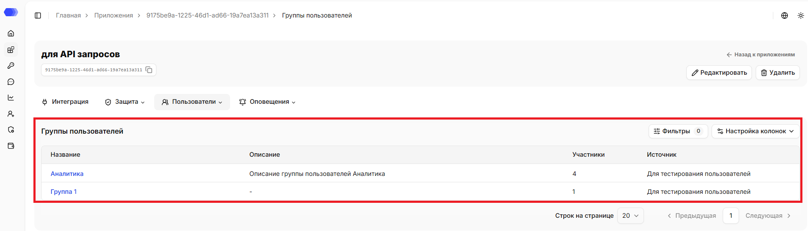
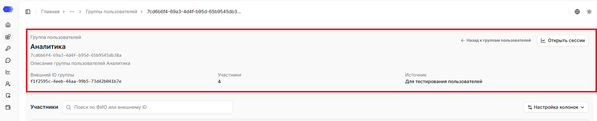
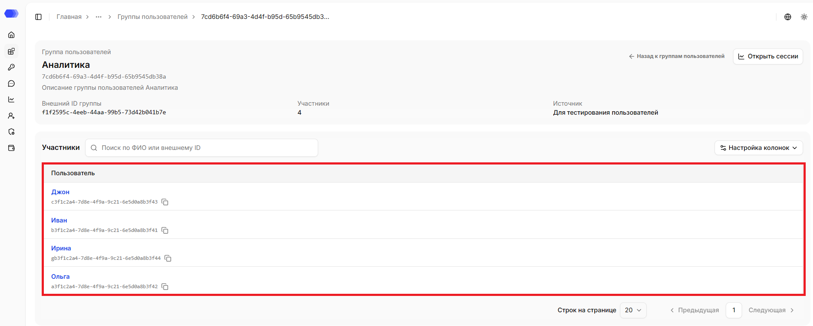

Раздел **«Группы пользователей»** показывает группы, добавленные в приложение и помогает перейти к участникам группы.

## Как открыть раздел **Группы пользователей**

1. В боковом меню выберите **Приложения**.
2. Откройте нужное приложение, нажав на карточку или на название приложения в зависимости от выбранного вида отображения.
3. Наведите на вкладку **Пользователи**.
4. Нажмите на **Группы пользователей**.

В верхней части страницы отображаются название, id, описание (при наличии) приложения. Рядом с ID доступна кнопка копирования. На странице также доступна ссылка `«Назад к приложениям»`, которая ведёт в раздел `Приложения`.

## Редактирование приложения

1. Нажмите `«Редактировать»`.
2. Измените нужные поля.
3. Нажмите `«Сохранить»`.

## Удаление приложения

1. Нажмите `«Удалить»`.
2. Подтвердите удаление в окне подтверждения.

Удаление необратимо. Сначала убедитесь, что интеграционный трафик остановлен или перенаправлен и связанные API-токены больше не используются.

## Таблица группы пользователей

В таблице доступны следующие данные:

- **Название** — название группы; синяя кликабельная ссылка ведёт на карточку группы;
- **Описание** — описание группы; если описание не задано, отображается дефис `(—)`;
- **Участники** — количество пользователей в группе;
- **Источник** — источник, из которого была добавлена группа.

Доступные действия:

1. Нажмите **«Фильтры»**, чтобы отфильтровать группы по названию или источнику; счётчик на кнопке показывает число активных фильтров. При нажатии на кнопку `Сбросить` фильтры сбрасываются, форма закрывается.
2. Откройте **«Настройка колонок»**, чтобы выбрать отображаемые столбцы.
3. В нижней части таблицы выберите число строк на странице или перейдите на другую страницу.
4. Нажмите синюю кликабельную ссылку, чтобы открыть карточку группы.

## Карточка группы пользователей

После нажатия на название группы открывается карточка группы. В верхней части указаны название, ID, описание (при наличии), внешний ID, количество участников, источник. Ссылка `«Назад к группам пользователей»` ведёт на страницу списка групп пользователей выбранного приложения.

На странице также доступна ссылка `«Открыть сессии»`, которая ведёт на страницу аналитики сессий с применёнными фильтрами по текущей группе приложения.

## Таблица пользователей

В таблице доступны следующие данные:

- **Пользователь** — синяя кликабельная ссылка ведёт на карточку пользователя. В ней отображается ФИО пользователя группы. Под синей ссылкой отображается внешний ID пользователя. Рядом с ID доступна кнопка копирования.

Доступные действия:

1. Воспользуйтесь поиском, чтобы найти записи по ФИО пользователя, внешнему ID пользователя — поиск работает по частичному совпадению.
2. Откройте **«Настройка колонок»**, чтобы выбрать отображаемые столбцы.
3. В нижней части таблицы выберите число строк на странице или перейдите на другую страницу.
4. Нажмите синюю кликабельную ссылку, чтобы открыть карточку пользователя.

## Доступ к странице

Для редактирования приложения из шапки нужны права:

- Область **Приложения** — уровень доступа не ниже `«Редактирование»`.

Для удаления приложения из шапки нужны права:

- Область **Приложения** — `Полный` уровень доступа.

Для просмотра группы пользователей и карточки группы нужны права:

- Область **Приложения** — уровень доступа не ниже `«Чтение»`;
- Область **Конечные пользователи** — уровень доступа не ниже `«Чтение»`.

Если у пользователя нет доступа для просмотра страницы, отображается страница `403 - Нет доступа`.
