Страница **«Пользователи»** показывает конечных пользователей выбранного AI-приложения и помогает перейти от пользователя к связанным с ним сессиям и файлам.

## Как открыть страницу **Пользователи**

1. В боковом меню выберите **Приложения**.
2. Откройте нужное приложение, нажав на карточку или на название приложения в зависимости от выбранного вида отображения.
3. Наведите на вкладку **Пользователи**.
4. Нажмите на **Список пользователей**.

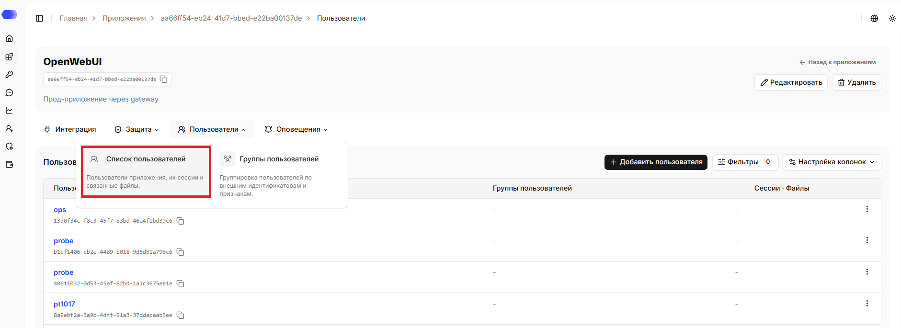

В верхней части страницы отображаются название, id, описание (при наличии) приложения. Рядом с ID доступна кнопка копирования. На странице также доступна ссылка `«Назад к приложениям»`, которая ведёт в раздел `Приложения`.

## Редактирование приложения

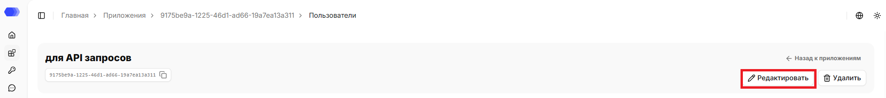

1. Нажмите `«Редактировать»`.
2. Измените нужные поля.
3. Нажмите `«Сохранить»`.

## Удаление приложения

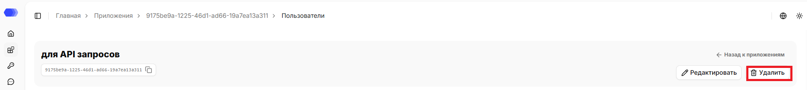

1. Нажмите `«Удалить»`.
2. Подтвердите удаление в окне подтверждения.

Удаление необратимо. Сначала убедитесь, что интеграционный трафик остановлен или перенаправлен и связанные API-токены больше не используются.

## Таблица пользователей

В таблице доступны следующие данные:

- **Пользователь** — синяя кликабельная ссылка ведёт на карточку пользователя. В ней отображается ФИО, если оно было добавлено вручную, либо внешний ID пользователя. Под синей ссылкой отображается внешний ID пользователя. Рядом с ID доступна кнопка копирования.
- **Группы пользователей** — группа, в которую добавлен пользователь.
- **Сессии** — количество сессий, связанных с данным пользователем. При клике на него выполняется переход в раздел `«Сессии»`.
- **Файлы** — количество файлов, которые пользователь загрузил. При клике на него выполняется переход в раздел `«Файлы»`.

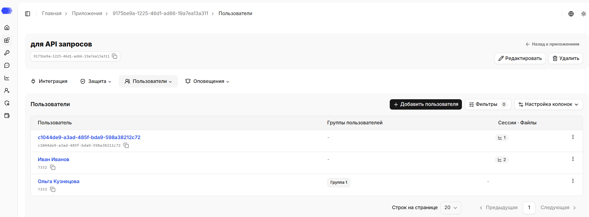

Доступные действия:

1. Нажмите **«Добавить пользователя»**, чтобы создать пользователя вручную.
2. Нажмите **«Фильтры»**, чтобы отфильтровать пользователей по ФИО, внешнему ID или группе; счётчик на кнопке показывает число активных фильтров. При нажатии на кнопку `Сбросить` фильтры сбрасываются, форма закрывается.
3. Откройте **«Настройка колонок»**, чтобы выбрать отображаемые столбцы.
4. Используйте меню **⋮** в строке пользователя для доступных действий с записью, включая редактирование и удаление.
5. В нижней части таблицы выберите число строк на странице или перейдите на другую страницу.
6. Нажмите синюю кликабельную ссылку, чтобы открыть карточку пользователя.

## Автоматическое создание пользователей

Пользователь создается автоматически, если в запросе HiveTrace передан новый идентификатор:

- в дополнительных параметрах при использовании API или SDK;
- в HTTP-заголовках при работе через прокси.

Автоматически созданная запись может содержать только **внешний ID клиента**. ФИО при необходимости добавляется через интерфейс.

## Сессии пользователя

После нажатия на синюю кликабельную ссылку открывается карточка пользователя. В верхней части указаны имя (при наличии) и внешний ID клиента, а ниже расположены вкладки **«Сессии»** и **«Файлы»**. Рядом с ID доступна кнопка копирования. Ссылка `«Назад к пользователям»` ведёт на страницу списка пользователей выбранного приложения.

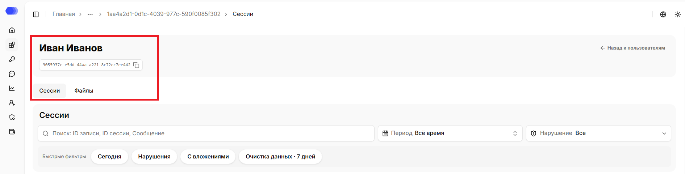

### Поиск

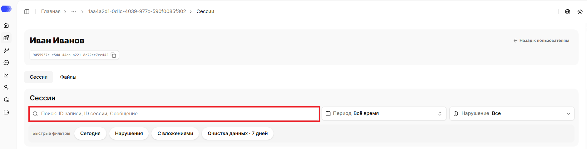

Поиск находит записи по ID записи, ID сессии и тексту сообщения. Точное совпадение необходимо только для ID записи, для остальных полей достаточно частичного совпадения. Строка должна содержать от 3 до 256 символов.

### Быстрые фильтры

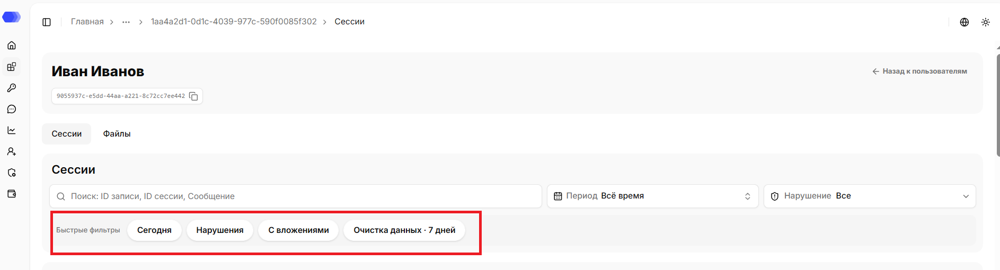

- **Сегодня** — только записи за текущий день;
- **Нарушения** — только записи хотя бы с одним нарушением;
- **С вложениями** — только записи с файлами;
- **Очистка данных · 7 дней** — нарушения DataClean за последние семь дней.

Нажатие применяет заранее подготовленный набор условий. 

### Период

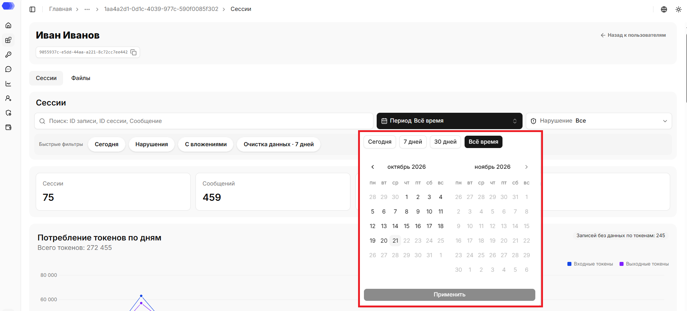

Доступны пресеты **«Сегодня»**, **«7 дней»**, **«30 дней»** и **«Всё время»**, а также произвольный диапазон в календаре. Стрелки переключают месяцы. После выбора начала и конца нажмите **«Применить»**. Недоступные будущие даты отображаются приглушёнными.

### Нарушение

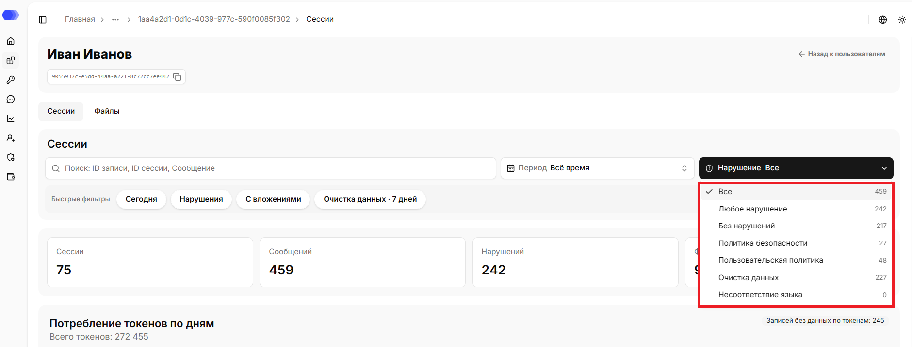

- **Все** — записи с нарушениями и без них;
- **Любое нарушение** — только записи с любым срабатыванием;
- **Без нарушений** — только чистые записи;
- **Политика безопасности** — нарушения Guardrail;
- **Пользовательская политика** — срабатывания пользовательских правил;
- **Очистка данных** — срабатывания DataClean;
- **Несоответствие языка** — нарушения по несоответствию разрешённым языкам.

Число справа показывает количество записей для варианта в текущей выборке.

### Сводка по сессиям пользователя

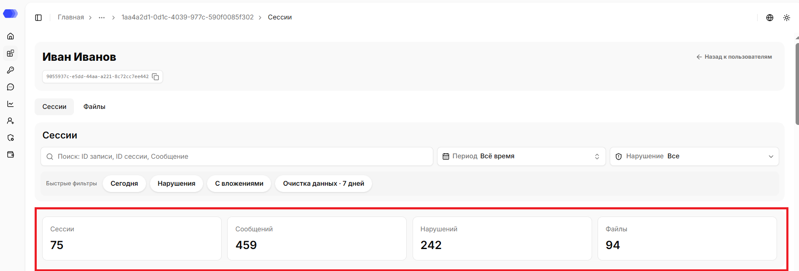

Блок со сводными показателями активности пользователя состоит из 4 разделов:

`Сессии` — общее количество сессий пользователя;

`Сообщений` — общее количество сообщений пользователя;

`Нарушений` — общее количество записей с нарушениями;

`Файлы` — общее количество переданных файлов.

### Потребление токенов по дням

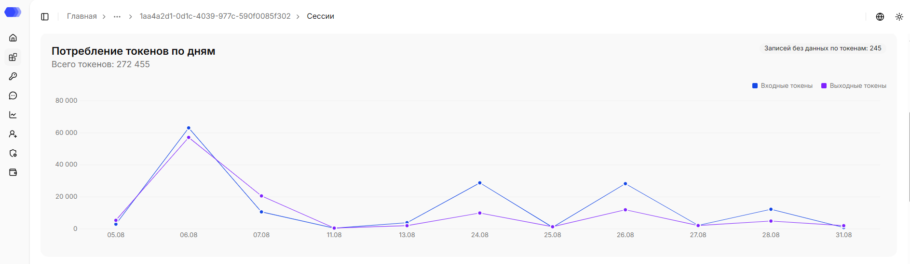

Раздел показывает динамику расхода токенов по дням в виде графика:

`Всего токенов` — общее количество израсходованных токенов;

`Записей без данных по токенам` — количество записей, для которых потребление токенов не было зафиксировано.

По горизонтальной оси отложены даты, по вертикальной — количество токенов. На графике отображаются точки, при наведении на которые можно посмотреть значение за конкретный день.

> **Примечание:** значения в графике обновляются при применении фильтров.

### Нарушений

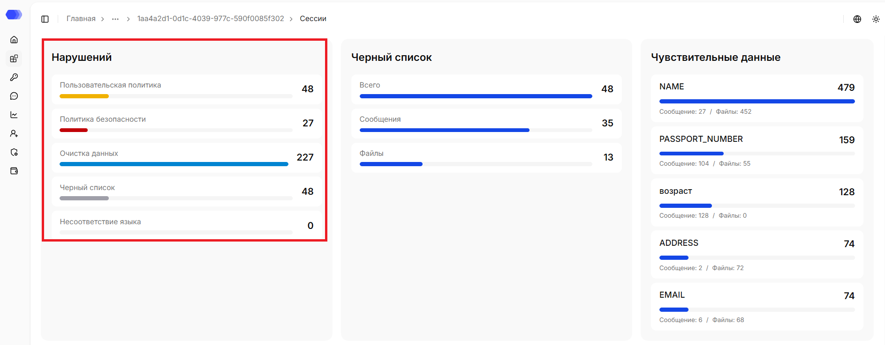

Раздел показывает количество записей по нарушениям:

`Пользовательская политика` — срабатывания пользовательских правил;

`Политика безопасности` — нарушения Guardrail;

`Очистка данных` — срабатывания DataClean;

`Чёрный список` - нарушения по чёрному списку для сообщений и файлов;

`Несоответствие языка` — нарушения по несоответствию разрешённым языкам.

### Чёрный список

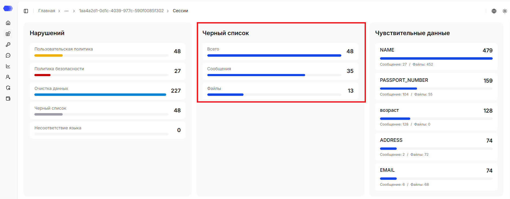

Раздел показывает нарушения по чёрному списку — для сообщений и файлов:

`Всего` — общее количество записей с нарушениями по чёрному списку;

`Сообщения` — общее количество нарушений по чёрному списку, найденных в сообщениях;

`Файлы` — общее количество нарушений по чёрному списку, найденных в файлах.

### Чувствительные данные

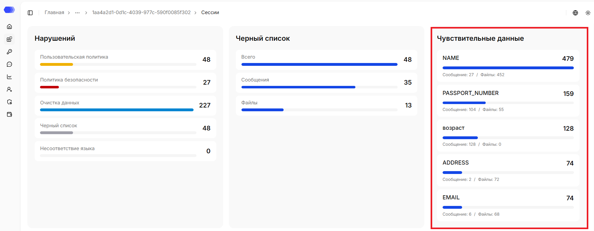

Раздел показывает 5 наиболее популярных категорий чувствительных данных, обнаруженных у пользователя, и где именно они были найдены — в сообщениях или в файлах.

Для каждой категории указаны:

- название базового или пользовательского паттерна, которое вернуло нарушение по DataClean;

- общее количество найденных данных.

### Таблица сессий пользователя

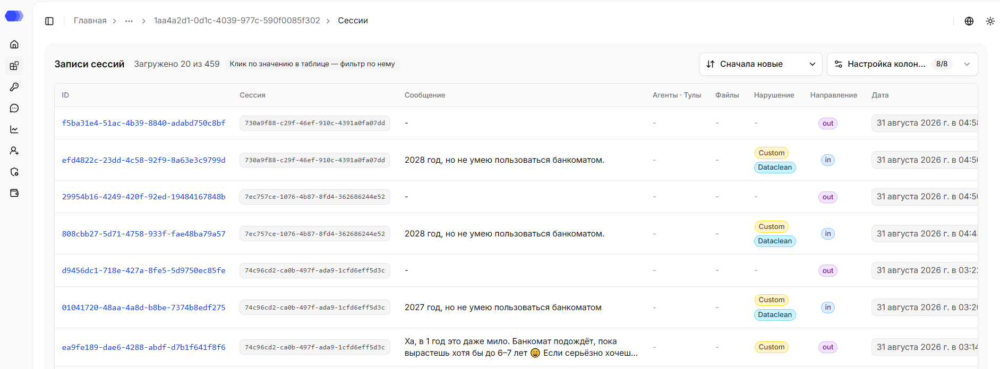

- **ID** — ссылка на детализацию записи;
- **Сессия** — клиентский идентификатор сессии;
- **Сообщение** — сокращённый запрос или ответ; полный текст доступен в детализации;
- **Агенты · Тулы** — число связанных вызовов инструментов, `—` при их отсутствии;
- **Файлы** — количество файлов, приложенных к сессии, `—` при их отсутствии;
- **Нарушение** — тип сработавшей проверки или `—`;
- **Направление** — `in` для запроса и `out` для ответа;
- **Дата** — локальные дата и время события.

Нажатие на значение в ячейке `«Сессия»`, `«Нарушение»`, `«Направление»` или `«Дата»` добавляет фильтр по этому значению.

Доступные действия:

1. Нажмите синий ID записи, чтобы открыть детализацию события.
2. Сортировать сессии по дате — по возрастанию или по убыванию. По умолчанию применяется сортировка по убыванию.
3. Используйте «Настройка колонок», чтобы изменить состав таблицы.
4. Выберите вкладку «Файлы», чтобы просмотреть загруженные пользователем вложения.

## Файлы пользователя

### Сводка по файлам пользователя

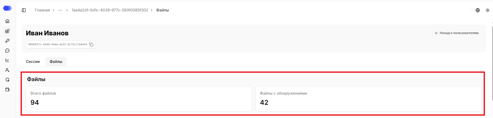

Блок со сводными показателями пользователя по файлам состоит из 2 разделов:

`Всего файлов` — общее количество файлов, приложенных к сессиям пользователя;

`Файлы с обнаружениями` — общее количество файлов, в которых были найдены нарушения. 

### Статус проверки

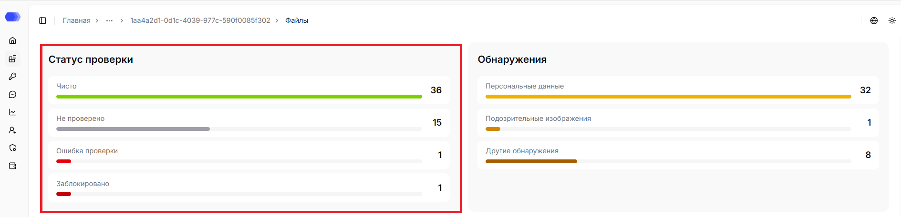

Раздел показывает распределение файлов по результатам проверки:

`Чисто` — общее количество файлов, проверка которых не выявила нарушений;

`Не проверено` — общее количество файлов, которые ещё не прошли проверку;

`Ошибка проверки` — общее количество файлов, при проверке которых произошла ошибка;

`Заблокировано` — общее количество файлов, заблокированных по результатам проверки.

### Обнаружения

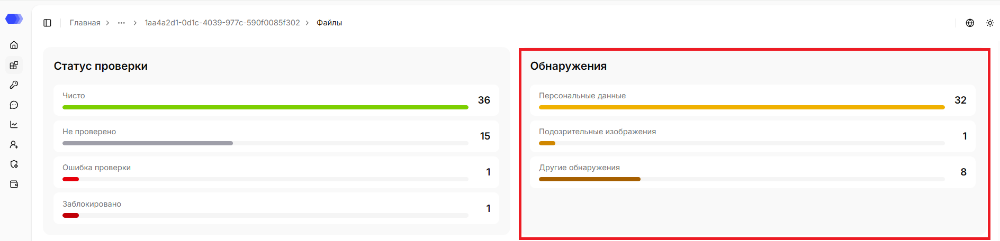

Раздел показывает какие типы обнаружений найдены в файлах:

`Персональные данные` — общее количество файлов, в которых найдены персональные данные;

`Подозрительные изображения` — общее количество файлов с изображениями, которые система сочла подозрительными;

`Другие обнаружения` — общее количество файлов с обнаружениями, не попавшими в перечисленные категории.

### Поиск по названию файла

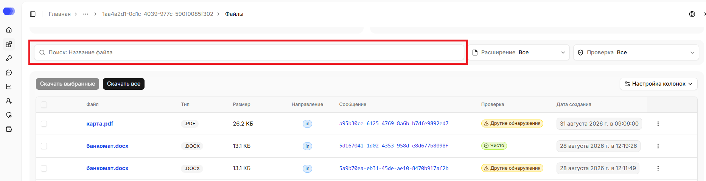

Поиск находит файлы по названию — достаточно частичного совпадения.

### Расширение

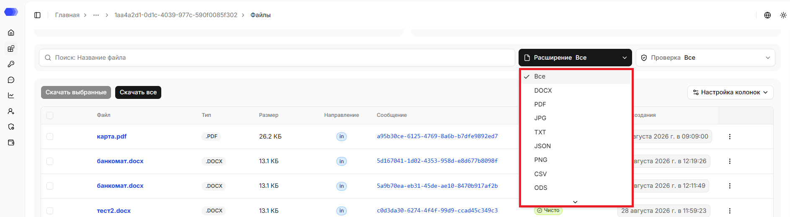

Список показывает доступные расширения файлов. Значение **«Все»** снимает ограничение по расширению; выбор конкретного пункта обновляет таблицу.

### Проверка

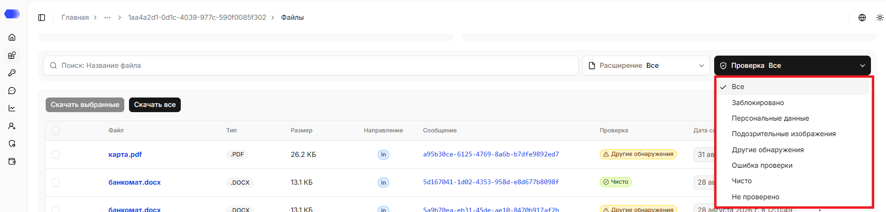

Список показывает доступные статусы проверки файлов. Значение «Все» снимает ограничение по статусу проверки; выбор конкретного пункта обновляет таблицу.

### Таблица файлов пользователя

В таблице отображаются файлы, связанные с запросами пользователя. Для доступных форматов можно открыть предпросмотр или скачать исходный файл.

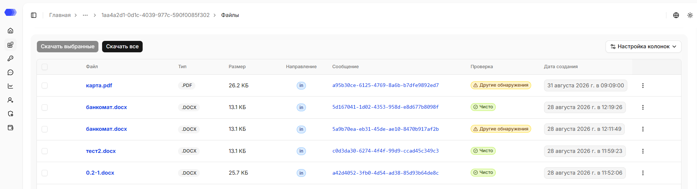

- **Файл** — название файла с расширением, при клике открывается предпросмотр файла;
- **Тип** — расширение файла;
- **Размер** — размер файла;
- **Направление** —  `in` для запроса и `out` для ответа;
- **Сообщение** — ID сессии, к которой приложен файл; при клике выполняется переход на страницу детализации сессии;
- **Проверка** — статус проверки файла;
- **Дата** — локальные дата и время события.

Доступные действия:

1. Нажмите `«Скачать выбранные»`, чтобы скачать файлы, отмеченные чекбоксами в таблице. Кнопка неактивна, пока не выбран ни один файл.
2. Нажмите `«Скачать все»`, чтобы скачать все файлы.
3. Используйте «Настройка колонок», чтобы изменить состав таблицы.
4. Нажмите на кнопку `⋮` (три точки) в строке таблицы, чтобы скачать выбранный файл.
5. Нажмите на название файла, чтобы открыть предпросмотр файла.

> **Важно:** обработка содержимого файлов зависит от глобальной настройки **«Пользовательская обработка файлов»** и конфигурации выбранного приложения. Если обработка отключена, наличие файла в этой вкладке само по себе не означает, что его содержимое было проверено политиками или очисткой данных.
